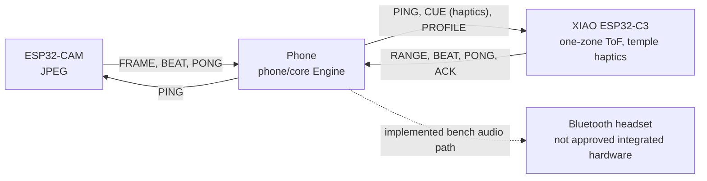

# Determine

Parking sensors for people: dumb glasses, a capable phone, and a calibrated warning about what is directly
ahead. Design: [`Determine-Architecture.html`](Determine-Architecture.html) (contract) and
[`Determine-Brief.html`](Determine-Brief.html) (8-page brief). Status: proposed design; untested with
blind or low-vision users.

**Platform status:** Android is implemented. [`ios/`](ios/README.md) is a native iPhone app with the Swift hazard
engine, Personal Hotspot UDP, headband-camera input, haptics, optional warning audio and an iPhone-camera fallback.
The user reports the camera and existing app working together on the bench; walking performance remains unvalidated.
The latest unsigned IPA adds streaming scene answers, local/cloud voice choices, live preview/alignment,
transcript/replay and length/style settings. The new UI is native-build verified, not independently device-tested.
OpenRouter speech reuses the existing server key; direct OpenAI/ElevenLabs remain optional. Hearing calibration is not available on iOS.

**Current design (24 Oct 2026, wire v2).** One Arduino Modulino Distance gives a single forward
distance; the purchased module identifies as VL53L4ED (0xECAA), not the originally assumed VL53L4CD. The
software warning envelope remains capped at 1.2 m: a staged near-field demo, not a grid or lateral sensor. One
ESP32-CAM streams JPEG for context (the second camera in the pair is a spare, not stereo). A XIAO ESP32-C3 reads
the sensor and drives one Modulino Vibro (a single haptic motor, no left/right); it has no audio hardware. The implemented phone audio path
uses a Bluetooth headset, but **the separate OpenRun headset is not approved for the intended build; integrated
bone-conduction output remains unresolved**. Proposed bands: FAR 900–1200 mm, MID 500–899 mm, NEAR under 500 mm.
One zone cannot say left/right or identify a camera object; physical performance remains unvalidated.

### Hardware in hand — user-confirmed purchase, 24 Oct 2026

| Purchased | Quantity / constraint |
|---|---|
| Modulino Distance | 1 module; forward ToF input |
| XIAO ESP32-C3 3-pack | 3 boards; one intended cue controller |
| ESP32-CAM pair | 2 boards; one intended camera, one spare, not stereo |
| DRV2605L | 1 breakout; on the bus only as the 10 kΩ SDA/SCL pull-up source (no motor, not driven) |
| Modulino Vibro, SKU 992891 | 1 complete I²C-controlled vibration module at 0x38; the board's only haptic actuator |
| TCA9548A multiplexer | 1; unused — the Distance (0x29), Vibro (0x38) and DRV2605L (0x5A) have distinct addresses |
| TPS62827 | 1 regulator board; confirm markings/pinout and measure its output before connecting loads |
| Inland FTDI Adapter/Programmer USB Controller | 1; confirm UART logic voltage and board power requirements before connecting the ESP32-CAM |
| Soldering tools | Purchased; types/quantities unspecified |

**Haptics now:** the cue firmware drives the single Vibro at `max(haptic_l, haptic_r)`; it cannot lateralise, and
there is one actuator, not two temple channels. Bench chain: C3 → soldered wires → Distance → Qwiic → DRV2605L →
Qwiic → Vibro, all on the C3's 3.3 V pin. Never connect the Vibro to DRV2605L motor outputs. The TPS62827 is unused.
No separate motor, power bank, complete cable/mount set or integrated audio hardware was confirmed in this purchase list.

Architecture §12.2–12.4, the brief/PDFs and older stock notes describe the **pre-purchase** Houston website snapshot,
not this inventory. Their proposed two-driver/two-motor/mux wiring is superseded for the bench build.
For wiring, firmware behaviour and supply cautions, see [cue-board hardware status](firmware/cue-board/README.md).

**Sensor bring-up:** the module identifies as VL53L4ED (0xECAA); the old L4CD driver rejected it, so firmware uses
ST's L4ED 1.0.1 driver. Four wires alone were unreliable because the Distance board has no SDA/SCL pull-ups. With
the DRV2605L breakout's 10 kΩ pull-ups added via Qwiic, readings tracked a hand from 231 mm to 28 mm on the bench.
Bench evidence only, not warning performance. See the [cue-board diagnosis](firmware/cue-board/README.md#distance-sensor-bring-up).

<p align="center">
  <a href="Determine-Brief.pdf"></a>
  <a href="Determine-Brief.pdf"></a>
  <a href="Determine-Brief.pdf"></a>
  <a href="Determine-Brief.pdf"></a>
</p>

All 8 brief pages: [`docs/images/brief-1.png` … `brief-8.png`](docs/images/) · PDF: [`Determine-Brief.pdf`](Determine-Brief.pdf)

## Try it without hardware

```sh
git clone https://github.com/nunera/Determine && cd Determine
nix run .#desktop -- --sim approach_centre --start     # the app on your desktop + both boards simulated
nix run .#android-demo -- --sim approach_centre        # the real APK in an Android emulator (needs KVM; --headless for no window)
```

The desktop app runs the Android app's own screens and engine (shared code in [`app-shared/`](app-shared)); it
uses the single forward distance reading, has no face blur and never uploads for Describe (the iPhone app can, with an
explicit unblurred-upload opt-in; see [`ios/README.md`](ios/README.md)). Desktop audio does
not verify a physical Bluetooth headset. Details: [`desktop/README.md`](desktop/README.md).

## Product website

The product site and live engineering cockpit are in [`web/`](web/). The studio embeds the existing
Determine World runtime and controls the real phone engine through the World bridge; it is not a local
configuration-draft editor.

```sh
# Node.js 22.13+, Python 3, JDK 17 on PATH
cd web
npm ci
npm run live
# On Nix: nix shell nixpkgs#nodejs_22 nixpkgs#jdk17 -c npm run live
# http://127.0.0.1:5175/ — product site
# http://127.0.0.1:5175/#/studio — live engineering studio
# http://127.0.0.1:5175/#/studio/hitl — hardware-in-the-loop entry
# http://127.0.0.1:5175/#/professionals — guided setup, APIs and compatibility
```

The compact translucent navigation opens grouped project/studio links by click, pointer hover where
supported, or keyboard (Enter/Space or Arrow Down; Escape closes). The product page has a single global
navigation bar, a CAD hero, a transparent Bracket distance/response interaction, and a native-scroll
CAD image sequence. The three images crossfade within one sticky stage as the document scrolls;
there is no wheel interception or scroll snapping. A theme-aware cane/glasses pictogram follows,
with “Complementary by Design” as the heading and concise labels beside it. Public cue labels are
Close / Medium / Far; engine wire bands remain NEAR / MID / FAR. Direct studio routes select
SIM/HITL without automatically connecting; changing routes tears down the previous browser producer.
The compact footer keeps the tagline beneath the wordmark and groups its navigation in one
content-aligned block, without a separate repeated-brand row.

`live` builds `phone/cli` and World, installs World's dependencies if absent, then supervises Vite,
the account service on loopback 8770, and two isolated bridges. **Connect bridge** explicitly opens a browser session:

| Preset | HTTP / WebSocket | Engine UDP | Board transport |
|---|---|---|---|
| SIM | `127.0.0.1:8765` | `127.0.0.1:47000` | Software cue/camera boards on UDP 47001/47002 |
| HITL | `127.0.0.1:8766` | `127.0.0.1:47110` | Real boards send to this laptop on UDP 47100 |

Both launcher sessions start `HAPTIC_ONLY`, audio ceiling −20 dBFS, haptic maximum 96/255. HITL starts
with real range and real camera input. Configure the boards' phone/relay destination for the bench LAN;
replies must reach their fixed UDP 47001/47002 listeners. This uses the existing Wi-Fi/UDP hardware path,
not USB pairing or firmware flashing. Pillow is optional for real-camera compositing; unavailable
compositing is disabled rather than substituted. See [HITL setup](tools/sim/README.md#real-hardware-in-the-loop-hitl).

The studio supplies course/view/transport controls, fresh range/band/ACK telemetry, SIM-only board
dropouts and jitter, and live hearing/audio/haptic profile changes. **Apply** waits for the actual engine's
acknowledgement; it does not restart the engine. Experiment switches explicitly restart it, preserving
the last acknowledged profile. HITL offers real/world/fused range, camera compositing, virtual target
geometry/reflectance, packet discovery/age/RSSI/faults and tagged engine-input JPEG preview. Missing
hardware stays missing; the ESP32 camera module is working per the current bench update. An ACK is command acceptance,
not measured physical motor onset or validated wearable performance.

The **Professionals → Get started** action opens three-step onboarding: connection, output profile,
then review. **Connect & apply profile** explicitly starts one browser session, waits for the live
bridge and running engine, verifies that the bridge's SIM/HITL mode matches the requested setup,
then applies the requested profile once. An already matching, engine-confirmed profile needs no write.
Initial offline replay is not a disconnect; loss after connection, rejection or timeout invalidates
guided confirmation and never automatically reapplies.
Use **Live profile** for later changes. **Download setup** exports the requested configuration, not
an ACK or clinical calibration. HITL onboarding requires a supervised bench acknowledgement.

The professional **Scene AI** inspector reuses World's user-requested JPEG → bridge → Describe API
path. Configure `DESCRIBE_URL` + `DESCRIBE_KEY` in `web/.env` for the existing service, or set
`OPENROUTER_API_KEY` to launch the project's OpenRouter/OpenAI-model backend locally on loopback
8771. `OPENROUTER_MODEL` selects the vision model; see [provider setup](web/.env.example) and the
[Describe contract](cloud/API.md). Provider/bearer keys stay out of the browser. A bridge hello
advertises configuration only; a successful response supplies the actual backend/model/timings.
Missing service configuration disables the request; upstream failures are shown, not replaced with
sample narration. The browser describes a **rendered World head view even in HITL**, not the
physical ESP32 feed. The mobile camera-description path is separate. Description is optional and
never drives the hazard loop.

The API/compatibility area distinguishes the implemented [Meta camera-profile export study](world/README-profiles.md)
from hardware support: a portrait crop/resample study is not DAT SDK pairing, live Meta capture,
validated optics or a replacement for Determine's range/haptic hardware.

Disconnect removes the browser World and its sensor stream; **the bridge, phone engine and physical
hardware can keep running**. Ctrl-C in `npm run live` shuts down its managed processes. Use one World
producer per bridge. External phones reject browser profile/tuning changes. HTTP endpoints may be edited
explicitly; credentials and HTTPS-to-HTTP embedding are rejected. Browser WebSockets require an Origin
matching the bridge Host. The iframe accepts only the same origin or local website ports 5175/4175,
with exact source/origin checks in both directions.

Paper, Midnight and Cobalt change the page and Three.js materials. The hero uses 15 original slim-study
CAD meshes; [`manifest.json`](web/public/model/manifest.json) records their sources. Floating `Determine`
typography is rendered behind the model and refracted by the actual front-window geometry—not CSS
blur patches. These are illustrative optics, not calibrated lenses or production hardware. Motion
supports pause/reduced motion, suspends offscreen, and falls back to an illustration without WebGL.
The shared header/emblem SVG and favicon use the same open-left, constant-thickness D geometry.
Header/emblem color inherits the active theme. The three scroll images are compressed WebP copies of
`hardware/glasses/renders/slim_{hero,front,exploded}.png`, not photos of finished hardware.

World's presentation uses cool architectural materials, procedural reflections, softer shadow filtering
and SMAA antialiasing. The embedded studio uses `?quality=balanced`: shadows and antialiasing remain,
while contact AO is disabled to avoid its additional geometry pass. Full quality adds subtle AO;
low/adaptive tiers lower resolution and remove shadows but retain antialiasing. These are rendering
changes only: course geometry, collider dimensions/reflectance, sensor model/rates and warning
decisions are unchanged. Camera input still comes from the actual rendered scene.

For site-only development, run `npm run auth` and `npm run dev -- --port 5175 --strictPort` in separate
terminals (start bridges separately for the studio). Checks: `npm test` for real isolated account/security
regressions, `npm run check`, and `npm run build`. Build World with `npm run build` in `world/`, CLI with
`./gradlew :cli:test :cli:installDist` in `phone/`, and bridge tests with
`python3 -m unittest discover -s tools/sim/tests` from the repository root.

UI stack: Svelte 5, Vite, Three.js and Atkinson Hyperlegible. Bracket's Button, Tabs, Dialog, Slider and
dependencies are vendored under `web/src/vendor/bracket/` with the original MIT license. Product styling
lives in `web/src/app.css`; cue, story, awareness and live-cockpit components have scoped styles.

### Accounts and Google sign-in

Accounts use Better Auth 1.7.6 with private, persistent SQLite storage. The sign-in dialog supports
password account creation/sign-in, existing-account email codes, verification links, password reset,
session persistence and logout. **Accounts are optional for local simulation and HITL sessions.**
Vite development and preview proxy same-origin `/api` requests to the loopback account service;
a built static site alone cannot authenticate.

Optional settings belong in `web/.env`; see [`web/.env.example`](web/.env.example). Never use `VITE_`
prefixes for secrets. Development creates `.auth/secret` and `.auth/accounts.sqlite`, excluded from
version control and denied by Vite. Keep this private storage when restarting the service.

Google is deliberately unavailable until **both** `GOOGLE_CLIENT_ID` and `GOOGLE_CLIENT_SECRET` are
configured. Create a Google Web OAuth client with authorized JavaScript origin
`http://127.0.0.1:5175` and exact authorized redirect URI
`http://127.0.0.1:5175/api/auth/callback/google`. Restart the account service after changing settings.
Google uses existing, verified, same-email accounts; create and verify an account first. For a different
host or preview port, change `BETTER_AUTH_URL` and the registered callback together. The actual Google
consent/callback round trip has not been verified: no Google credentials are provisioned locally.
When unconfigured, the dialog offers **Set up Google sign-in** instead of an inert Continue button;
it opens `#/professionals/google` with the exact callback read from the account service. A configured
client opened at the wrong origin links to the canonical account address. Account return destinations
preserve professional routes as well as direct studio routes.

**Local email is not sent.** Development verification/reset links and codes appear only in the
account-server console. Never expose the development service publicly or share its email logs.
Codes are hashed, single-use, valid for five minutes, limited to three guesses and three sends per
minute/address and IP; resends rotate the challenge. First-time email proof—link or code—removes
passwords and sessions created before mailbox ownership was proven. Use password reset to set a new
password afterward. Resetting a password revokes existing sessions.

Production requires `NODE_ENV=production`, an HTTPS `BETTER_AUTH_URL`, an explicit strong
`BETTER_AUTH_SECRET`, private persistent storage, and a same-origin reverse proxy for `/api` to
loopback 8770. Email features require a Resend key, verified sender, and nonempty recipient allowlist;
otherwise they stay unavailable. Delivery errors return failures, not a fake “email sent” result.
External Resend delivery has not been verified without provider credentials.

## App screenshots

Current v2 app on an Android API 28 emulator, with no Bluetooth headset or connected boards. These captures prove
the missing-headset warning, scalar diagnostics layout, hardware settings and disabled hearing-calibration gate,
not physical sensor or headset performance. The CLI's two-board simulator separately exercises the live warning loop.

<p align="center">
  
  
  
  
</p>

## Software layout

| Path | What | Build / test |
|---|---|---|
| [`protocol/`](protocol/PROTOCOL.md) | Wire contract v2 (UDP, 8 packet types; scalar RANGE, haptic-only CUE), Python reference codec, golden vectors | `cd protocol/python && python3 -m unittest` |
| [`firmware/cue-board/`](firmware/cue-board/README.md) | XIAO ESP32-C3: single-zone ToF (Modulino Distance), Modulino Vibro haptics, haptic-only watchdog | `pio run -e xiao_esp32c3`, `pio test -e native` |
| [`firmware/cam-board/`](firmware/cam-board/README.md) | ESP32-CAM: JPEG capture, chunked FRAME stream, PSRAM fallback | `pio run -e esp32cam`, `pio test -e native` |
| [`phone/`](phone/README.md) | Kotlin hazard engine (`core`) + headless phone (`cli`) | `./gradlew build` |
| [`app-shared/`](app-shared) | Screens, runtime, engine host, UDP and Describe client shared by Android and desktop; wire v2, no object detector | built by both |
| [`android/`](android/README.md) | Android device layer: foreground service, Bluetooth-only cue audio with explicit route failure, alerts, on-phone face blur and phone-camera fallback | `./gradlew assembleDebug testDebugUnitTest` |
| [`desktop/`](desktop/README.md) | Desktop test app: same UI and engine, Java Sound cues, espeak-ng speech; does not verify a physical Bluetooth route | `./gradlew build`, `nix run .#desktop` |
| [`ios/`](ios/README.md) | iPhone app: Swift engine port, UDP link, haptic-only live session, iPhone-camera fallback; Linux headless `DeterminePhone` cli for e2e | `swift run DetermineEngineChecks` from `ios/` in `nix-shell -p swift swiftpm`; IPA via the xtool container in `ios/README.md` |
| [`cloud/`](cloud/README.md) | Describe loop on Annapurna silicon: Graviton2 Lambda API + SmolVLM server on Inferentia2 | `python3 -m unittest discover -s cloud/describe-api/tests` (and `cloud/inference/tests`) |
| [`tools/sim/`](tools/sim/README.md) | Two-board simulator, bench tool for real boards, end-to-end harness | `python3 -m unittest discover -s tools/sim/tests` |
| [`docs/flows/`](docs/flows/README.md) | Hardware flow maps and software flowcharts (Mermaid) | `nix shell nixpkgs#mermaid-cli -c python3 docs/flows/render.py` |

Toolchains come from nix: `nix develop` (JDK 17, Python, PlatformIO, espeak-ng), or per command
`nix shell nixpkgs#jdk17 nixpkgs#platformio -c <cmd>`. Firmware Wi-Fi credentials:
copy `firmware/common/include/secrets.example.h` to `secrets.h` (gitignored).



The phone makes every hazard decision; the wearable never decides. There is no "all clear" sound, and a
failure is announced, never silent (Arch §1.2, §4.2). Cue audio never falls back silently to the phone speaker.

## Machine learning and Annapurna silicon

| Where | Model / chip | Role | Status |
|---|---|---|---|
| Phone | none | no on-phone object detector: camera frames feed only Describe and frame diagnostics, never the hazard decision | in app |
| Phone | MediaPipe BlazeFace short-range | blurs faces before any Describe upload | in app |
| AWS Graviton2 | Lambda arm64 `describe-api` | auth, prompt, safety filter | code + SAM template; not deployed |
| AWS Inferentia2 | SmolVLM-256M via optimum-neuron, inf2.xlarge | "What's ahead?" two-sentence description | code + compile/setup scripts; needs Inf quota; CPU path measured at p50 2.0 s |
| Bedrock | Nova Lite | fallback if Inf2 is down (silicon unspecified) | code |

No learned model is in the hazard decision: warnings come from one forward ToF distance banded by fixed rules (Arch §7.2).
See [`cloud/README.md`](cloud/README.md) for the event-day order and measurements.

## Diagrams

Sources and the full set of 15: [`docs/flows/`](docs/flows/README.md). The checked-in SVGs under
`docs/flows/rendered/` are generated from those sources and must be re-rendered after any edit:
`nix shell nixpkgs#mermaid-cli -c python3 docs/flows/render.py`.

### Hardware

**Physical layout and power** — front camera and single-zone ToF, rear-strap C3 and haptic drivers, temple motors, pocket power bank, phone and Bluetooth bone headset.


**Electrical buses and pins** — one I²C bus (Modulino Distance, DRV2605L pull-ups, Modulino Vibro), GPIO, programming. No I²S.


**Network and data topology** — both boards on the phone hotspot; ports, packet types and rates.


**Steady-state cue round trip** — range sample → phone bands and decides → phone audio to the headset and CUE with deadline to the C3 → haptic → ACK.


**Failure paths** — cue board power loss, phone silence (board haptic watchdog, no sound), camera unplugged, headset route lost.


### Software

**Phone pipeline** — UDP ingest → clock sync → freshness → forward range band → hazard
policy → cue scheduler → phone audio plus CUE haptics.


**Hazard policy** — bands, persistence, rate limit; no side, no camera object, there is no CLEAR output.


**System state machine** — STARTING, READY, DEGRADED, UNAVAILABLE, PAUSED.


**Cue board CUE handling** — validate → clock sync and deadline → clamp haptic to haptic_max → play → ACK.


More: [boot and join sequence](docs/flows/rendered/hardware-4.svg) ·
[cue-board tasks](docs/flows/rendered/software-1.svg) · [camera loop](docs/flows/rendered/software-3.svg) ·
[calibration](docs/flows/rendered/software-7.svg) · [Describe loop](docs/flows/rendered/software-8.svg) ·
[module map](docs/flows/rendered/software-9.svg)

## End to end without hardware

```sh
(cd phone && nix shell nixpkgs#jdk17 -c ./gradlew :cli:installDist)
nix shell nixpkgs#jdk17 -c python3 tools/sim/e2e.py
```

## Determine World and research

[Determine World](world/README.md) adds a procedural 3-D campus walk that drives the real wire-v2 phone engine:
one forward ToF reading, phone/headset sound, and board vibration. It includes seven courses, four camera views,
an engine mirror, a sound/vibration score, fault injection and experimental TTC/exploration controls.

```sh
(cd world && npm ci && npm run build)
nix shell nixpkgs#jdk17 -c python3 tools/sim/world_bridge.py --serve world/dist
# Open http://127.0.0.1:8765/ (build phone/cli above first)
```
The [hardware-in-the-loop guide](docs/research/hitl.md) connects real board traffic to this same World and engine:
`--hitl 0.0.0.0:47100 --engine-port 47010 --port 8766`. It supports conservative real/virtual range fusion,
camera-frame compositing, and a `?view=camera` monitor view for optical camera stimulation. A monitor cannot
give the physical ToF sensor the rendered object's depth; that requires a real target. Real-board ACKs report
command acceptance, not measured vibration onset. Physical end-to-end validation is still required.


[Research and experiment decisions](docs/research/README.md) link the competitor landscape, simulation fidelity,
Annapurna Labs/Austin and Meta findings. [Work tracking](docs/research/WORKLOG.md) separates implemented behaviour
from proposals; reports include explanatory Mermaid flowcharts and rendered SVGs.

Confirm demo and data rules with HackTX organizers. Simulator measurements are not hardware or
blind-user safety validation, and no Meta SDK or AWS deployment is implied by a rendered demo.
