# Determine

Parking sensors for people: dumb glasses, a capable phone, and a calibrated warning about what is directly
ahead. Design: [`Determine-Architecture.html`](Determine-Architecture.html) (contract) and
[`Determine-Brief.html`](Determine-Brief.html) (8-page brief). Status: proposed design; untested with
blind or low-vision users.

**Platform status:** Android is implemented. [`ios/`](ios/README.md) is a native iPhone app with the Swift hazard
engine, Personal Hotspot UDP, headband-camera input, haptics, optional warning audio and an iPhone-camera fallback.
The user reports the camera and existing app working together on the bench; walking performance remains unvalidated.
The latest unsigned IPA adds streaming scene answers, local/cloud voice choices, live preview/alignment,
transcript/replay and length/style settings. The new UI is native-build verified, not independently device-tested.
OpenRouter speech reuses the existing server key; direct OpenAI/ElevenLabs remain optional. Hearing calibration is not available on iOS.

**Current design (24 Oct 2026, wire v2).** One Arduino Modulino Distance gives a single forward
distance; the purchased module identifies as VL53L4ED (0xECAA), not the originally assumed VL53L4CD. The
software warning envelope remains capped at 1.2 m: a staged near-field demo, not a grid or lateral sensor. One
ESP32-CAM streams JPEG for context (the second camera in the pair is a spare, not stereo). A XIAO ESP32-C3 reads
the sensor and drives one Modulino Vibro (a single haptic motor, no left/right); it has no audio hardware. The implemented phone audio path
uses a Bluetooth headset, but **the separate OpenRun headset is not approved for the intended build; integrated
bone-conduction output remains unresolved**. Proposed bands: FAR 900–1200 mm, MID 500–899 mm, NEAR under 500 mm.
One zone cannot say left/right or identify a camera object; physical performance remains unvalidated.

### Hardware in hand — user-confirmed purchase, 24 Oct 2026

| Purchased | Quantity / constraint |
|---|---|
| Modulino Distance | 1 module; forward ToF input |
| XIAO ESP32-C3 3-pack | 3 boards; one intended cue controller |
| ESP32-CAM pair | 2 boards; one intended camera, one spare, not stereo |
| DRV2605L | 1 breakout; on the bus only as the 10 kΩ SDA/SCL pull-up source (no motor, not driven) |
| Modulino Vibro, SKU 992891 | 1 complete I²C-controlled vibration module at 0x38; the board's only haptic actuator |
| TCA9548A multiplexer | 1; unused — the Distance (0x29), Vibro (0x38) and DRV2605L (0x5A) have distinct addresses |
| TPS62827 | 1 regulator board; confirm markings/pinout and measure its output before connecting loads |
| Inland FTDI Adapter/Programmer USB Controller | 1; confirm UART logic voltage and board power requirements before connecting the ESP32-CAM |
| Soldering tools | Purchased; types/quantities unspecified |

**Haptics now:** the cue firmware drives the single Vibro at `max(haptic_l, haptic_r)`; it cannot lateralise, and
there is one actuator, not two temple channels. Bench chain: C3 → soldered wires → Distance → Qwiic → DRV2605L →
Qwiic → Vibro, all on the C3's 3.3 V pin. Never connect the Vibro to DRV2605L motor outputs. The TPS62827 is unused.
No separate motor, power bank, complete cable/mount set or integrated audio hardware was confirmed in this purchase list.

Architecture §12.2–12.4, the brief/PDFs and older stock notes describe the **pre-purchase** Houston website snapshot,
not this inventory. Their proposed two-driver/two-motor/mux wiring is superseded for the bench build.
For wiring, firmware behaviour and supply cautions, see [cue-board hardware status](firmware/cue-board/README.md).

**Sensor bring-up:** the module identifies as VL53L4ED (0xECAA); the old L4CD driver rejected it, so firmware uses
ST's L4ED 1.0.1 driver. Four wires alone were unreliable because the Distance board has no SDA/SCL pull-ups. With
the DRV2605L breakout's 10 kΩ pull-ups added via Qwiic, readings tracked a hand from 231 mm to 28 mm on the bench.
Bench evidence only, not warning performance. See the [cue-board diagnosis](firmware/cue-board/README.md#distance-sensor-bring-up).

<p align="center">
  <a href="Determine-Brief.pdf">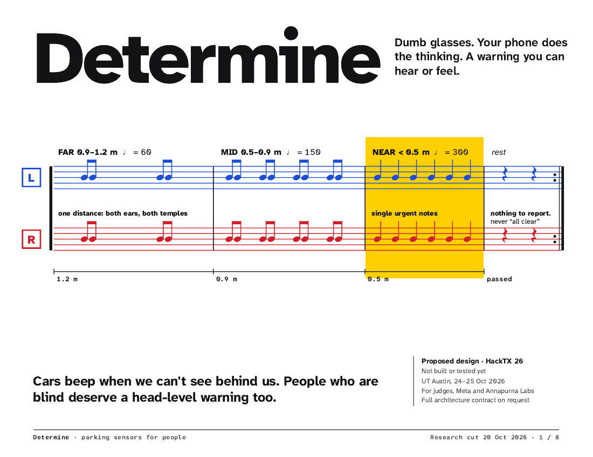</a>
  <a href="Determine-Brief.pdf">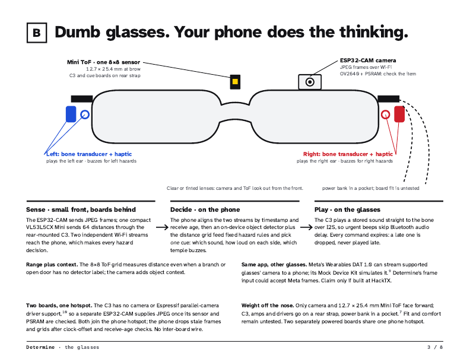</a>
  <a href="Determine-Brief.pdf">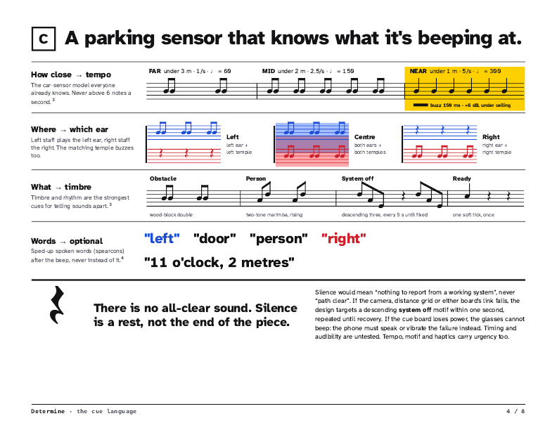</a>
  <a href="Determine-Brief.pdf">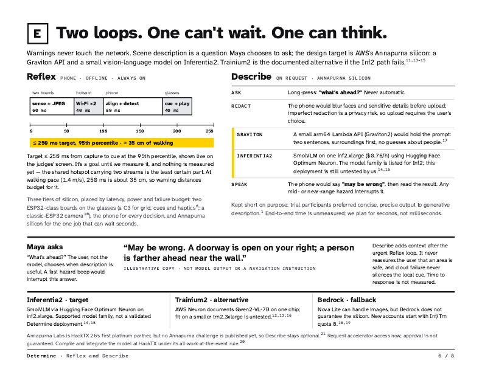</a>
</p>

All 8 brief pages: [`docs/images/brief-1.png` … `brief-8.png`](docs/images/) · PDF: [`Determine-Brief.pdf`](Determine-Brief.pdf)

## Try it without hardware

```sh
git clone https://github.com/nunera/Determine && cd Determine
nix run .#desktop -- --sim approach_centre --start     # the app on your desktop + both boards simulated
nix run .#android-demo -- --sim approach_centre        # the real APK in an Android emulator (needs KVM; --headless for no window)
```

The desktop app runs the Android app's own screens and engine (shared code in [`app-shared/`](app-shared)); it
uses the single forward distance reading, has no face blur and never uploads for Describe (the iPhone app can, with an
explicit unblurred-upload opt-in; see [`ios/README.md`](ios/README.md)). Desktop audio does
not verify a physical Bluetooth headset. Details: [`desktop/README.md`](desktop/README.md).

## App screenshots

Current v2 app on an Android API 28 emulator, with no Bluetooth headset or connected boards. These captures prove
the missing-headset warning, scalar diagnostics layout, hardware settings and disabled hearing-calibration gate,
not physical sensor or headset performance. The CLI's two-board simulator separately exercises the live warning loop.

<p align="center">
  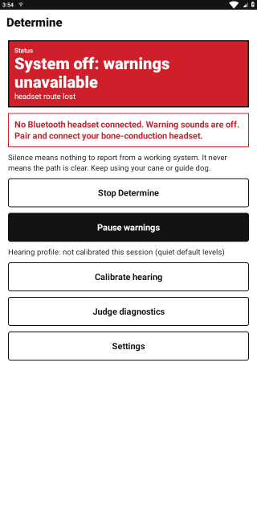
  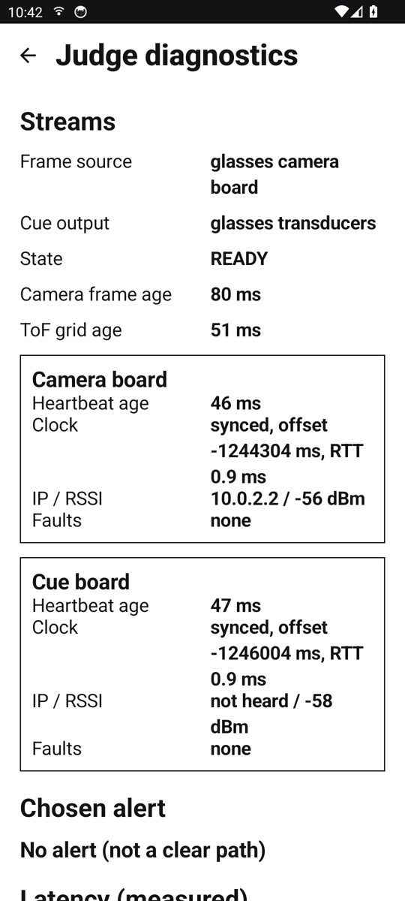
  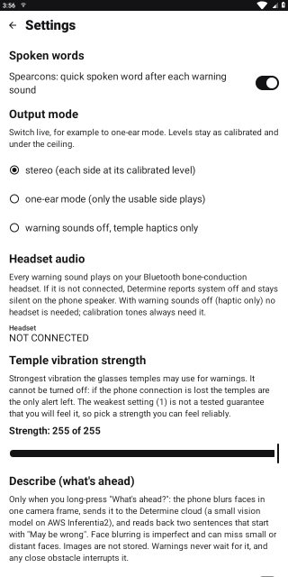
  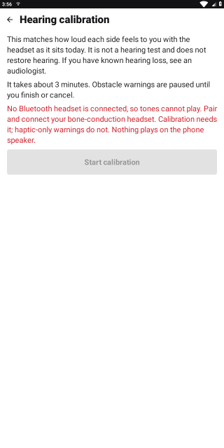
</p>

## Software layout

| Path | What | Build / test |
|---|---|---|
| [`protocol/`](protocol/PROTOCOL.md) | Wire contract v2 (UDP, 8 packet types; scalar RANGE, haptic-only CUE), Python reference codec, golden vectors | `cd protocol/python && python3 -m unittest` |
| [`firmware/cue-board/`](firmware/cue-board/README.md) | XIAO ESP32-C3: single-zone ToF (Modulino Distance), Modulino Vibro haptics, haptic-only watchdog | `pio run -e xiao_esp32c3`, `pio test -e native` |
| [`firmware/cam-board/`](firmware/cam-board/README.md) | ESP32-CAM: JPEG capture, chunked FRAME stream, PSRAM fallback | `pio run -e esp32cam`, `pio test -e native` |
| [`phone/`](phone/README.md) | Kotlin hazard engine (`core`) + headless phone (`cli`) | `./gradlew build` |
| [`app-shared/`](app-shared) | Screens, runtime, engine host, UDP and Describe client shared by Android and desktop; wire v2, no object detector | built by both |
| [`android/`](android/README.md) | Android device layer: foreground service, Bluetooth-only cue audio with explicit route failure, alerts, on-phone face blur and phone-camera fallback | `./gradlew assembleDebug testDebugUnitTest` |
| [`desktop/`](desktop/README.md) | Desktop test app: same UI and engine, Java Sound cues, espeak-ng speech; does not verify a physical Bluetooth route | `./gradlew build`, `nix run .#desktop` |
| [`ios/`](ios/README.md) | iPhone app: Swift engine port, UDP link, haptic-only live session, iPhone-camera fallback; Linux headless `DeterminePhone` cli for e2e | `swift run DetermineEngineChecks` from `ios/` in `nix-shell -p swift swiftpm`; IPA via the xtool container in `ios/README.md` |
| [`cloud/`](cloud/README.md) | Describe loop on Annapurna silicon: Graviton2 Lambda API + SmolVLM server on Inferentia2 | `python3 -m unittest discover -s cloud/describe-api/tests` (and `cloud/inference/tests`) |
| [`tools/sim/`](tools/sim/README.md) | Two-board simulator, bench tool for real boards, end-to-end harness | `python3 -m unittest discover -s tools/sim/tests` |
| [`docs/flows/`](docs/flows/README.md) | Hardware flow maps and software flowcharts (Mermaid) | `nix shell nixpkgs#mermaid-cli -c python3 docs/flows/render.py` |

Toolchains come from nix: `nix develop` (JDK 17, Python, PlatformIO, espeak-ng), or per command
`nix shell nixpkgs#jdk17 nixpkgs#platformio -c <cmd>`. Firmware Wi-Fi credentials:
copy `firmware/common/include/secrets.example.h` to `secrets.h` (gitignored).

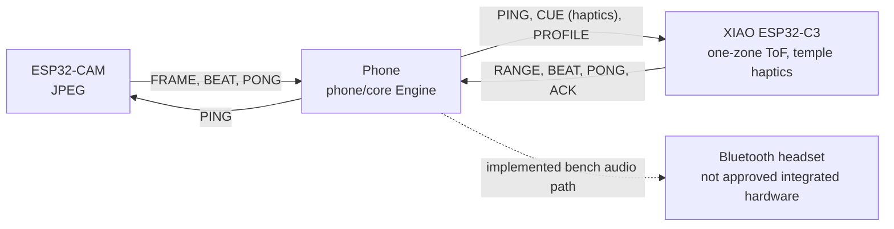

The phone makes every hazard decision; the wearable never decides. There is no "all clear" sound, and a
failure is announced, never silent (Arch §1.2, §4.2). Cue audio never falls back silently to the phone speaker.

## Machine learning and Annapurna silicon

| Where | Model / chip | Role | Status |
|---|---|---|---|
| Phone | none | no on-phone object detector: camera frames feed only Describe and frame diagnostics, never the hazard decision | in app |
| Phone | MediaPipe BlazeFace short-range | blurs faces before any Describe upload | in app |
| AWS Graviton2 | Lambda arm64 `describe-api` | auth, prompt, safety filter | code + SAM template; not deployed |
| AWS Inferentia2 | SmolVLM-256M via optimum-neuron, inf2.xlarge | "What's ahead?" two-sentence description | code + compile/setup scripts; needs Inf quota; CPU path measured at p50 2.0 s |
| Bedrock | Nova Lite | fallback if Inf2 is down (silicon unspecified) | code |

No learned model is in the hazard decision: warnings come from one forward ToF distance banded by fixed rules (Arch §7.2).
See [`cloud/README.md`](cloud/README.md) for the event-day order and measurements.

## Diagrams

Sources and the full set of 15: [`docs/flows/`](docs/flows/README.md). The checked-in SVGs under
`docs/flows/rendered/` are generated from those sources and must be re-rendered after any edit:
`nix shell nixpkgs#mermaid-cli -c python3 docs/flows/render.py`.

### Hardware

**Physical layout and power** — front camera and single-zone ToF, rear-strap C3 and haptic drivers, temple motors, pocket power bank, phone and Bluetooth bone headset.


**Electrical buses and pins** — one I²C bus (Modulino Distance, DRV2605L pull-ups, Modulino Vibro), GPIO, programming. No I²S.


**Network and data topology** — both boards on the phone hotspot; ports, packet types and rates.


**Steady-state cue round trip** — range sample → phone bands and decides → phone audio to the headset and CUE with deadline to the C3 → haptic → ACK.

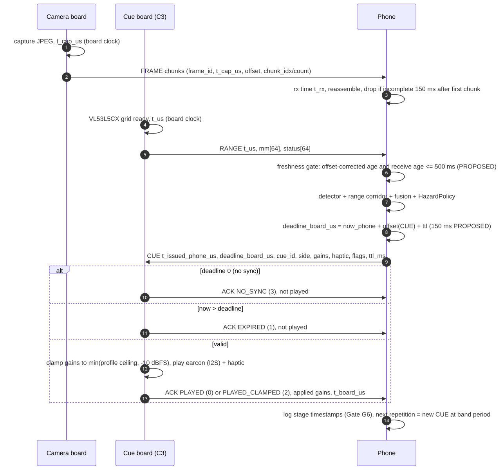

**Failure paths** — cue board power loss, phone silence (board haptic watchdog, no sound), camera unplugged, headset route lost.

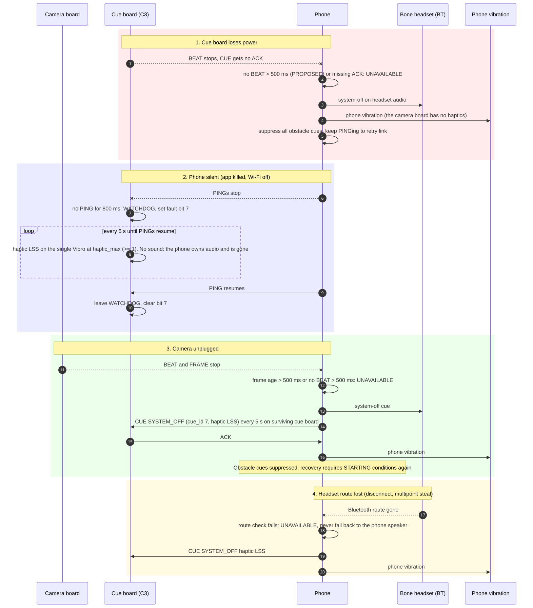

### Software

**Phone pipeline** — UDP ingest → clock sync → freshness → forward range band → hazard
policy → cue scheduler → phone audio plus CUE haptics.


**Hazard policy** — bands, persistence, rate limit; no side, no camera object, there is no CLEAR output.


**System state machine** — STARTING, READY, DEGRADED, UNAVAILABLE, PAUSED.


**Cue board CUE handling** — validate → clock sync and deadline → clamp haptic to haptic_max → play → ACK.


More: [boot and join sequence](docs/flows/rendered/hardware-4.svg) ·
[cue-board tasks](docs/flows/rendered/software-1.svg) · [camera loop](docs/flows/rendered/software-3.svg) ·
[calibration](docs/flows/rendered/software-7.svg) · [Describe loop](docs/flows/rendered/software-8.svg) ·
[module map](docs/flows/rendered/software-9.svg)

## End to end without hardware

```sh
(cd phone && nix shell nixpkgs#jdk17 -c ./gradlew :cli:installDist)
nix shell nixpkgs#jdk17 -c python3 tools/sim/e2e.py
```

## Determine World and research

[Determine World](world/README.md) adds a procedural 3-D campus walk that drives the real wire-v2 phone engine:
one forward ToF reading, phone/headset sound, and board vibration. It includes seven courses, four camera views,
an engine mirror, a sound/vibration score, fault injection and experimental TTC/exploration controls.

```sh
(cd world && npm ci && npm run build)
nix shell nixpkgs#jdk17 -c python3 tools/sim/world_bridge.py --serve world/dist
# Open http://127.0.0.1:8765/ (build phone/cli above first)
```

[Research and experiment decisions](docs/research/README.md) link the competitor landscape, simulation fidelity,
Annapurna Labs/Austin and Meta findings. [Work tracking](docs/research/WORKLOG.md) separates implemented behaviour
from proposals; reports include explanatory Mermaid flowcharts and rendered SVGs.

Confirm demo and data rules with HackTX organizers. Simulator measurements are not hardware or
blind-user safety validation, and no Meta SDK or AWS deployment is implied by a rendered demo.
