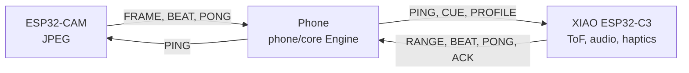

# Determine

Parking sensors for people: dumb glasses, a capable phone, and a calibrated warning about what is directly
ahead. Design: [`Determine-Architecture.html`](Determine-Architecture.html) (contract) and
[`Determine-Brief.html`](Determine-Brief.html) (8-page brief). Status: proposed design; untested with
blind or low-vision users.

<p align="center">
  <a href="Determine-Brief.pdf"></a>
  <a href="Determine-Brief.pdf"></a>
  <a href="Determine-Brief.pdf"></a>
  <a href="Determine-Brief.pdf"></a>
</p>

All 8 brief pages: [`docs/images/brief-1.png` … `brief-8.png`](docs/images/) · PDF: [`Determine-Brief.pdf`](Determine-Brief.pdf)

## Software layout

| Path | What | Build / test |
|---|---|---|
| [`protocol/`](protocol/PROTOCOL.md) | Wire contract v1 (UDP, 8 packet types), Python reference codec, golden vectors | `cd protocol/python && python3 -m unittest` |
| [`firmware/cue-board/`](firmware/cue-board/README.md) | XIAO ESP32-C3: 8×8 ToF, I²S stereo cues, DRV2605L haptics, watchdog | `pio run -e xiao_esp32c3`, `pio test -e native` |
| [`firmware/cam-board/`](firmware/cam-board/README.md) | ESP32-CAM: JPEG capture, chunked FRAME stream, PSRAM fallback | `pio run -e esp32cam`, `pio test -e native` |
| [`phone/`](phone/README.md) | Kotlin hazard engine (`core`) + headless phone (`cli`) | `./gradlew build` |
| [`android/`](android/README.md) | Android app: service, MediaPipe detector, TTS/vibration, judge + calibration UI | `./gradlew assembleDebug testDebugUnitTest` |
| [`tools/sim/`](tools/sim/README.md) | Two-board simulator, bench tool for real boards, end-to-end harness | `python3 -m unittest discover -s tools/sim/tests` |
| [`docs/flows/`](docs/flows/README.md) | Hardware flow maps and software flowcharts (Mermaid) | `nix shell nixpkgs#mermaid-cli -c python3 docs/flows/render.py` |

Toolchains come from nix: `nix shell nixpkgs#jdk17 nixpkgs#platformio -c <cmd>`. Firmware Wi-Fi credentials:
copy `firmware/common/include/secrets.example.h` to `secrets.h` (gitignored).



The phone makes every hazard decision; the wearable never decides. There is no "all clear" sound, and a
failure is announced, never silent (Arch §1.2, §4.2).

## Diagrams

Sources and the full set of 15: [`docs/flows/`](docs/flows/README.md). Re-render with
`nix shell nixpkgs#mermaid-cli -c python3 docs/flows/render.py`.

### Hardware

**Physical layout and power** — front camera and ToF, rear-strap boards, temple outputs, pocket power bank.


**Electrical buses and pins** — I²C (ToF, mux, haptic drivers), I²S (amps, bone transducers), GPIO, programming.


**Network and data topology** — both boards on the phone hotspot; ports, packet types and rates.


**Steady-state cue round trip** — capture → RANGE/FRAME → phone decides → CUE with deadline → play → ACK.


**Failure paths** — cue board power loss, phone silence (board watchdog), camera unplugged.


### Software

**Phone pipeline** — UDP ingest → clock sync → frame assembly and freshness → detector + ToF corridor → hazard
policy → cue scheduler.


**Hazard policy** — bands, persistence, priority, rate limit; there is no CLEAR output.


**System state machine** — STARTING, READY, DEGRADED, UNAVAILABLE, PAUSED.


**Cue board CUE handling** — validate → clock sync and deadline → clamp → mode → play → ACK.


More: [boot and join sequence](docs/flows/rendered/hardware-4.svg) ·
[cue-board tasks](docs/flows/rendered/software-1.svg) · [camera loop](docs/flows/rendered/software-3.svg) ·
[calibration](docs/flows/rendered/software-7.svg) · [Describe loop](docs/flows/rendered/software-8.svg) ·
[module map](docs/flows/rendered/software-9.svg)

## End to end without hardware

```sh
(cd phone && nix shell nixpkgs#jdk17 -c ./gradlew :cli:installDist)
nix shell nixpkgs#jdk17 -c python3 tools/sim/e2e.py
```
