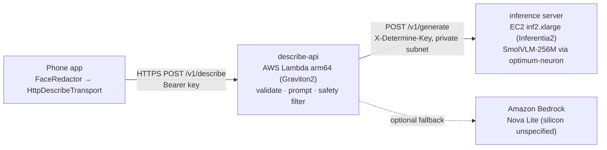

# cloud — Describe loop on Annapurna silicon (Arch §7.3, §11.6)

Optional, on-request scene description. The phone blurs faces, then sends one frame; the answer is spoken with the
prefix "May be wrong." Never in the hazard loop: warnings keep playing and any MID/NEAR hazard interrupts it.

| Part | Path | Contract |
|---|---|---|
| Contract | [`API.md`](API.md) | phone ↔ API ↔ inference, prompt, safety filter |
| Graviton API | [`describe-api/`](describe-api/README.md) | §1, §3 |
| Inferentia2 server | [`inference/`](inference/README.md) | §2 |

## Measured so far (this machine, CPU dev backend — not Inferentia2)

| Path | Requests | Server p50 | Server p95 | Tokens/s |
|---|---|---|---|---|
| SmolVLM-256M, transformers CPU, 8 threads, 640×480 test scene | 5 | 2003 ms | 2141 ms | 30.2 |
| Full chain phone-format request → describe-api (local) → CPU server | 1 | 2098 ms total | — | — |

Inferentia2 numbers do not exist yet: they need Inf quota and a compile on the instance. `inference/bench.py` produces
the table for judges (p50/p95, tokens/s, $ per request at $0.76/h). Quality note: on the synthetic test scene the
256M model invented "a person"; that is why the spoken answer is prefixed "May be wrong." and why the 500M/2.2B
variants (same `idefics3` class, untested on Neuron) are worth trying once the 256M path works.

## Event-day order

1. Before Saturday: request EC2 quota "Running On-Demand Inf instances" (L-1945791B) ≥ 4 vCPU; default is 0.
2. Launch inf2.xlarge on the Neuron SDK 2.31 PyTorch 2.9 AMI, run `inference/setup_inf2.sh` (compile + systemd).
3. `sam deploy` the describe-api into the same VPC; put both keys in SSM.
4. In the app: Settings → Describe → URL + key, enable. Long-press "What's ahead?".
5. Run `inference/bench.py` and show the JSON plus the app's Judge screen (backend, silicon, timings).
