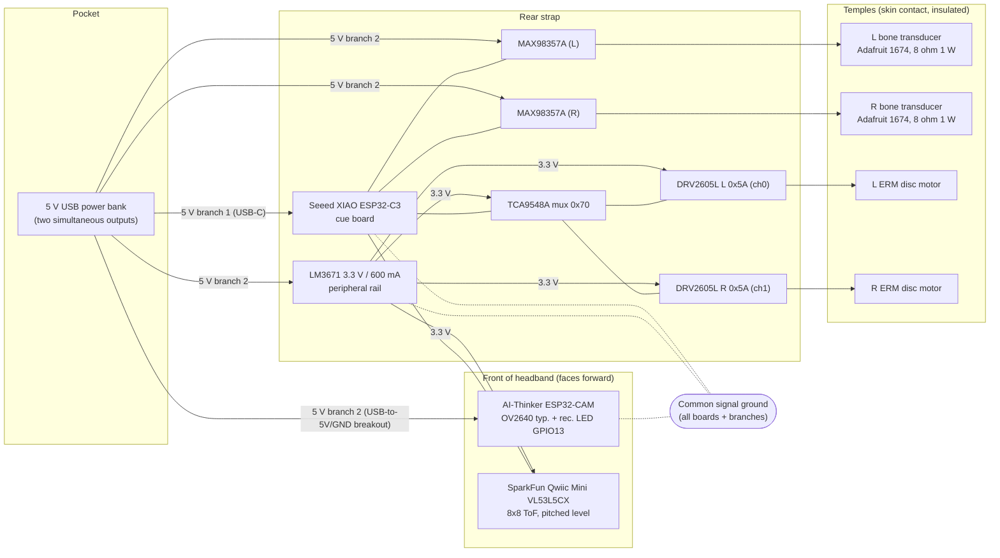
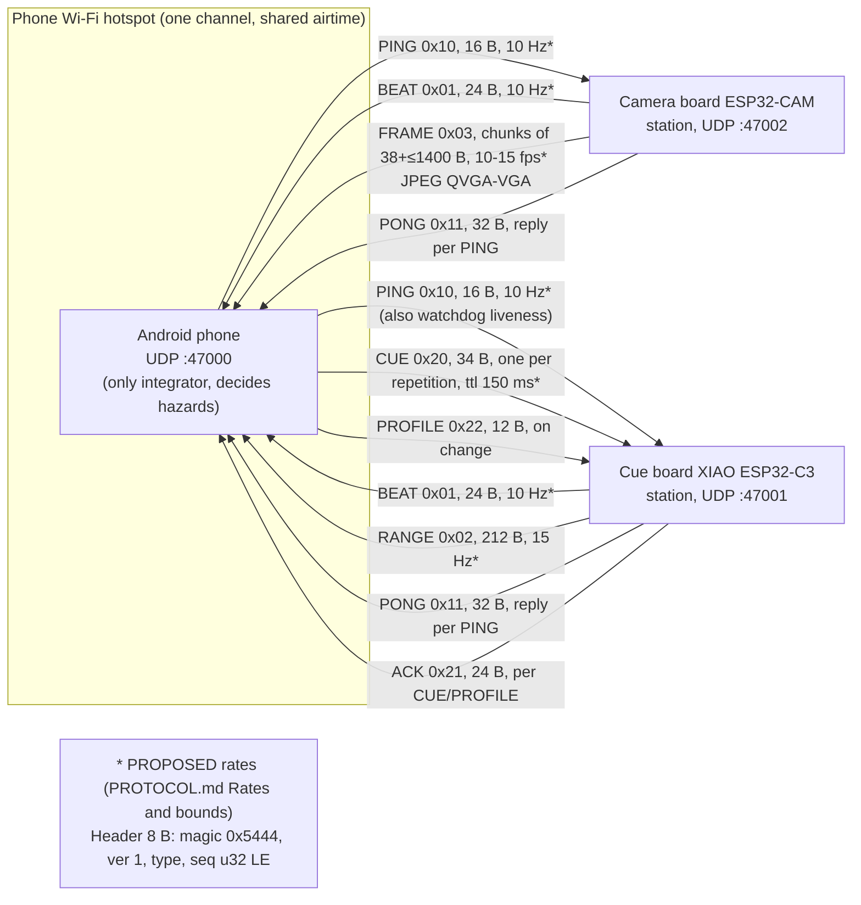
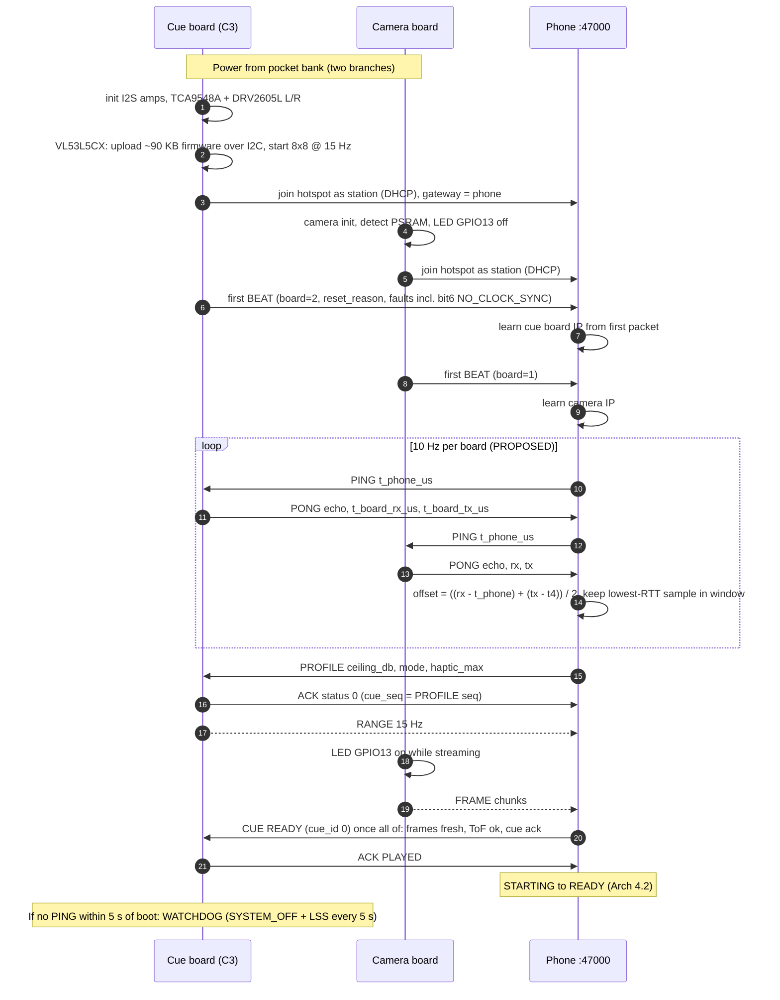
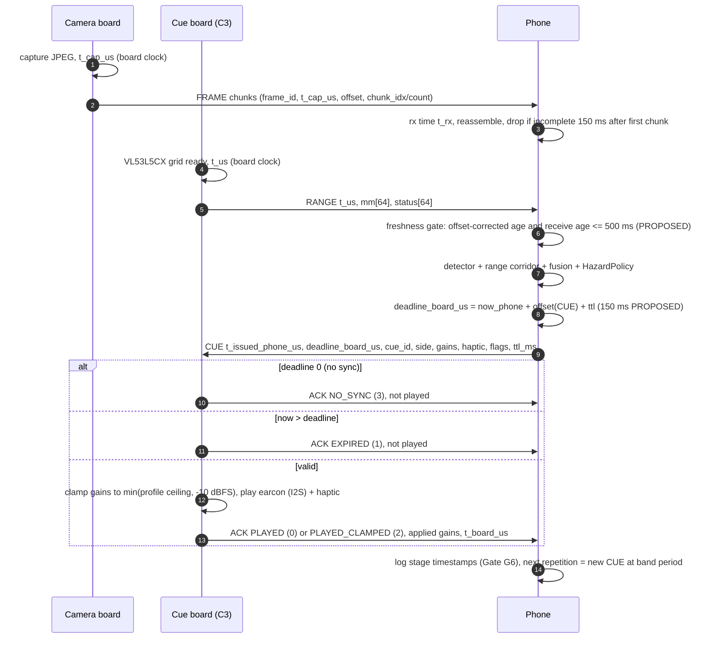
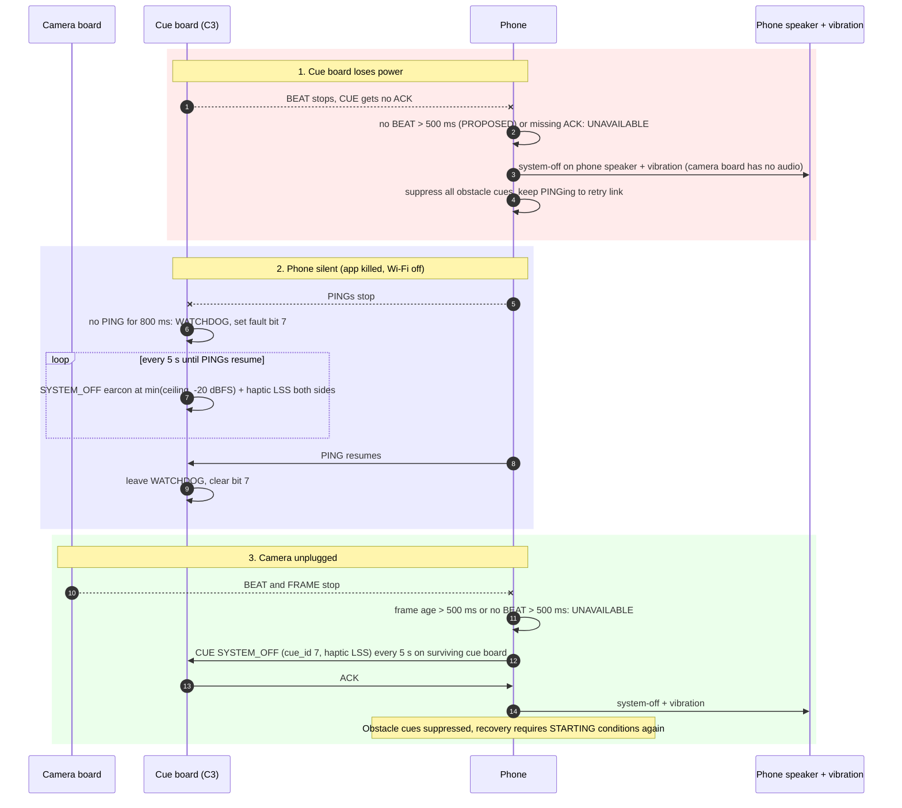

# Determine — hardware flow maps

Grounded in `protocol/PROTOCOL.md` (wire v1, frozen), `firmware/common/include/determine_wire.h`,
and `Determine-Architecture.html` §4–§6, §8, §13. Numbers marked **PROPOSED** are the
architecture's untuned values (tuned at Gates G6–G7); nothing here is measured.

Rendered copies: [`rendered/`](rendered/) (one SVG per diagram, linked under each block).

## (a) Physical layout / topology (Arch §5.3–§5.4)

Only the camera and the Mini ToF face forward. Control boards sit on the rear strap; the
battery stays in a pocket. Two separately powered 5 V branches, common signal ground.

[rendered](rendered/hardware-1.svg) · Motors and amps are never powered from the C3 3V3 pin (Arch §5.4).
Exact rail assignment of each peripheral beyond "camera, amps, LM3671 on branch 2" is a G0 bring-up decision.

## (b) Electrical buses (Arch §5.3–§5.4; shared hardware facts)

```mermaid
flowchart LR
  subgraph C3["XIAO ESP32-C3 (cue board)"]
    SDA["GPIO6 / D4 SDA"]
    SCL["GPIO7 / D5 SCL"]
    BCLK["GPIO3 / D1 BCLK"]
    LRC["GPIO4 / D2 LRCLK"]
    DIN["GPIO5 / D3 DIN"]
    LED["GPIO10 / D10 status LED"]
    PWML["GPIO21 / D6 PWM L<br/>(build flag DT_HAPTIC_MOSFET)"]
    PWMR["GPIO20 / D7 PWM R<br/>(build flag DT_HAPTIC_MOSFET)"]
  end
  subgraph I2C["I2C bus (one hardware bus)"]
    TOF["VL53L5CX 0x29<br/>~90 KB fw upload at boot"]
    MUX["TCA9548A 0x70"]
    DL["DRV2605L 0x5A"]
    DR["DRV2605L 0x5A"]
  end
  SDA --- TOF
  SCL --- TOF
  SDA --- MUX
  SCL --- MUX
  MUX -- "ch0" --- DL
  MUX -- "ch1" --- DR
  DL --> ERML["ERM L"]
  DR --> ERMR["ERM R"]
  subgraph I2S["I2S (shared 3 signals)"]
    AL["MAX98357A L<br/>SD-pin resistor selects LEFT"]
    AR["MAX98357A R<br/>SD-pin resistor selects RIGHT"]
  end
  BCLK --> AL
  BCLK --> AR
  LRC --> AL
  LRC --> AR
  DIN --> AL
  DIN --> AR
  AL --> TL["L bone transducer"]
  AR --> TR["R bone transducer"]
  LED --> SLED["Status LED"]
  PWML -. "fallback only" .-> QL["N-MOSFET + flyback diode"] -.-> ERML
  PWMR -. "fallback only" .-> QR["N-MOSFET + flyback diode"] -.-> ERMR
  subgraph CAMB["AI-Thinker ESP32-CAM (camera board)"]
    DVP["DVP camera bus (on-module)"]
    G13["GPIO13 recording LED<br/>on while streaming"]
    G4["GPIO4 flash LED<br/>held OFF"]
    UART["U0TXD GPIO1 / U0RXD GPIO3<br/>+ IO0 flash jumper"]
  end
  DVP --- OV["OV2640 typ.<br/>(sensor + PSRAM detected at runtime)"]
  G13 --> RLED["Front recording LED"]
  FTDI["FTDI USB-UART (3.3 V logic)"] -- "programming only" --- UART
  PC["Laptop"] -- "USB" --- FTDI
  PC -- "USB-C (flash + power)" --- C3
```

[rendered](rendered/hardware-2.svg)

| Board | GPIO | Pin | Function | Notes |
|---|---|---|---|---|
| XIAO C3 | 6 | D4 | I²C SDA | VL53L5CX 0x29, TCA9548A 0x70 |
| XIAO C3 | 7 | D5 | I²C SCL | same bus |
| XIAO C3 | 3 | D1 | I²S BCLK | both MAX98357A |
| XIAO C3 | 4 | D2 | I²S LRCLK | both MAX98357A |
| XIAO C3 | 5 | D3 | I²S DIN | both MAX98357A; channel chosen by SD-pin resistor |
| XIAO C3 | 10 | D10 | Status LED | |
| XIAO C3 | 21 | D6 | PWM haptic L | only with `DT_HAPTIC_MOSFET` |
| XIAO C3 | 20 | D7 | PWM haptic R | only with `DT_HAPTIC_MOSFET` |
| XIAO C3 | 2, 8, 9 | — | avoided | strapping pins |
| TCA9548A | ch0 / ch1 | — | DRV2605L L / R | both 0x5A, isolated by mux |
| ESP32-CAM | 13 | IO13 | Recording LED | on while streaming |
| ESP32-CAM | 4 | IO4 | Flash LED | held off |
| ESP32-CAM | 1 / 3 | U0T / U0R | FTDI UART | programming; IO0→GND to flash |

## (c) Network / data topology (PROTOCOL.md "Transport", "Rates")

Both boards are **stations** on the phone hotspot and send to their DHCP gateway; the phone
learns each board's IP from its first packet. No board-to-board bus (Arch §4, Fig 4.1).

[rendered](rendered/hardware-3.svg)

## (d) Sequences

### Boot and join

[rendered](rendered/hardware-4.svg)

### Steady-state cue round trip with timestamps

Latency budget (Arch §6.3, all PROPOSED): exposure + JPEG ≤ 60 ms, Wi-Fi ≤ 40 ms, decode + detector +
fusion ≤ 80 ms, policy + dispatch + playback start ≤ 40 ms → capture-to-cue p95 ≤ 250 ms. ToF path skips the camera stages.

[rendered](rendered/hardware-5.svg)

### Failure paths (Arch §4.2, §13 G7; PROTOCOL.md Watchdog)

[rendered](rendered/hardware-6.svg) · Target: unavailable cue ≤ 1 s after a fault (G7, PROPOSED).
