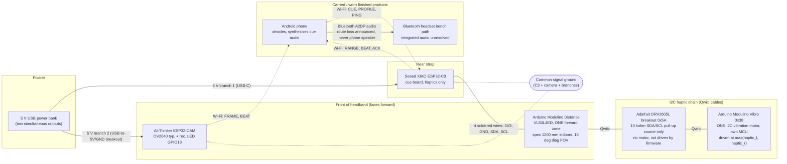
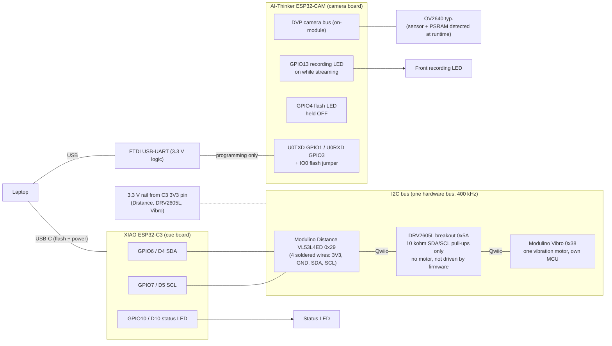
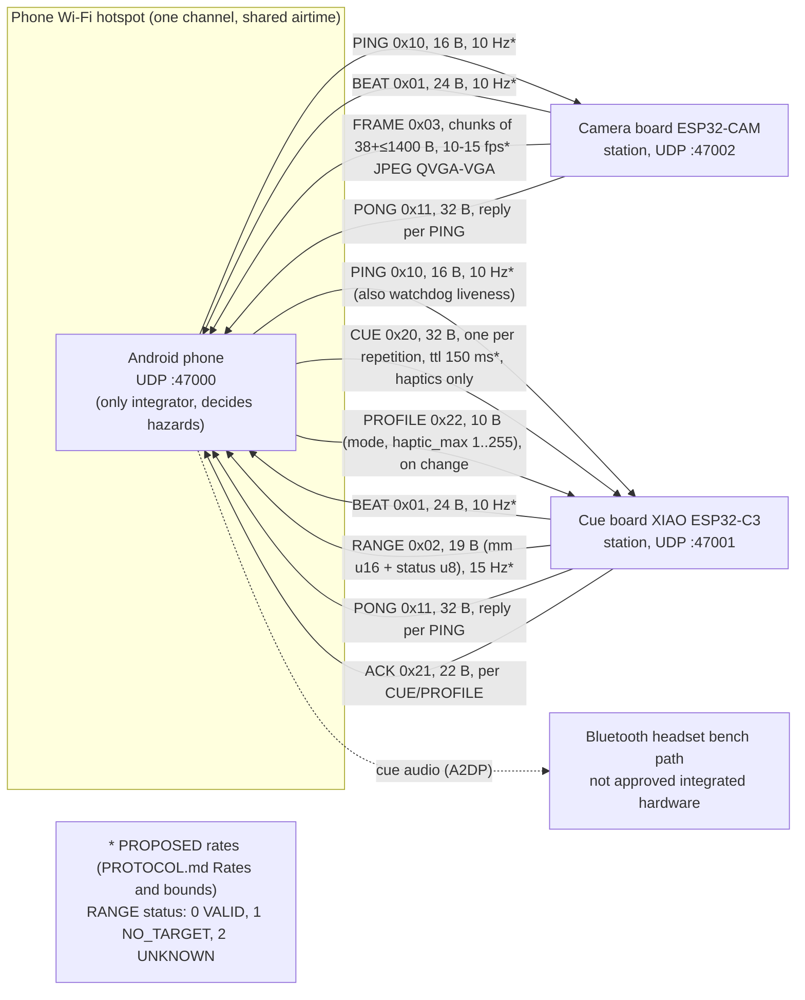
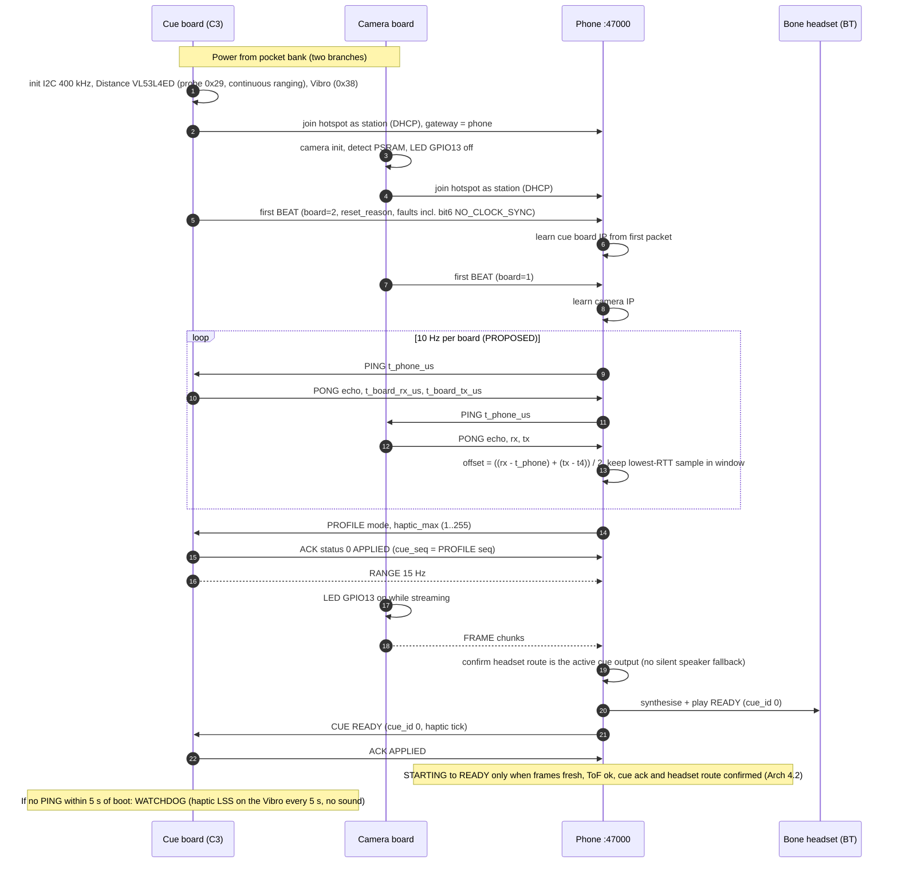
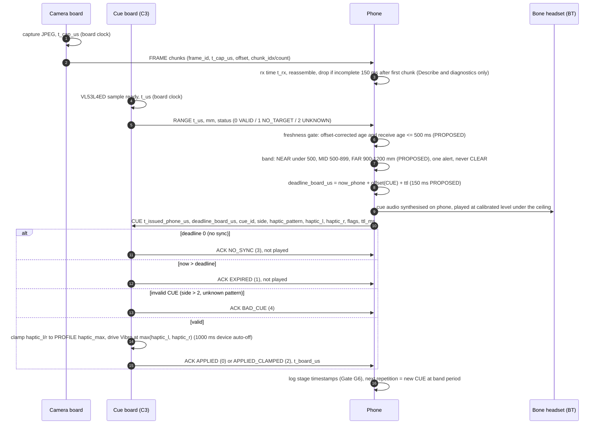
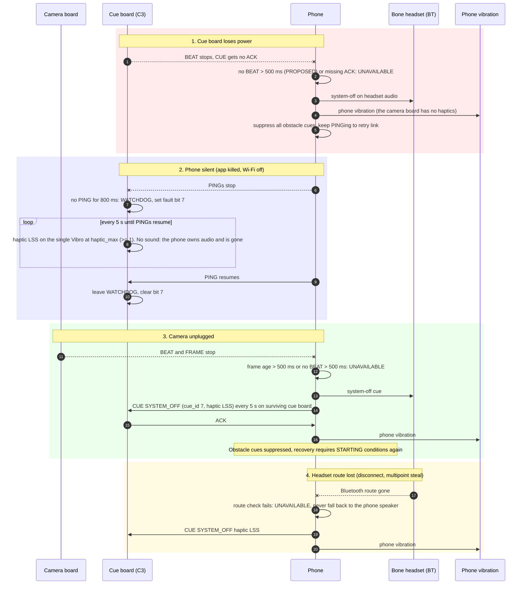

# Determine — hardware flow maps

Grounded in `protocol/PROTOCOL.md` (wire **v2**), `firmware/common/include/determine_wire.h`,
and `Determine-Architecture.html` §4–§6, §8, §12–§13. Numbers marked **PROPOSED** are the
architecture's untuned values (tuned at Gates G6–G8); nothing here is measured.

Design basis (updated 24 Oct 2026 from the bench): ONE Arduino Modulino Distance (VL53L4ED) as a single forward ToF zone, one
ESP32-CAM from the pair (the second is a spare, not a stereo partner), and the XIAO ESP32-C3 driving ONE Arduino Modulino Vibro
(a single I2C-controlled vibration motor) as the haptic output. The firmware cannot lateralise: it drives the Vibro at
max(haptic_l, haptic_r). An Adafruit DRV2605L breakout is in the Qwiic chain only as the source of the 10 kΩ SDA/SCL pull-ups; no motor is
attached to it and the firmware does not drive it. There is no I2C mux. Phone-to-Bluetooth-headset audio
is the implemented software/bench path, not approved integrated hardware. The separate OpenRun is not
approved; integrated bone-conduction output is unresolved. No wearable performance or latency is validated. Houston stock snapshot and unadopted regulator/motor
candidates: Architecture §12.2 (24 Oct 2026 ~1:40 PM CDT). Micro Center-only; no shipped fallback.

Rendered copies: [`rendered/`](rendered/) (one SVG per diagram, linked under each block). The checked-in SVGs
are regenerated from these sources with `render.py`; regenerate after editing.

## (a) Physical layout / topology (Arch §5.3–§5.4)

Only the camera and the Modulino Distance face forward. The C3 and the I2C haptic chain are bench-wired; the battery
stays in a pocket. The phone and the headset are separate finished products. Two separately powered 5 V
branches, common signal ground.

[rendered](rendered/hardware-1.svg) · Rail assignment beyond "C3 on branch 1, camera on branch 2": the Modulino Distance, the DRV2605L breakout and the Modulino Vibro all
sit on the 3.3 V rail from the C3 3V3 pin (bench wiring). No separate regulator is adopted (LM3671 sold out, TPS62827 candidate not adopted). The Vibro's motor
draws about 67 mA typ / 85 mA max per the Arduino datasheet; that is not measured on this rail. This departs from the Arch §5.4 rule that motors are not powered from
the C3 3V3 pin. There are no amplifiers in this revision.

## (b) Electrical buses (Arch §5.3–§5.4; shared hardware facts)

[rendered](rendered/hardware-2.svg)

| Board | GPIO | Pin | Function | Notes |
|---|---|---|---|---|
| XIAO C3 | 6 | D4 | I²C SDA | Modulino Distance 0x29, Modulino Vibro 0x38, DRV2605L 0x5A (pull-ups only) |
| XIAO C3 | 7 | D5 | I²C SCL | same bus |
| XIAO C3 | — | 3V3 | 3.3 V rail | Distance (4 soldered wires), DRV2605L and Vibro via Qwiic chain |
| XIAO C3 | 10 | D10 | Status LED | |
| XIAO C3 | 2, 8, 9 | — | avoided | strapping pins |
| Qwiic chain | — | — | Distance → DRV2605L → Vibro | DRV2605L only supplies 10 kΩ SDA/SCL pull-ups; Vibro power 0–50 from intensity 0–255 |
| ESP32-CAM | 13 | IO13 | Recording LED | on while streaming |
| ESP32-CAM | 4 | IO4 | Flash LED | held off |
| ESP32-CAM | 1 / 3 | U0T / U0R | FTDI UART | programming; IO0→GND to flash |

The v1 I²S pins (D1–D3) are unused in v2. The firmware keeps an untested `DT_HAPTIC_MOSFET` build flag (GPIO21/20 PWM) from an earlier
revision; the architecture's shopping list contains no parts for it, so treat it as unsupported.

## (c) Network / data topology (PROTOCOL.md "Transport", "Rates")

Both boards are **stations** on the phone hotspot and send to their DHCP gateway; the phone
learns each board's IP from its first packet. No board-to-board bus (Arch §4, Fig 4.1). Header is 8 B:
magic 0x5444, **ver 2**, type, seq u32 LE. Audio never travels on this network: it goes phone → headset over Bluetooth.

[rendered](rendered/hardware-3.svg)

## (d) Sequences

### Boot and join

[rendered](rendered/hardware-4.svg)

### Steady-state cue round trip with timestamps

Latency budget (Arch §6.3, all PROPOSED): exposure + JPEG ≤ 60 ms, Wi-Fi ≤ 40 ms, band + policy ≤ 80 ms,
CUE dispatch + haptic start ≤ 40 ms → range-sample-to-haptic p95 ≤ 250 ms. Headset audio adds 100–200 ms of
Bluetooth A2DP latency; report the audio and haptic legs separately. The ToF path does not use the camera stages.

[rendered](rendered/hardware-5.svg)

### Failure paths (Arch §4.2, §13 G7; PROTOCOL.md Watchdog)

[rendered](rendered/hardware-6.svg) · Target: unavailable cue ≤ 1 s after a fault (G7, PROPOSED). A phone that dies leaves only the board's haptic buzz.
