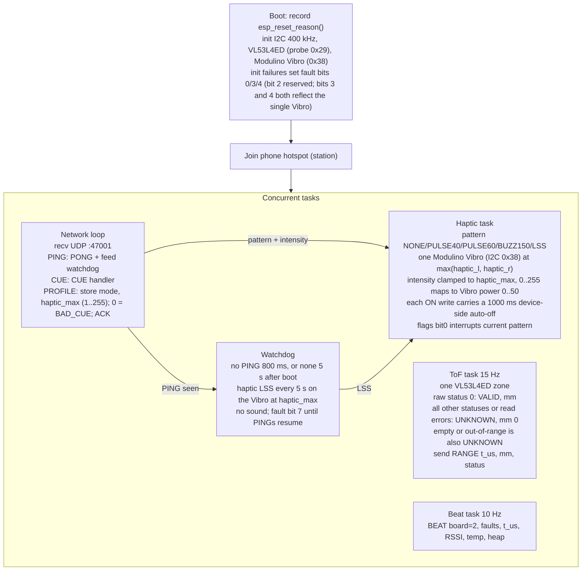
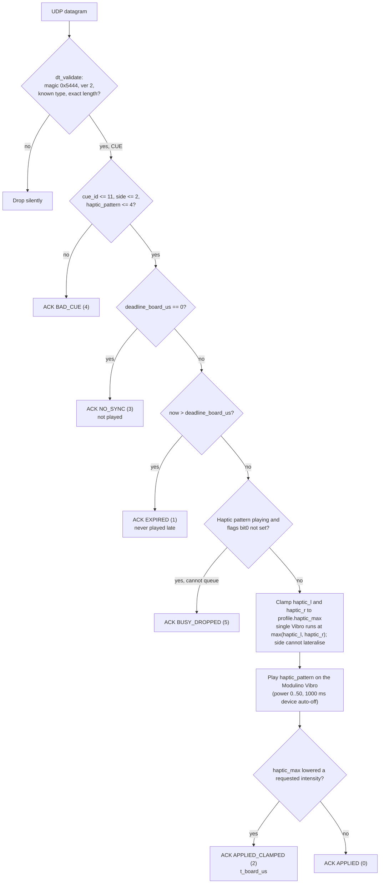
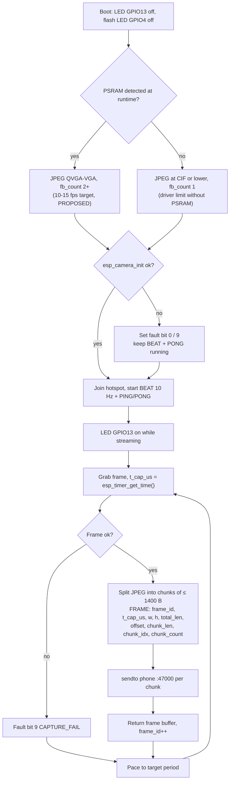
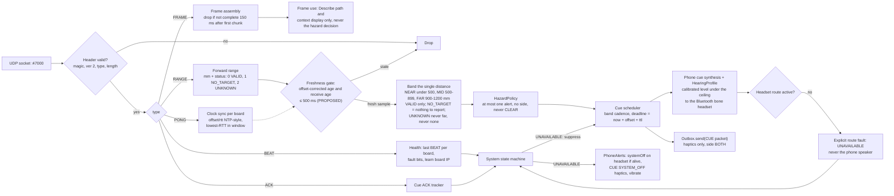
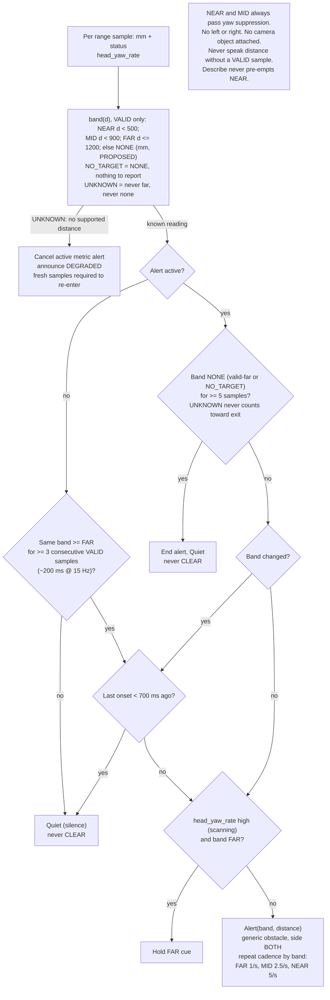
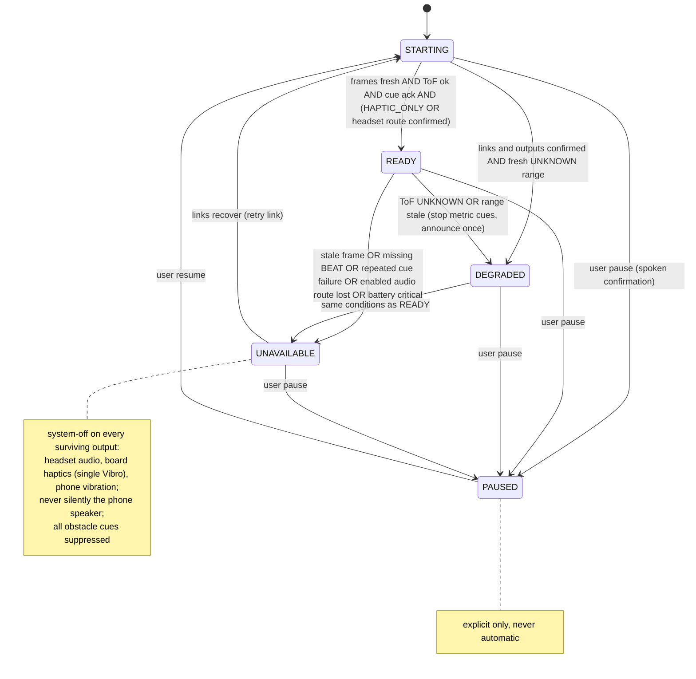
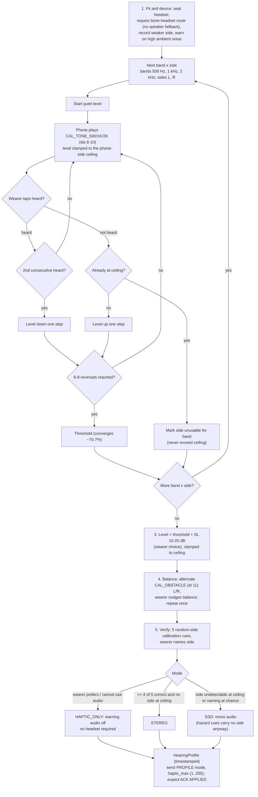
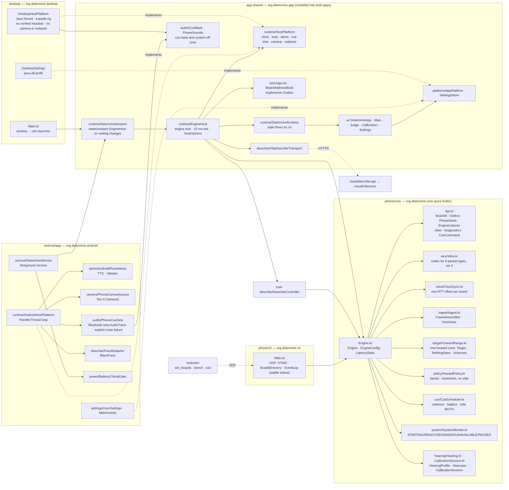

# Determine — software flowcharts

Grounded in `protocol/PROTOCOL.md` (wire **v2**), `firmware/common/include/determine_wire.h` and
`Determine-Architecture.html` §4.2, §7.1–§7.3, §8, §9. **PROPOSED** marks untuned numbers from the docs.
v2 basis: one forward ToF zone (VL53L4ED), scalar RANGE, haptic-only cue board (one Modulino Vibro, no lateral haptics), phone-synthesised cue audio on a
Bluetooth bone-conduction headset. No grid, no board audio, no lateral range.
The audio path is implemented software/bench behavior only: the separate OpenRun is not approved, and integrated bone-conduction hardware remains unresolved (Architecture §12.2–12.4).

Rendered copies: [`rendered/`](rendered/). The checked-in SVGs are regenerated from these sources with
`render.py`; regenerate after editing.

## (a) Cue-board firmware (XIAO ESP32-C3)

### Tasks

[rendered](rendered/software-1.svg)

### CUE handling decision chart

[rendered](rendered/software-2.svg) · The board makes no sound in any profile mode; `mode` (STEREO/SSD/HAPTIC_ONLY) is phone
audio-route semantics. Side exclusion (L/R zeroing the other channel) is not clamping. An unknown `mode` or `haptic_max` = 0 in a
PROFILE is also ACK BAD_CUE (haptic_max must be 1..255 so the watchdog LSS can never be configured silent). The exact BUSY policy is
the firmware's.

## (b) Camera board (ESP32-CAM) capture / chunk / pace loop

[rendered](rendered/software-3.svg)

## (c) Phone pipeline (Arch §7.1)

[rendered](rendered/software-4.svg)

## (d) HazardPolicy v0 (Arch §7.2; bands PROPOSED)

[rendered](rendered/software-5.svg)

## (e) System state machine (Arch §4.2; 500 ms bounds PROPOSED)

[rendered](rendered/software-6.svg) · Arch §4.2 states "retry link" for UNAVAILABLE and does not spell out the
DEGRADED→READY and resume edges; `UNAVAILABLE → STARTING` and `PAUSED → STARTING` re-require the STARTING conditions ([INFERENCE], matches the demo "reconnect and wait for READY", Arch §11.4). The headset-route conditions follow Arch §4.2.

## (f) Calibration (Arch §9; staircase details PROPOSED)

Cue tones are synthesised on the phone and played on the Bluetooth bone headset; calibration refuses to start if that route is not the active cue output.

[rendered](rendered/software-7.svg) · Arch §9 defines STEREO (≥ 4/5, no side at ceiling) and SSD (side undetectable or chance); outcomes in between are not specified there. `haptic_max` has a floor of 1: the haptic channel cannot be configured away, but 1 is not a measured guarantee of perceptibility.

## (g) Describe loop (Arch §7.3) — as implemented in `phone/core/describe` + `cloud/`

[rendered](rendered/software-8.svg)

## (h) Module / package map (phone `core`, `cli`, shared app layer, Android and desktop apps)

Matches the code in the working tree (`phone/core/src/main/kotlin/org/determine/core`, `phone/cli`,
`app-shared/src/main/kotlin/org/determine/app`, `android/app/…/org/determine/android`,
`desktop/…/org/determine/desktop`). Public API: `phone/core/API.md`.

[rendered](rendered/software-9.svg) · The module names track the working tree while the v2 cutover is in progress; re-check against
`phone/core/API.md` when regenerating.
