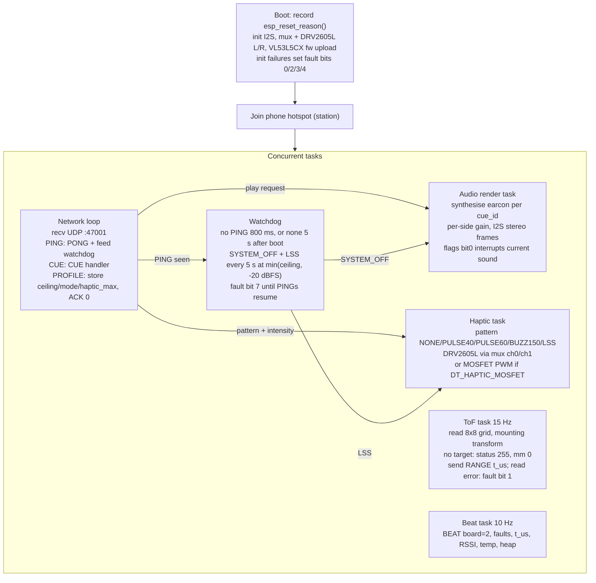
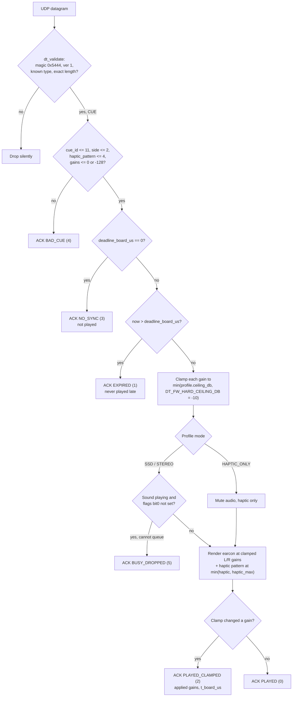
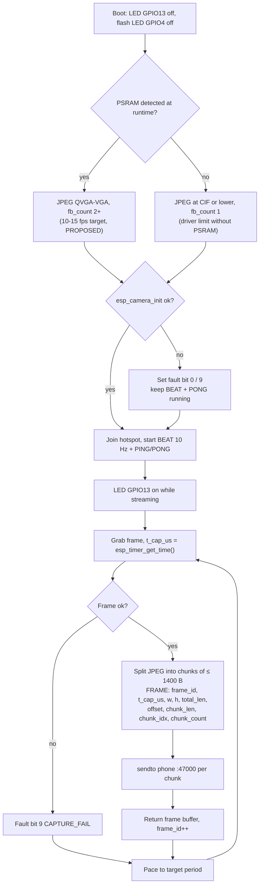
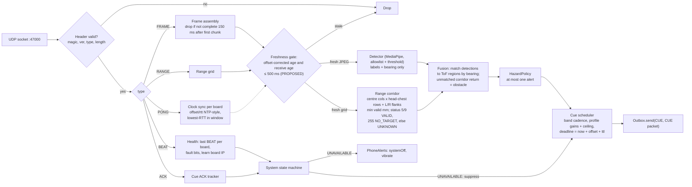
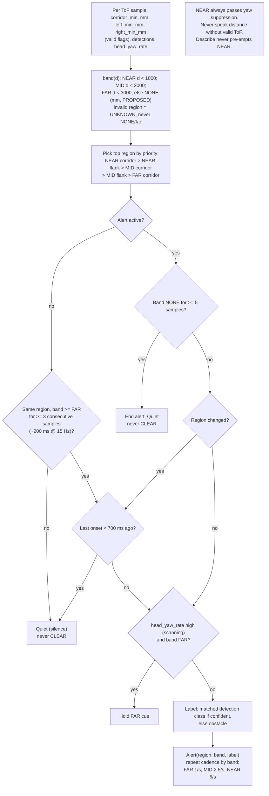
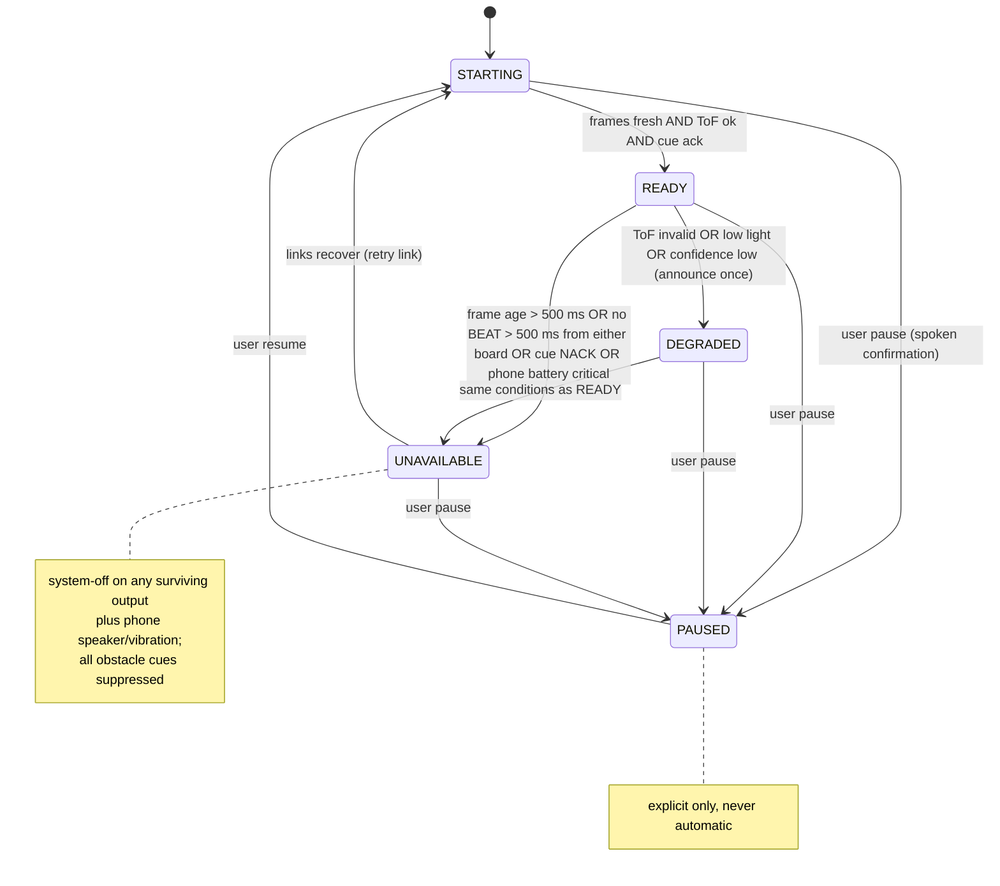
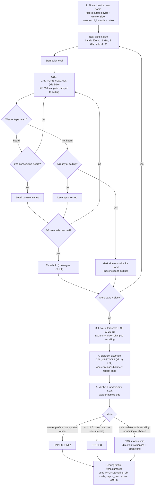
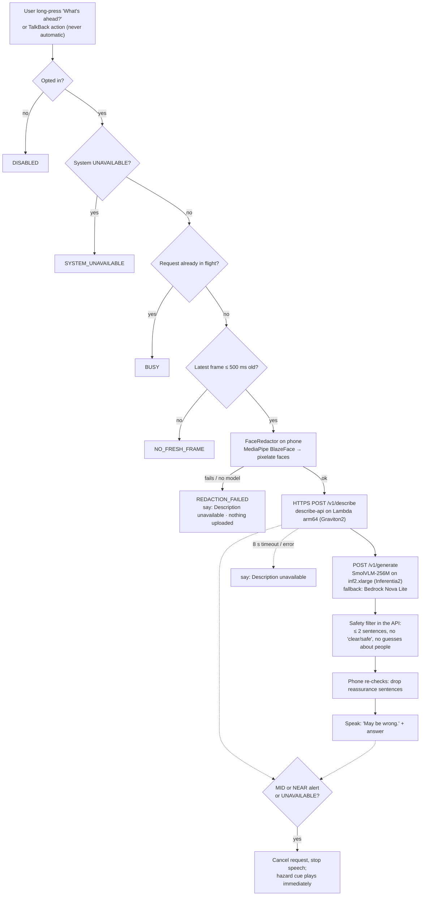
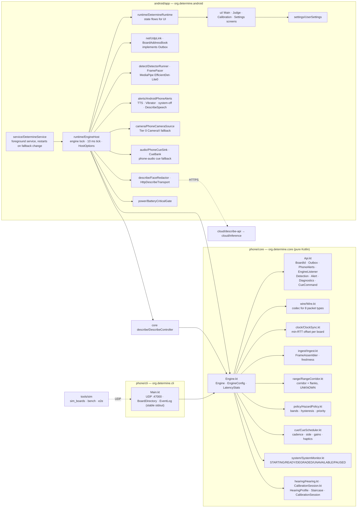

# Determine — software flowcharts

Grounded in `protocol/PROTOCOL.md` (wire v1, frozen), `firmware/common/include/determine_wire.h` and
`Determine-Architecture.html` §4.2, §7.1–§7.3, §8, §9. **PROPOSED** marks untuned numbers from the docs.

Rendered copies: [`rendered/`](rendered/).

## (a) Cue-board firmware (XIAO ESP32-C3)

### Tasks

[rendered](rendered/software-1.svg)

### CUE handling decision chart

[rendered](rendered/software-2.svg) · In SSD mode the phone sends identical L/R gains (Arch §9); the board plays what it is sent within the ceiling.
Haptic intensity limited by `haptic_max` follows PROFILE semantics; the exact BUSY policy is the firmware's.

## (b) Camera board (ESP32-CAM) capture / chunk / pace loop

[rendered](rendered/software-3.svg)

## (c) Phone pipeline (Arch §7.1)

[rendered](rendered/software-4.svg)

## (d) HazardPolicy v0 (Arch §7.2; bands PROPOSED)

[rendered](rendered/software-5.svg)

## (e) System state machine (Arch §4.2; 500 ms bounds PROPOSED)

[rendered](rendered/software-6.svg) · Arch §4.2 states "retry link" for UNAVAILABLE and does not spell out the
DEGRADED→READY and resume edges; `UNAVAILABLE → STARTING` and `PAUSED → STARTING` re-require the STARTING conditions ([INFERENCE], matches the demo "reconnect and wait for READY", Arch §11.4).

## (f) Calibration (Arch §9; staircase details PROPOSED)

[rendered](rendered/software-7.svg) · Arch §9 defines STEREO (≥ 4/5, no side at ceiling) and SSD (side undetectable or chance); outcomes in between are not specified there.

## (g) Describe loop (Arch §7.3) — as implemented in `phone/core/describe` + `cloud/`

[rendered](rendered/software-8.svg)

## (h) Module / package map (phone `core`, `cli`, Android app)

Matches the code as of this commit (`phone/core/src/main/kotlin/org/determine/core`, `phone/cli`,
`android/app/src/main/kotlin/org/determine/android`). Public API: `phone/core/API.md`.

[rendered](rendered/software-9.svg)
