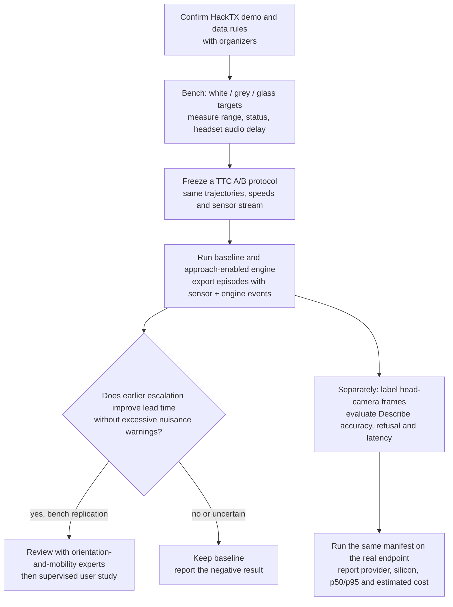

# Determine: research → experiments → demo

**Build the evidence loop, not another AI narrator:** a credible near-field warning demo, an A/B measurement of the existing TTC rule, and a separately evaluated Describe service. Keep the cane and the limits visible. Use Meta data/tooling and AWS silicon where they answer a real research question—not merely to add sponsor logos.

**Visual technical brief:** [Determine — Simulation and Glasses (PDF)](../visual-guide/Determine-Simulation-and-Glasses.pdf) explains the running simulator, physical architecture, recorded engine trace, sensor/latency limits and proposed glasses route. [Editable source and rebuilding](../visual-guide/README.md).

This guide is the decision layer. Detailed evidence has one home per topic:

| Question | Evidence and implementation detail |
|---|---|
| Which products/features should we compare? | [Competitive landscape](competitive-landscape.md): product table, user-evidence caveats, E1–E13 experiment backlog |
| What makes the simulation credible and professional? | [Simulation and demo](simulation-demo.md): sensor limits, rendering choices, validation ladder, storyboard |
| Where does Annapurna's Austin work connect? | [Annapurna Labs](annapurna-labs.md): Austin findings, silicon/Neuron support, research programmes, ranked paths |
| Which claims in the two Meta briefs hold up? | [Meta fit](meta-fit.md): claim-by-claim verdicts, ADT/ASE licensing, DAT, VRS, EgoBlur, ExecuTorch, Llama, internship plan |
| What was actually built and checked? | [Work log](WORKLOG.md) and [running the simulator](../../world/README.md) |

## What changed after pulling GitHub?

Research now targets upstream **`65cfa0c`**, not the earlier desktop-app branch. It changed the problem materially:

- Wire v2 uses **one forward ToF zone**, approximately 18°, up to 1.2 m—not an 8×8 grid at 4 m. ADT depth must be projected into this cone, not reduced to 64 cells.
- Sound originates on the phone and travels to a Bluetooth headset. The board applies vibration on **one motor**, not independent left/right audio or temple motors.
- TTC approach escalation and exploration pulses already exist as experimental `Tuning` options. The simulator exposes these for measurement; building another TTC policy would duplicate work.
- The Android object detector was removed. MediaPipe remains in the face-redaction path, so “replace the detector with ExecuTorch” no longer matches this revision.

### Why does this change the pitch?

Warning lead time has an upper bound of range divided by closing speed, before sensing, persistence, scheduling and Bluetooth delays. For a white target at 1.2 m and a 1.0 m/s walk, the geometric bound is 1.2 s. Two people closing at 2.0 m/s halve it to 0.6 s. TTC can escalate urgency sooner *after detection*; it cannot recover a target the sensor never saw.

The world includes a datasheet-anchored reflectance model, clearly marked as an inference: darker bark and grey steel return later than a white sign. It is not a calibrated VL53L4ED digital twin. Details and sources live in the simulation report.

## Which experiments should we run first?

Freeze inclusion rules, hazard windows, acceptable false-alarm increase, and promotion criteria **before** running A/B. Episode exports preserve what happened; they do not by themselves establish miss rate, safety, collision avoidance, or real-world user benefit.

| Priority | Experiment | Evidence to collect | Stop condition |
|---|---|---|---|
| 1 | TTC baseline vs existing approach escalation | Warning onset, escalation onset, closing speed, nuisance cues, state availability; paired trajectories | Don't promote on simulator-only gains |
| 2 | Sensor-envelope sweep | First reliable return for white/grey/dark targets, head pitch, walking speed, glass status | Correct the model if bench results disagree |
| 3 | Describe hallucination audit | Human-labelled visible objects, known-object inventions, salient recall, reassurance/distance flags, failures | Keep Describe outside the hazard loop |
| 4 | Audio+haptic vs haptic-only; exploration pulses | Cue identification, cognitive load, response time in supervised sessions | No unsupervised mobility trial |
| 5 | ADT/ASE external-data replay | Calibrated camera-to-cone projection, independent collision corridor, timestamp alignment, held-out metrics | Obtain permissions before showing derived visuals publicly |

## Where does Meta fit without hardware changes?

The strongest near-term bridge is **external egocentric evaluation**, not a runtime swap. [ADT](https://www.projectaria.com/datasets/adt/) supplies reconstruction-derived depth and annotations, but depth is not a simulated ToF return: material reflectance, glass, ambient light and missing returns still need modelling. Report ideal-depth replay separately from sensor-model replay. See the [Meta licence analysis](meta-fit.md) before downloading or displaying derived assets.

DAT adds a glasses camera route. Audio is ordinary Bluetooth, not a DAT-specific audio API. The documented Android stream supports portrait 720×1280 at selected rates up to 30 fps; the [integration guide](https://wearables.developer.meta.com/docs/build-integration-android/) also documents adaptive quality under bandwidth constraints. The browser profile study only crops/resamples its own simulated camera; it is **not** an SDK integration or proof of Ray-Ban optics or latency.

VRS, EgoBlur, Llama Guard and ExecuTorch have real roles, but each adds integration or validation work. The Meta report separates supported capabilities from the attachment's speculative cost, speed and safety claims. Do not claim `retention 0 s` or an exact face-redaction count without verified enforcement and measured telemetry.

## Where does Annapurna fit?

```mermaid
flowchart LR
  SIM["Determine World<br/>head-camera captures + labelled manifest"] --> EVAL["Batch Describe evaluator<br/>same images and audit rules per backend"]
  EVAL --> API["Configured describe-api<br/>optional Graviton-backed deployment"]
  API --> INF["Configured real VLM endpoint<br/>Inferentia / Trainium only if deployed there"]
  INF --> RESULT["Response + backend metadata + timing<br/>failures preserved, no invented measurements"]
  RESULT --> REPORT["Quality vs latency vs cost estimate<br/>artifact for Annapurna / Neuron discussion"]
  REPORT --> TRAIN["Post-event: broader labelled episodes<br/>faculty-backed Trainium research proposal"]
```

Austin's documented fit is custom-silicon development and validation; do not turn that into a claim that every Austin role does ML research. The useful conversation is **workload placement and evaluation**: warnings stay local because the network cannot satisfy their deadline; optional descriptions can use cloud silicon and be evaluated for quality, cost and latency. The detailed report maps this to public Austin postings and research programmes.

Llama 3.2 Vision has a genuine [versioned Neuron tutorial](https://awsdocs-neuron.readthedocs-hosted.com/en/v2.27.1/libraries/nxd-inference/tutorials/llama3.2-multimodal-tutorial.html), but its documented setup is `inf2.48xlarge` or `trn1.32xlarge`, **not** the small SmolVLM `inf2.xlarge` deployment. Version-pinned support is not evidence that the current SDK supports the same path. Verify version, instance quota, model access and compile before promising it.

## What should judges see?

1. **Architectural maquette, not game spectacle:** limestone arcade, disciplined ink edges, soft shadows, sparse sensor overlays, real engine status and the sound/vibration score.
2. **White sign:** cane passes below a head-height obstacle; the measured cone reading drives FAR → MID → NEAR through the real engine.
3. **A limit:** side obstacle, dark branch, glass or stairs. Explain why the system cannot promise a clear path.
4. **An announced failure:** unplug the cue board and the phone announces loss. A lost phone/link can trigger the powered board's watchdog; an unplugged board cannot vibrate.
5. **A measured experiment:** compare approach settings using exported episodes. No stage claim of millisecond *acoustic* latency from software ACK timing.
6. **Optional Describe:** show an actual configured model result and provider metadata, or visibly unavailable if no service is configured. Compare models with the same labelled images, not different anecdotes.

The simulator already uses procedural geometry and real protocol/engine behaviour. It does **not** prove acoustic Bluetooth delay, sensor accuracy on hardware, blind-user usability, cloud deployment, Meta SDK interoperability, or safety certification.

## Event eligibility and recruiting

All repo work was done at HackTX, per the event rule that all work must be done at the event. Keep the demo ledger explicit about what is measured versus proposed, and never present proposed work as built.

For Meta and Annapurna, bring one link, a 30-second pitch and one reproducible artifact. Ask engineers which team owns the matching problem, then whether they are comfortable referring you after reviewing it. Apply independently of a referral. Use resume numbers only from recorded runs and label simulator measurements **in simulation**. Pitch scripts and verified caveats are in [Meta fit](meta-fit.md); programme routes are in [Annapurna Labs](annapurna-labs.md).
