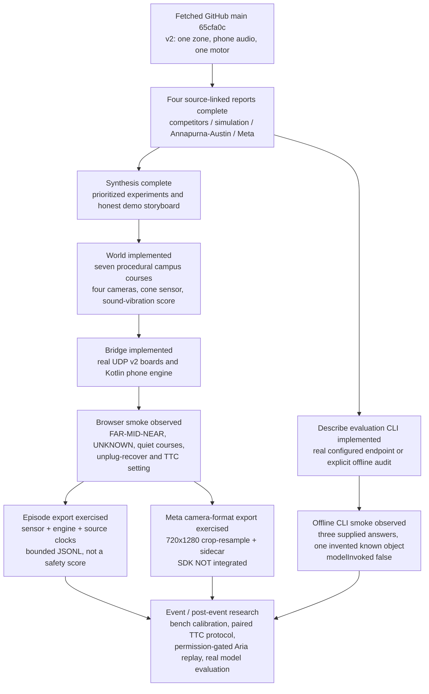
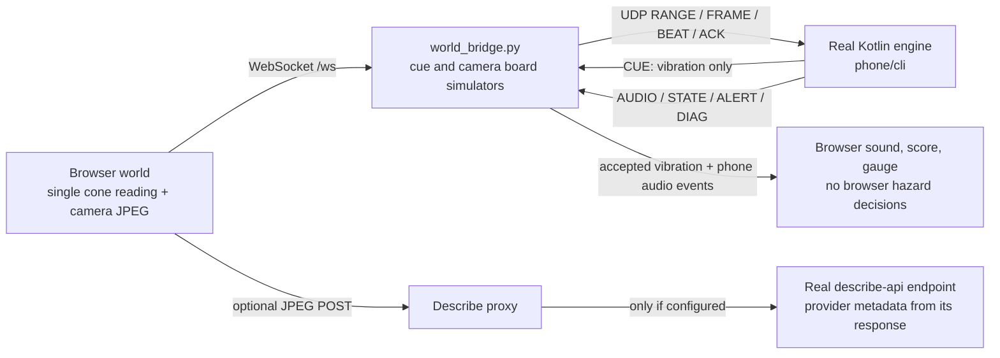

# Determine research and simulation work log

## Delivered versus proposed

Research, a runnable procedural virtual environment, real-engine integration, episode export, a camera-format study and a configured-endpoint evaluation CLI are implemented. Aria replay, VRS, EgoBlur, Llama Guard, ExecuTorch, DAT SDK integration, cloud deployment and training remain **research proposals**, not hidden implementations or tested integrations.

The research implementation targets GitHub upstream **`main`**, developed on branch `world-sim` during the event.

## Research → decisions → runnable evidence

## Runtime truth chain (wire v2)

The browser plays the phone's `AUDIO` events, not board `played` events. The board has one Vibro motor. An unplugged board cannot vibrate; a powered board may apply its watchdog LSS when phone/link disappears. Describe never participates in the warning decision.

## Work ledger

| Slice | State | Evidence / boundary |
|---|---|---|
| Pull latest | complete | Fetched `origin/main` at `65cfa0c`; rebased local work without the unmerged desktop-app commit |
| Competitive research | complete | [Report](competitive-landscape.md), sourced table and E1–E13 experiment backlog |
| Simulation research | complete | [Report](simulation-demo.md), fidelity/visual rules, validation ladder, storyboard |
| Annapurna/Austin research | complete | [Report](annapurna-labs.md), verified versus inferred roles, silicon/software paths, programme gates |
| Both Meta briefs | complete | [Report](meta-fit.md), claim-verdict tables and five flowcharts |
| World + bridge + HUD | complete | Seven courses, four camera modes, v2 single-zone gauge, separate audio/vibration staves, fault and tuning controls |
| TTC experiment hook | complete | CLI `--approach` / `--explore`; UI toggle confirmed by live bridge tuning state |
| Episode recorder | complete | Exported all seven production-demo courses to `/tmp/determine-smoke-episodes/`; each file's metadata matches its selected course, with sensor/engine events and retention summary |
| Meta profile | complete study only | Export decoded to 720×1280; sidecar states crop/resample, no added optical detail, SDK/hardware absent, latency unmeasured |
| Annapurna eval tooling | complete | [CLI](../../tools/sim/EVALUATION.md), explicit endpoint/auth, labelled manifest, failure-aware summary; no AWS run claimed |
| Synthesis / runnable docs | complete | [Research index](README.md), [world instructions](../../world/README.md), root README |
| Diagrams | rendered | Research Markdown Mermaid blocks compiled to `rendered/*.svg`; no unrelated hardware SVG regeneration required |

## Exercised verification

- `npm run build`: TypeScript check and production Vite bundle succeeded, including JPEG worker and export modules.
- `python3 -m unittest discover -s tools/sim/tests`: **99 tests passed**. Two existing unclosed-UDP-socket `ResourceWarning`s still printed; bridge-specific tests were not their source in earlier isolation.
- Bridge integration agent reported successful `:cli:installDist :core:test`; live parent smoke used that actual installed CLI.
- Sensor smoke: a white front target at 980 mm returned VALID/980; same geometry at 17% reflectance returned NO_TARGET; glass returned UNKNOWN; an off-axis target returned NO_TARGET. The reflectance fit reproduces the 450 mm grey anchor.
- Live browser/bridge/engine: sign produced FAR → MID → NEAR and corresponding `OBSTACLE_*` audio; glass reached `DEGRADED tof_unknown`; open plaza and stairs produced no obstacle cues; dark branch produced NEAR only; scaffold produced MID and NEAR; pedestrian produced obstacle cues (the headless CLI has no camera classifier).
- Switching courses does not reset the engine's real hysteresis: a prior alert can briefly persist during the transition. Do not score the previous course's warm-down as a new course detection; predeclare washout windows in an experiment protocol.
- Cue-board unplug: `DEGRADED range_stale → UNAVAILABLE cue_beat_missing`; reconnect: `READY recovered`.
- Approach toggle: live status returned `{approach:true, explore:false}` after restart, matching the UI.
- Episode and Meta profile downloads were read from their generated Blob URLs and inspected, not inferred from button wiring.
- Final production run exported all seven courses (694–872 JSONL lines each) with correct course IDs and source clocks. A recorder selection bug found during this smoke was fixed: following the active episode now follows the next active episode, while an explicitly selected historical episode stays selected.
- `eval_describe.py --audit-only` on three explicitly supplied responses: three scored, zero failed; one invented known object / four affirmative known-category mentions; salient recall 3/3; no model calls, no round-trip samples. This is a CLI smoke fixture, **not a model benchmark**.

## Visual/performance findings

The maquette pipeline uses depth/normal ink edges, GTAO, a key/fill light rig, cast shadows, SMAA and Neutral tone mapping. A three r186 GTAOPass external-G-buffer initialization bug required constructing its default target before assigning the shared G-buffer. A deprecated PCFSoft mode was replaced by PCFShadowMap.

On software-rendered Chromium, main-thread JPEG encoding delayed captures by ~1.1–1.7 s despite small frames. A dedicated OffscreenCanvas worker reduced the observed median live frame gap to 281 ms in one run. This is environment-specific diagnostic evidence, **not** a hardware/GPU performance claim. Some transient `frame_stale` announcements remain under render load; stale thresholds were not relaxed or hidden. Adaptive quality drops AO, then shadows, then resolution and remaining post-processing. Normal-GPU 1080p performance, acoustic Bluetooth delay and battery power are unmeasured.

## Eligibility and external prerequisites

- Confirm demo and data-use rules with HackTX organizers before judging.
- ADT/ASE public imagery or derived visual displays need licence review/permission; no restricted dataset assets were downloaded into this demo.
- A real model evaluation needs endpoint credentials and a deployed model; Inferentia/Trainium execution, Neuron compilation, Llama support for a specific SDK and cloud costs are not proven by this local run.
- Neither the simulator nor lexical Describe audit establishes blind-user safety. Sensor calibration and supervised orientation-and-mobility review remain required.
