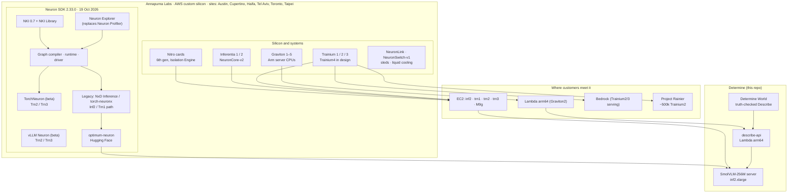
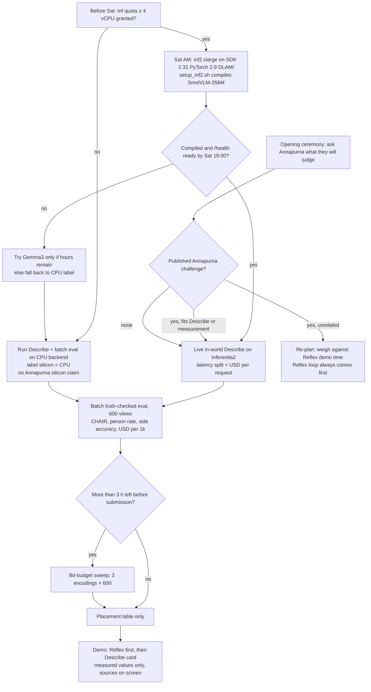
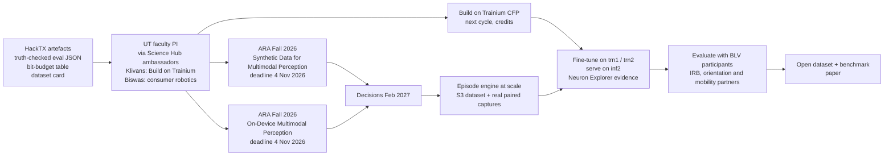
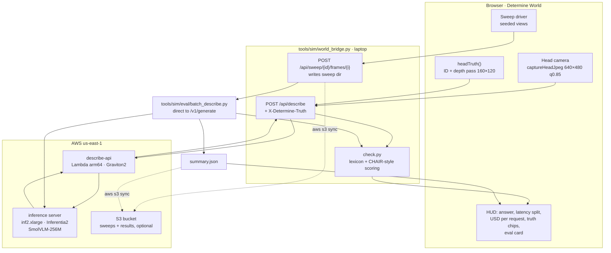

# Annapurna Labs (AWS) and Determine World

> Re-grounded on wire v2 (main 65cfa0c, 2026-10-24): one forward single-zone ToF (VL53L4ED, ~18° diagonal, up to
> 1.2 m, status VALID / NO_TARGET / UNKNOWN), haptic-only cue board, all audio on the phone's Bluetooth headset. The
> v1 8×8 grid in earlier drafts is superseded. Silicon, Neuron and programme facts are unchanged.

Research brief for HackTX 26 (UT Austin, 24–25 Oct 2026). All web sources retrieved **2026-10-24**; source numbers
`[Sn]` resolve in §8. Tags: **VERIFIED** = stated by the cited source; **UNVERIFIED** = searched for and not
confirmed; **[INFERENCE]** = our reasoning, not a sourced fact. Nothing here claims a partnership, endorsement, credit
grant or judging criterion from Annapurna Labs, AWS or HackTX.

---

## 0. Conclusion (read this first)

1. **Who they are.** Annapurna Labs is Amazon's custom-silicon organization (Nitro, Graviton, Inferentia, Trainium),
   founded in Israel in 2011 and acquired by Amazon in January 2015 for about $350 million [S3][S2][S4]. Austin is a
   major engineering and lab site, not the only one: on 24 Oct 2026, 75 of 308 "Annapurna Labs" job postings were in
   Austin, behind Cupertino's 84, followed by Haifa (60) and Tel Aviv (41) [S6].
2. **What Austin does (VERIFIED).** Silicon bring-up and validation labs in The Domain district, where Trainium3 was
   first powered on. The site also covers server sleds, a private QA data centre a short drive away, and work on
   Trainium4 [S2][S1][S3]. The Austin job postings are for ML-accelerator design verification, physical design,
   packaging and SI/PI, post-silicon validation, Graviton software, the Neuron Runtime/driver, Trainium fleet
   "vetting" and pre-silicon hardware/software co-design [S6][S7][S8][S9]. **UNVERIFIED for Austin:** Neuron
   compiler, NKI and applied-science roles. No Austin posting in the snapshot matched them; they cluster in
   Cupertino, Seattle, Toronto and New York [S6].
3. **What they reward.** Their own programmes reward measured, hardware-aware work, open artefacts and rigorous
   evaluation, not logo use. Examples: the Trainium Frontier scoring (val_bpb in a fixed chip-time budget) [S37], the
   Build on Trainium criteria (open source, novel hardware use) [S31][S35], and the ARA criteria ("rigor of the
   proposed evaluation, particularly where standard benchmarks do not yet exist") [S33].
4. **Best in-hackathon connection: "Truth-checked Describe".** Keep the existing in-world *What's ahead?* path
   (head camera → bridge → describe-api on Lambda arm64/Graviton2 → SmolVLM-256M on inf2.xlarge/Inferentia2) and add
   the one thing only a simulator can provide: **ground truth**. Each Describe answer gets checked against the
   objects the head camera actually saw. A batch run of ~600 procedurally varied views measures, on Inferentia2:
   p50/p95 latency, throughput, USD per 1,000 descriptions, the object-hallucination rate (CHAIR-style [S45]), the
   "invented a person" rate already observed on CPU (cloud/README.md), left/right accuracy of the *camera* answer
   and the safety-filter drop rate. Score 20/25 in §4; spec in §5. **HackTX rule:** "All work must be done at the
   event. You can't demo something you didn't build" (Architecture §11). `cloud/`, the bridge and Determine World
   are event-built; anything shown says what was measured at HackTX and what is proposed.
5. **Cheap add-ons, same harness.** (i) A **bit-budget sweep**: the same frames at three JPEG sizes, plotting
   hallucination and recall against bytes uploaded. That is the open question in ARA's *On-Device Multimodal
   Perception* CFP, topic 2 [S34]. (ii) The **placement table** (frame / phone / cloud) with budgets from Arch §6.3,
   filled only with numbers measured on the day.
6. **Not at the hackathon.** Fine-tuning on Trainium, NKI kernels and Trn2 work. Trn2 has no public on-demand price
   in the EC2 list. It is sold through Capacity Blocks ($2.235/h for trn2.3xlarge, offered only in Hyderabad,
   Melbourne and São Paulo; $35.76/h for trn2.48xlarge in Ohio) [S26][S27]. Current NKI docs target Trn2/Trn3 [S19].
   Trn/Inf quotas start at 0 vCPU [S28]. A ToF "kernel" on Neuron makes no sense in v2: the sensor sends one
   scalar reading at 15 Hz, and cloud-side hazard logic is forbidden by the product rules.
7. **Post-event (the strong research fit).** ARA Fall 2026 is open until **4 Nov 2026, 11:59 PM PT**. Three of its
   nine CFPs fit Determine World [S32]:
   - *Synthetic Data Generation for Multimodal Perception*, topic 3: long-horizon episodes, "how sensor
     characteristics change with mounting position" [S33].
   - *On-Device Multimodal Perception*, topics 2–3: visual encoding under a bandwidth budget; learned fusion of
     inertial, visual and ranging streams [S34].
   - *Build on Trainium: agentic kernel improvement* [S35].

   The first two come from Amazon Devices & Services, not Annapurna [S33][S34]. Every ARA route needs an eligible
   faculty PI. At UT the visible contacts are the UT Austin–Amazon Science Hub ambassadors: Adam Klivans (Build on
   Trainium) and Joydeep Biswas (consumer robotics) [S38].
8. **Never claim** Inferentia2 numbers that were not logged on an inf2 instance, any affiliation with Annapurna, or
   that a hallucination-free Describe answer makes a path "clear". Describe stays outside the hazard loop.

---

## 1. Annapurna Labs: what it is

### 1.1 History

| Date | Event | Status |
|---|---|---|
| 2011 | Founded in Israel by Intel and Broadcom veterans [S3]. Founders named by the Technion include Nafea Bshara and Hrvoje (Bilik) Bilić [S54] | VERIFIED |
| Before 2015 | Worked with AWS on the hardware that became the Nitro System and its hypervisor [S1] | VERIFIED |
| Jan 2015 | Amazon agrees to acquire Annapurna Labs; about $350M reported [S4][S2][S3] | VERIFIED |
| 2018 | Graviton (first Arm server CPU) [S11]; Graviton2 2019, Graviton3 2021, Graviton4 2023, Graviton5 2025 [S11] | VERIFIED |
| 2019 / 2020 | First Inferentia chips (2019), Trainium (2020) [S3] | VERIFIED |
| 2023 | Trainium2 unveiled [S3] | VERIFIED |
| Oct 2025 | Project Rainier activated: nearly 500,000 Trainium2 chips, used by Anthropic [S15][S2] | VERIFIED |
| Dec 2025 | Trn3 UltraServers GA: AWS's first 3 nm AI chip, up to 144 Trainium3 chips per UltraServer [S12] | VERIFIED |
| Mar 2026 | 1.4 million Trainium chips deployed across three generations. Trainium2 serves most Bedrock inference traffic. Trainium4 is being designed [S2] | VERIFIED (company statements to press) |
| Jun 2026 | Graviton5 (M9g/M9gd) GA: 192 cores, 3 nm, sixth-generation Nitro with the formally verified Nitro Isolation Engine [S10][S48] | VERIFIED |

### 1.2 Sites

Job-posting snapshot via the amazon.jobs search API (query `"Annapurna Labs"`, 308 postings, 24 Oct 2026) [S6]:

| Location | Postings | What the Austin rows show |
|---|---|---|
| Cupertino, CA | 84 | ML compiler, NKI, Neuron SDK principal roles, silicon validation |
| **Austin, TX** | **75** | MLA design verification, physical design, AI silicon packaging, SI/PI, post-silicon validation, Graviton software, Neuron Runtime/driver, Trainium fleet ops, MLA vetting, hw/sw co-design |
| Haifa, Israel | 60 | formal verification, embedded/Nitro, EFA/SRD |
| Tel Aviv, Israel | 41 | embedded, Nitro, software |
| Seattle, WA | 19 | strategy, solutions architects |
| Toronto, Canada | 10 | design verification, Neuron compiler |
| New York | 7 | software |
| Taipei | 6 | silicon operations, ASIC test |

The careers page says Annapurna has "development centers in the U.S. and Israel" [S5]. A snapshot is not a
headcount. It is the best public signal of which teams sit where. **[INFERENCE]**

### 1.3 Product lines

| Line | Generations (Oct 2026) | Facts that matter to Determine |
|---|---|---|
| Nitro | 6th generation | Offloads virtualization, storage and networking. Every EC2 instance, including the inf2 that serves Describe, runs on it [S1][S10] |
| Graviton | 1 to 5 | Lambda `arm64` runs on Graviton2 [S49]. describe-api is an arm64 Lambda (`cloud/describe-api/template.yaml`) |
| Inferentia | 1, 2 | Inferentia2 chip: 2× NeuronCore-v2, 32 GiB HBM at 820 GiB/s, 190 TFLOPS FP16/BF16 [S24]. inf2.xlarge = 1 chip, 4 vCPU, $0.7582/h on-demand us-east-1 [S26][S14] |
| Trainium | 1, 2, 3 (4 in design) | Trainium1 has the **same NeuronCore-v2** as Inferentia2 [S25][S24], so a model fine-tuned on trn1 is served by the same core generation on inf2. Trn2: 16 chips per instance, 64 per UltraServer [S13]. Trn3 UltraServer: up to 144 chips [S12] |
| Interconnect | NeuronLink, NeuronSwitch-v1 | Trn3 mesh switching [S2][S12] |
| Systems | sleds, racks, liquid cooling | Designed and brought up by the Austin lab [S2] |

### 1.4 What happens in Austin

| Claim | Status | Source |
|---|---|---|
| Annapurna has offices, three hardware labs and a mini "data center" on the outskirts of Austin | VERIFIED | [S1] |
| Austin lab sits in The Domain district. Silicon bring-up happens there, including the Trainium3 bring-up | VERIFIED | [S2] |
| A private QA/test data centre at a co-location site a short drive away, running no customer workloads | VERIFIED | [S2] |
| Chips are stress-tested in full servers; engineers solder under microscopes; chip, board and system health are monitored | VERIFIED | [S3] |
| The team is designing Trainium4 | VERIFIED | [S2] |
| Austin roles: MLA DV, PD, packaging, SI/PI, post-silicon validation, Graviton software, Neuron Runtime/driver, Trainium fleet vetting and ops, pre-silicon hw/sw co-design | VERIFIED (postings) | [S6][S7][S8][S9] |
| Neuron compiler / NKI teams in Austin | UNVERIFIED: no Austin match in the snapshot | [S6] |
| ML research scientists in Austin | UNVERIFIED: no Austin Applied Scientist posting in the snapshot | [S6] |
| Which Annapurna staff will attend HackTX, and from which site | UNVERIFIED: not published | [S39][S42][S43] |

Two Austin postings echo Determine's design. **[INFERENCE]**

- **MLA Vetting** "decide[s] which failures block a host, which route to a technician for repair, and which are
  noise" [S9]. Determine's phone engine makes the same split: a failure gets announced (`DEGRADED`/`UNAVAILABLE`, the
  watchdog's system-off cue), never left silent.
- **Pre-silicon co-design** writes bare-metal software to verify SoC function before silicon exists [S7]. Determine
  World is the pre-hardware twin: it drives the real phone engine before the frame is built.



---

## 2. Software and ML stack (status 24 Oct 2026)

### 2.1 Neuron SDK

| Component | State | Applies to | Source |
|---|---|---|---|
| **Neuron SDK 2.33.0** | Released **19 Oct 2026** (latest) | all | [S16] |
| TorchNeuron | Public beta: native PyTorch (eager + `torch.compile`) through PrivateUse1 | Trn2, Trn3 | [S16] |
| NKI 0.7.0 | Kernels traced in standard Python. CPU simulator `nki.simulate` targets trn1/gen2, trn2, trn3 | Docs list Trn2, Trn3 | [S16][S19] |
| NKI Library | +25 experimental kernels (DeepSeek-V3.2, Qwen3.5, FlashAttention-2 forward on Trn3) | Trn2, Trn3 | [S16] |
| Neuron Explorer | Profiling suite. **Neuron Profiler is retired/archived**: "Neuron profiler" now means Neuron Explorer (`neuron-explorer capture`) | Trn2, Trn3 docs | [S18][S20] |
| vLLM Neuron | Beta (launched Jul 2026), 0.29.0.1.2.0. Qwen3-VL-32B up to 38% more throughput than in 2.32 | **Trn2, Trn3 only** | [S21][S16] |
| NxD Inference / NxD Core inference | Maintenance mode since 2.30. **End of support on Trn2/Trn3 from 2.34**. Last supported versions ship in SDK 2.31 (NxDI 0.10.18399, NxD Core 0.19.28492) | Inf2/Trn1 path is "legacy" | [S17][S18] |
| GpSIMD custom-op library | Maintenance from 2.33; use NKI instead | all | [S17] |
| DLAMIs | Ubuntu 24.04 and 26.04. The current SSM prefix list no longer includes `pytorch-2.9` | all | [S50][S16] |
| optimum-neuron | PyPI latest 0.4.5 (11 Feb 2026). Supported-architectures page (main) lists **SmolVLM** and **Gemma3** for `image-text-to-text` on Inf2, plus Yolos (object detection), MobileViT/MobileNetV2 (segmentation), Dpt (feature extraction) and CLIP | Inf2 (inference), Trn1 (training) | [S23][S22] |

**Consequence for this repo (VERIFIED against the repo and [S17][S22]).** The Inf2 Describe path is pinned to the
SDK 2.31 PyTorch 2.9 DLAMI, because optimum-neuron main pins NxD 0.19.28492 (`cloud/inference/README.md`). That path
is supported but in maintenance. If a judge asks "why not Trn2?", the honest answer: Trn2 needs a Capacity Block,
SmolVLM is listed for Inf2 by optimum-neuron [S22], and vLLM Neuron, the forward path, is Trn2/Trn3 only [S21].

### 2.2 Vision-language models on Neuron

| Model | Where documented | Hardware | Status |
|---|---|---|---|
| SmolVLM (256M / 500M / 2.2B, Apache-2.0) [S44] | optimum-neuron supported list [S22] | Inf2 | VERIFIED listed; Neuron compile time for this model **unmeasured** |
| Gemma3 (image-text-to-text) | optimum-neuron [S22] | Inf2 | VERIFIED listed |
| Qwen2-VL, Qwen3-VL, Pixtral | NxD Inference tutorials (legacy section) [S18] | Trn2 per tutorials | VERIFIED listed |
| Qwen3-VL (dense, incl. 32B) | vLLM Neuron model recipe [S18][S21] | Trn2/Trn3 | VERIFIED |
| Llama 3.2 Vision (11B / 90B) | NxD Inference tutorial in docs **v2.26.0–v2.27.1** only. It launches on `trn1.32xlarge` or `inf2.48xlarge` [S55]. The page returns 404 in v2.28.0, v2.30.0, v2.31.1 and latest | Trn1, Inf2 (per old tutorial) | VERIFIED for docs ≤ 2.27.1. Current support **UNVERIFIED** |
| Llama 4 Scout / Maverick (text + image) | NxD Inference tutorial (legacy section), deployed with vLLM V1 + vLLM-Neuron plugin [S56] | **Trn2** | VERIFIED |
| Qwen2.5-VL | Not found in the current Neuron doc index [S18] | — | UNVERIFIED |

### 2.3 Prices and quotas

| Item | Price | Source |
|---|---|---|
| inf2.xlarge (1× Inferentia2, 4 vCPU, 16 GiB) | **$0.7582/h** on-demand, us-east-1 (page rounds to $0.76; 1-yr RI $0.45) | [S26][S14] |
| inf2.8xlarge (1× Inferentia2, 32 vCPU) | $1.96786/h | [S26] |
| trn1.2xlarge (1× Trainium, 8 vCPU, 32 GiB) | **$1.34375/h** on-demand, us-east-1/2, us-west-2 | [S26] |
| trn1.32xlarge | $21.50/h on-demand; $9.532/h by Capacity Block | [S26][S27] |
| trn2.3xlarge (1× Trainium2) | **$2.235/h**, Capacity Block only, offered in Hyderabad, Melbourne, São Paulo | [S27] |
| trn2.48xlarge (16× Trainium2) | **$35.7608/h**, Capacity Block, Ohio or Hyderabad. No on-demand entry in the public price list | [S27][S26] |
| Lambda arm64 | $0.0000133334 per GB-s + $0.20 per 1M requests (us-east-1, tier 1) | [S29] |
| S3 Standard | $0.023 per GB-month, first 50 TB, us-east-1 | [S30] |
| Quotas | "Running On-Demand Inf instances" and "Running On-Demand Trn instances" default to **0 vCPU** | [S28] |

The repo uses quota code `L-1945791B` for Inf (`cloud/README.md`). The Trn quota code was not confirmed from a
primary page: look it up by name in Service Quotas. UNVERIFIED

---

## 3. Programmes and what they reward

| Programme | Facts | What it rewards | Use for Determine |
|---|---|---|---|
| **HackTX 26 platinum partner** | HackTX announced Annapurna Labs as its first platinum partner [S39]. MLH's HackTX 26 page lists 7 prize categories, none from Annapurna [S42]. No Annapurna challenge or rubric is published [S43]. Annapurna was absent from the HackTX 2025 prize list [S40] | Unknown until opening | Ask at opening (§6). Don't build for an assumed track |
| Cal Hacks 12.0 (Oct 2025) precedent | Live page listed "Best Use of Annapurna", prize "TBD" [S41] | Precedent only | A late-defined prize is possible **[INFERENCE]** |
| **Build on Trainium** | $110M programme. ARA calls give Trainium credits and research-cluster access, with up to 40,000 chips: the page says Trn1, the Fall 2026 CFP says Trn2 [S31][S35]. NKI highlighted [S31] | Novel research on Trainium, open-source contribution, kernels | Post-event, faculty PI only |
| **ARA Fall 2026** (open 1 Oct – **4 Nov 2026**) | 9 CFPs. Unrestricted funds plus AWS promotional credits. Decisions Feb 2027 [S32][S33][S34] | "Rigor of the proposed evaluation, particularly where standard benchmarks do not yet exist"; open-sourcing [S33] | §4.4 |
| — Synthetic Data Generation for Multimodal Perception | Topic 3: long-horizon episodes, persistent world state, "how sensor characteristics change with mounting position". Funds ≤ $80k average; credits ≤ $40k average [S33] | Scalable synthetic data with causal consistency | **Best fit** for Determine World's episode engine |
| — On-Device Multimodal Perception | Topic 2: visual encoding for on-device VLMs under a power/bandwidth budget. Topic 3: learned fusion of inertial, visual and **ranging** streams [S34] | Credible results under constraints | Fits ESP32-CAM bit budget and ToF+camera fusion |
| — Build on Trainium: agentic, recursive improvement of kernels | Agents that generate, profile and repair kernels; reward-hacking detection. Credits up to $50k or $250k+ [S35] | Kernel/system optimization, open models and benchmarks | Weak fit unless a faculty team owns a kernel question |
| Build on Trainium recipients (Aug 2026) | 34 recipients, 30 universities. The announcement text does not mention Texas or UT Austin (text search) [S36] | — | UT is not a visible recipient |
| **AWS Trainium Frontier** | Train an LM from scratch on Trn2 in a fixed time budget. $25k / $10k / $5k. Co-publication with Annapurna researchers. NeurIPS 2026 event (Sydney, 6–12 Dec). Registration closed 30 Sep 2026 [S37] | "Full-stack thinking under a fixed time and compute budget" [S37] | Closed. The culture signal is measured co-design |
| **UT Austin–Amazon Science Hub** | Launched 2023. PhD fellowships, research collaborations, events. Ambassadors include Adam Klivans (Build on Trainium) and Joydeep Biswas (consumer robotics) [S38] | Amazon-wide, not Annapurna-specific | Faculty entry point |
| Amazon Science publications (Annapurna-adjacent) | Graviton5 design blog [S47]; Nitro Isolation Engine formal-verification blog [S48]; Trainium Frontier post written by the Trainium team "within Annapurna Labs" [S37] | Engineering rigour, formal methods, measured efficiency | Tone to match: claims with measurements |

The pattern across these sources: Annapurna-linked programmes score **measured outcomes under a fixed budget**
(val_bpb in 30 minutes on one Trn2 chip [S37]), **evaluation where no benchmark exists** [S33], and **open
artefacts** [S31][S35]. **[INFERENCE]** A hackathon pitch that shows a self-built, ground-truth evaluation with costs
from published prices fits this pattern better than "we used Inferentia".

---

## 4. Connection paths from Determine World to Annapurna's work

### 4.1 Scoring

- **Judge impact** (1–5) [INFERENCE]: does it show Annapurna engineers something measured on their silicon, or a
  system-level placement decision?
- **Feasibility** (1–5) within HackTX's ~32 h with a 3–4 person team, given that `cloud/` already runs on CPU and
  the inf2 path is untested.
- **Score** = impact × feasibility.

All costs use the cited prices in §2.3. Latency-dependent costs are written as formulas, because no Inferentia2
latency exists yet (`cloud/README.md`). Worked examples are labelled.

### 4.2 In-hackathon ranking

| Rank | Path | What to build | AWS / instances | Cost (cited prices) | Quotas | Artefact for judges | Main risk | I × F |
|---|---|---|---|---|---|---|---|---|
| **1** | **(c) Batch truth-checked evaluation** | World "sweep mode" emits head-camera JPEG + `SceneTruth`. `tools/sim/eval/batch_describe.py` calls the inf2 server directly and scores against truth (§5) | 1× inf2.xlarge (already planned); laptop renders | Serving cost per 1k descriptions = 0.7582 × t / 3.6 USD for mean server time t s. Example [INFERENCE] t = 1 s → **$0.21**. A 1,800-call run at t = 1 s takes 0.5 h → **$0.38** | Inf ≥ 4 vCPU | Eval card: n, p50/p95, img/h, $/1k, CHAIRi/CHAIRs, person-hallucination rate with 95% CI, side accuracy, filter drop rate | Inf2 compile fails or quota denied. Then run on CPU and label it `CPU`: the truth metrics stay valid, the silicon claim drops | 5 × 4 = **20** |
| **2** | **(a) Describe-in-the-world, live** | Already wired (`world/src/link/link.ts` → `/api/describe`). Add the truth header, the `check` field and the HUD readout (§5.6) | Lambda arm64 + inf2.xlarge | 32 h of inf2.xlarge = **$24.26**. Lambda at 512 MB and 1 s ≈ **$0.0069 per 1k** requests [S29] | Inf ≥ 4 vCPU | Live answer with latency split (browser / API / inference), $/request, truth chips | Lambda-in-VPC networking on the day; 8 s phone timeout vs 20 s browser timeout | 4 × 4 = **16** |
| **3** | **(f1) Bit-budget sweep** (new) | Re-run path 1 at three encodings: 640×480 q0.85, 320×240 q0.70, 160×120 q0.50 | same inf2 | 3 × 600 calls; at t = 1 s → **$0.38** | — | Table and curve: KB/frame vs CHAIRs, person recall | SmolVLM resizes to longest edge 512 (`backends.py`), so small inputs are upscaled. Report as-is | 4 × 4 = **16** |
| **4** | **(e) Placement co-design table** | HUD/report table: per tier, the budget (Arch §6.3, API.md) next to the value measured in sim or on hardware, each with its source | none new | $0 | — | One table, "not measured" where true | Reading sim latency as phone latency. Label the host and the clock | 4 × 4 = **16** |
| 5 | (f2) Scenario regression on Graviton (new) | Run `tools/sim/e2e.py` scenarios × seeds on an arm64 EC2 (M9g/Graviton5) for a miss and false-alert table at scale | m9g.xlarge $0.19568/h [S26] | 4 h ≈ **$0.78** | standard quota | Miss / false-alert table over N seeded runs | e2e.py needs JVM + `phone/cli` on arm64 (untested); weak Annapurna angle | 2 × 4 = 8 |
| 6 | (b) Synthetic data engine, exporter only | Episode exporter to disk/S3 (format §5.3.4). No training at the event | S3 | ~17 GB for 1,000 × 30 s episodes at 8 fps ≈ **$0.40/month** [S30] (size per frame [INFERENCE] ~72 KB) | — | Dataset card + sample episode | Time taken from the demo | 3 × 3 = 9 |
| 7 | (b) full: fine-tune on trn1, serve on inf2 | LoRA/SFT of SmolVLM on sim episodes | trn1.2xlarge **$1.34375/h** [S26] | 8 h ≈ $10.75 | Trn ≥ 8 vCPU | Before/after hallucination on held-out sim views | idefics3 training on Neuron unverified [S22]; sim-only gains prove nothing about the real world | 5 × 1 = 5 |
| 8 | (d) NKI kernel | e.g. SigLIP-style vision-encoder attention for SmolVLM | trn2.3xlarge Capacity Block **$2.235/h**, three regions only [S27], or the NKI CPU simulator (no profiler evidence) [S19] | ≥ hours of Capacity Block | Capacity Block purchase | Neuron Explorer trace | NKI docs target Trn2/Trn3 [S19]; no Inf2 benefit shown at the event. A ToF-fusion kernel would be fake work and cloud-side hazard logic | 4 × 1 = 4 |
| 9 | **(f3) Llama vision on Neuron** (speaks to both Meta and Annapurna; Meta side in [`meta-fit.md`](meta-fit.md)) | Swap SmolVLM for a Llama vision model behind the same describe-api, then run the same truth-checked batch (§5) | Llama 3.2 Vision: `inf2.48xlarge` **$12.98127/h** or `trn1.32xlarge` **$21.50/h** [S26], per the docs ≤ 2.27.1 tutorial [S55]. Llama 4 Scout/Maverick: Trn2 only [S56], so trn2.48xlarge Capacity Block **$35.7608/h** in Ohio [S27] | Example [INFERENCE]: 24 h on inf2.48xlarge ≈ $311.55 | Inf ≥ 192 vCPU, or Trn ≥ 128 vCPU (trn1.32xlarge), or a Capacity Block | Same eval card, Llama vs SmolVLM | Docs no longer list Llama 3.2 Vision after 2.27.1 [S55], and the repo pins SDK 2.31. Llama 4 needs Trn2. Both are large instances. optimum-neuron lists Llama 4 for text-generation only, not image-text-to-text [S22]. Meta licence and gated-weights terms are not covered here (see meta-fit.md) | 4 × 1 = 4 |

**Recommendation:** build ranks 1+2 as one feature, "Truth-checked Describe". Add 3 and 4 if time allows. Ranks 5–9
are post-event. Rank 9 is the cleanest post-event bridge between the Meta and Annapurna stories: the truth-checked
harness compares models, so a Llama vision row can sit next to SmolVLM once a supported Neuron path is confirmed.



### 4.3 Why not the obvious alternatives at the event

- **"Run hazard detection on Inferentia."** This violates the product truths: urgent warnings never wait on the
  network, and the phone decides. Determine's honest Annapurna story is placement: the job that can wait seconds
  goes to the cloud.
- **"Use Bedrock."** describe-api supports a Nova Lite fallback, but its silicon is reported as `unspecified` (API.md).
  Use it only as a labelled control, never as an Annapurna claim.
- **"Fine-tune at the event."** Without a held-out real-world set, a sim-trained gain is a sim artefact. The ARA CFP
  itself demands rigorous evaluation [S33].

### 4.4 Post-event ranking (research)

| Rank | Path | Programme | Why it fits (sourced) | What to show reviewers | Needs |
|---|---|---|---|---|---|
| 1 | Episode engine: head-mounted, long-horizon, multi-sensor (RGB, depth, the single forward ToF reading `mm` + status + true distance, IMU-like pose, cue events), with ground truth and a sim-to-real check on a real frame | ARA *Synthetic Data for Multimodal Perception*, topic 3 [S33] | CFP asks for persistent world state across long episodes and "how sensor characteristics change with mounting position" [S33]; v2's narrow ~18° cone makes head pitch a first-order mounting effect | The HackTX dataset card, the truth-check metric, a plan for real paired captures | Faculty PI by 4 Nov 2026; IRB if BLV participants |
| 2 | ToF + camera + IMU learned fusion under a power budget; bit-budget VLM encoding | ARA *On-Device Multimodal Perception*, topics 2–3 [S34] | "Learned multimodal sensor fusion ... inertial, visual, and ranging streams"; "efficient visual encoding ... under a fixed power and bandwidth budget" [S34] | Bit-budget curve from HackTX (§5.7) | Faculty PI; research only — wire v2 forbids fusing the ToF zone with a camera object by identity in the product |
| 3 | Fine-tune small VLM on trn1/trn2 using sim + real data, serve on inf2. Measure hallucination before and after | Build on Trainium (next CFP cycle) [S31] | Trainium credits; NeuronCore-v2 shared by trn1 and inf2 [S24][S25] | Neuron Explorer traces, $/1k before/after | Faculty PI; credits |
| 4 | Agent-generated NKI kernels for the small-VLM vision encoder, with reward-hacking checks against the sim truth | ARA Build on Trainium: agentic kernels [S35] | CFP asks for compile-execute-repair loops and correctness criteria [S35] | Kernel speedup with correctness tolerances | Kernel-oriented faculty group |
| 5 | Next Trainium Frontier, if run again | [S37] | Measured co-design culture | — | Team; future dates **UNVERIFIED** |



---

## 5. Build-ready spec: Truth-checked Describe

### 5.1 What it is

One feature, two modes, one checker:

- **Live mode:** the existing *What's ahead?* button. The browser adds a `SceneTruth` header. The bridge proxies to
  describe-api as today, prefixes "May be wrong.", runs the checker and returns `check` with the result. The HUD
  shows the answer, the latency split, the cost and the truth chips.
- **Batch mode:** the world renders N seeded views and posts JPEG + truth to the bridge, which writes a sweep
  directory. `batch_describe.py` sends each JPEG to the inf2 server with the same prompt, applies the same safety
  filter and checker, and writes `results.jsonl` and `summary.json`. The HUD's eval card reads `summary.json`.

Describe is camera-only context, never a warning. The v2 ToF reading travels beside each view as ground truth for
the record (§5.3.1 `tof`), but it is never sent to the model, never appended to the answer and never matched to a
camera object (PROTOCOL v2: the single zone is never associated with a camera object by identity).

**HackTX rule.** Determine World, the bridge and `cloud/` were built during the event. Under the HackTX rule
("All work must be done at the event. You can't demo something you didn't build", Architecture §11) everything
presented as HackTX work was built on 24–25 Oct.



### 5.2 Files and owners

| File | New/changed | Purpose |
|---|---|---|
| `world/src/data/truth.ts` | new | Builds `SceneTruth` from an object-ID pass and a depth pass of the head camera |
| `world/src/data/sweep.ts` | new | Sweep driver: `?sweep=<id>&n=600&seed=1[&enc=E0,E1,E2]` |
| `world/src/link/link.ts` | change | Sends the `X-Determine-Truth` header; copies `body.check` into the result |
| `world/src/hud/*` | change | Describe panel and eval card (§5.6) |
| `world/src/contract.ts` | **additions needed** (§5.9) | `SceneTruth`, `DescribeCheck`, `WorldHandle.headTruth`, `WorldHandle.stageSweepView` |
| `tools/sim/world_bridge.py` | change | Truth header, `check`, "May be wrong." prefix, sweep endpoints |
| `tools/sim/eval/lexicon.json` | new | Class vocabulary and synonyms (single source of truth) |
| `tools/sim/eval/check.py` | new | Checker, stdlib only; imported by the bridge and the batch script |
| `tools/sim/eval/batch_describe.py` | new | Batch runner; reuses `PROMPT` and `apply_filter` from `cloud/describe-api/app/safety.py` and `percentile` from `cloud/inference/bench.py` |
| `tools/sim/eval/tests/test_check.py` | new | Unit tests (§5.8) |

### 5.3 Data formats

#### 5.3.1 `SceneTruth` (JSON, schema `determine.truth/1`)

```json
{
  "schema": "determine.truth/1",
  "simMs": 41250,
  "courseId": "scaffold-head-height",
  "seed": 1734,
  "pose": {"x": 1.20, "z": -6.40, "yaw": 0.12, "speedMps": 1.2},
  "camera": {"heightM": 1.6, "hfovDeg": 62.0, "width": 640, "height": 480, "truthWidth": 160, "truthHeight": 120},
  "tof": {"mm": 0, "status": 1, "truthM": 1.84, "kind": "sign"},
  "objects": [
    {"id": "obj-17", "kind": "person", "side": "right", "bearingDeg": 21.5, "distM": 3.4,
     "pixelFrac": 0.061, "salient": true, "heightBand": "full"},
    {"id": "obj-03", "kind": "door", "side": "left", "bearingDeg": -18.0, "distM": 5.9,
     "pixelFrac": 0.034, "salient": false, "heightBand": "full"}
  ],
  "ambient": ["floor", "wall", "ceiling"]
}
```

Rules:

- `kind` comes from the world's object kinds. Vocabulary: `person, door, wall, glass, bar, pole, step_down, step_up,
  stairs, car, bicycle, bench, table, chair, sign, tree, bin, curb, railing, box, obstacle`. The existing sim kinds
  are `bar, pole, person, wall, glass, obstacle` (`tools/sim/scene.py`, `scenarios.py`). The world may add kinds
  without a schema change; the lexicon maps them.
- An object appears in `objects` if it covers ≥ 1 pixel of the 160×120 ID pass. `pixelFrac` = its pixels / 19,200.
- `distM` = the 10th-percentile depth over the object's pixels, in metres, from the camera along the view ray.
- `bearingDeg` = horizontal angle of the object's pixel centroid; negative = wearer's left.
  `side` = `left` if bearing < −10°, `right` if > +10°, else `ahead`.
- `salient` = `pixelFrac ≥ 0.02 && distM ≤ 4.0`. The camera describes further than the ToF warns; 4.0 m matches the
  truth horizon of `SensorFrame.truthM`, not the 1.2 m ToF limit (`RANGE_LIMIT_MM`).
- `tof` = the `SensorFrame` at the same render tick: `mm` (0 unless VALID), canonical `status` (0 VALID, 1
  NO_TARGET, 2 UNKNOWN), `truthM` (nearest surface along the ~18° cone, null if none within 4 m) and `kind` (HUD
  only). In the example the sign is 1.84 m away, beyond 1.2 m, so the sensor honestly reports NO_TARGET with mm 0.
  `tof` is recorded, never scored against the answer.
- `ambient` = surfaces always present and never scored (floor, ground, wall when a corridor, ceiling, sky).
- Truth is computed at the render tick before the JPEG capture starts. Pose skew is negligible at walking speed:
  [INFERENCE] 1.4 m/s × 16 ms ≈ 2 cm.

#### 5.3.2 Sweep directory (written by the bridge)

```
/tmp/determine-sweeps/<sweep_id>/
  sweep.json                  # {"schema":"determine.sweep/1","sweepId","createdIso","seed","n","encodings":[...],"world":{"gitSha","userAgent"}}
  frames/000000/E0.jpg        # 640×480 q0.85  (current DESCRIBE_SIZE in link.ts)
  frames/000000/E1.jpg        # 320×240 q0.70  (only if enc includes E1)
  frames/000000/E2.jpg        # 160×120 q0.50  (only if enc includes E2)
  frames/000000/truth.json    # SceneTruth
  frames/000001/...
```

`sweep_id` matches `[A-Za-z0-9_-]{8,64}`, the same rule as `request_id` in API.md.

#### 5.3.3 `results.jsonl` (one line per call) and `summary.json`

```json
{"frame":"000123","enc":"E0","bytes":41873,"request_id":"sw-a1b2c3d4-000123-E0",
 "ok":true,"error":null,"client_ms":912,"server_ms":{"preprocess":31,"generate":846,"total":877},"tokens":38,
 "raw_text":"A person is walking toward you on the right. The hallway is clear ahead.",
 "filtered_sentences":["A person is walking toward you on the right."],
 "filter":{"dropped_reassurance":1,"dropped_person":0,"truncated":false,"candidates":2},
 "check_raw":{...DescribeCheck...},"check_filtered":{...DescribeCheck...}}
```

`summary.json` (the numbers the HUD shows):

```json
{"schema":"determine.eval/1","sweepId":"…","createdIso":"…",
 "backend":{"device":"inf2","instance":"inf2.xlarge","model":"HuggingFaceTB/SmolVLM-256M-Instruct",
            "neuronSdk":"2.31","compileSeconds":null,"hourlyUsd":0.7582,"priceSource":"AWS public price list, us-east-1, 2026-10-24"},
 "byEncoding":{"E0":{
   "n":600,"ok":598,"errors":2,
   "client_ms":{"p50":0,"p95":0,"max":0},"server_ms":{"p50":0,"p95":0,"mean":0},
   "throughput_img_per_h":0,"usd_per_1k_utilized":0,"usd_per_1k_wall":0,"mean_bytes":0,
   "chair_i":0,"chair_s":0,
   "person_halluc":{"k":0,"n":0,"rate":0,"ci95":[0,0]},
   "person_recall":{"k":0,"n":0,"rate":0,"ci95":[0,0]},
   "side_acc":{"k":0,"n":0,"rate":0},"distance_claim_rate":0,
   "raw_reassurance_rate":0,"post_filter_reassurance":0,"failed_after_filter_rate":0,
   "unmatched_nouns_top":[["hallway",0]]}}}
```

The zeros mark fields to fill; never ship placeholder values. `compileSeconds` comes from the server's `/health`
`compiled.seconds` (API.md §2).

#### 5.3.4 Episode format (exporter for path b, post-event ready)

```
episodes/<episode_id>/
  episode.json      # {"schema":"determine.episode/2","wire":2,"courseId","seed","durationS","rangeHz":15,"cameraFps":8,"sensor":{"model":"VL53L4ED","zones":1,"heightM":1.6,"pitchDeg":0,"diagFovDeg":18,"rangeLimitMm":1200},"bands":{"nearMm":500,"midMm":900,"farMm":1200},"tuning":{"approach":false,"explore":false},"engine":{"phone":"<hello.phone>","gitSha"}}
  frames.jsonl      # per camera frame (8 Hz): {"i","simMs","pose":WearerPose,"rgb":"rgb/000123.jpg","depth":"depth/000123.png","truth":"truth/000123.json"}
  range.jsonl       # per RANGE reading (15 Hz), one forward zone: {"simMs","mm","status","kind","truthM"}   (SensorFrame)
  labels.jsonl      # per RANGE reading, derived from truth only: {"simMs","truthBand":"NEAR|MID|FAR|NONE","expectStatus":"VALID|NO_TARGET|UNKNOWN","ttcS"}
  events.jsonl      # every FromBridge message verbatim with bridge host time: {"hostMs", "msg":{...}}  (state, alert, audio, cueTx, played, speak, systemOff, diag)
  rgb/*.jpg  depth/*.png (16-bit grayscale, millimetres, 0 = no return, 160×120)  truth/*.json
```

Ground-truth labels come from the world, never from engine output. `truthBand` applies the episode's bands to
`truthM` (`NONE` beyond `farMm` or with no surface in the cone). `expectStatus` is VALID when a non-glass surface is
within 1.2 m in the cone, UNKNOWN for explicit glass/saturation fixtures, NO_TARGET otherwise (the `tools/sim/scene.py`
mapping). `ttcS` = `truthM / speedMps` when the wearer closes on the surface, else null. Engine outputs stay in
`events.jsonl` as predictions: a run is scored by comparing `alert`/`played` against these labels (missed NEAR,
late onset, any cue during `NONE`). NO_TARGET is never labelled "clear".

### 5.4 Endpoints (bridge, same origin as Vite proxy `/api`)

| Method + path | Request | Response | Notes |
|---|---|---|---|
| `POST /api/describe` | Body `image/jpeg` (unchanged). Optional header `X-Determine-Truth: <base64url(JSON SceneTruth)>`, ≤ 8 KiB | `DescribeResult` + `check?: DescribeCheck` | Bridge builds the API.md §1 request: `request_id`, base64 JPEG, `width`, `height`, `redacted: true`, `locale: "en"`. The sim has no real faces, so `redacted: true` is truthful only because rendered people have no identifiable faces. Say so in the HUD footnote. Bridge prefixes `text` with "May be wrong." (API.md: the API never adds it). Maps `timings_ms` → `timings` (`inference`, `api`, `total`) |
| `POST /api/sweep/{sweepId}/frames/{index}` | `multipart/form-data`: `truth` (application/json), `E0` (image/jpeg), optional `E1`, `E2` | `{"ok":true}` | Writes §5.3.2. First frame creates `sweep.json` from query `?seed=&n=&enc=` |
| `GET /api/eval/latest` | — | latest `summary.json` | HUD eval card source. 404 → card shows "no batch run yet" |

`DescribeCheck` (returned by the bridge, also embedded in `results.jsonl`):

```json
{"schema":"determine.check/1",
 "mentions":[{"kind":"person","word":"person","side":"right","present":true,"sideMatch":true},
             {"kind":"door","word":"doorway","side":"left","present":false,"sideMatch":null}],
 "invented":["door"], "missedSalient":["pole"], "unmatched":["hallway"], "reassurance":false, "distanceClaim":false}
```

### 5.5 Checker algorithm (`check.py`)

1. Lower-case the text. Split sentences with `split_sentences` from `safety.py`.
2. In each sentence, find lexicon terms (whole-word, plurals by `s`/`es`). `lexicon.json` maps term → kind, for
   example `"doorway":"door","entrance":"door","man":"person","woman":"person","people":"person","pedestrian":"person",
   "staircase":"stairs","steps":"stairs","pillar":"pole","column":"pole","post":"pole","window":"glass",
   "beam":"bar","scaffold":"bar","scaffolding":"bar","vehicle":"car","trash can":"bin"`. Ambient terms (`floor`,
   `ground`, `path`, `sidewalk`, `hallway`, `corridor`, `room`, `ceiling`, `sky`, `street`) are skipped. Other nouns
   after a determiner (`a|an|the|some`) go to `unmatched`. They are reported, never scored.
3. A mention's `side` comes from the first side word in the same sentence: `left` ← left; `right` ← right;
   `ahead` ← ahead | in front | straight | center | centre. Otherwise null.
4. `present` = truth has ≥ 1 object of that kind (any `pixelFrac` > 0). This is lenient, so only plain inventions
   count.
5. `sideMatch` = mention side equals the side of the nearest truth object of that kind. Null if either is missing.
6. `invented` = kinds mentioned and not present. `missedSalient` = kinds of `salient` truth objects not mentioned.
7. `reassurance` = `asserts_safety_or_absence` (from `safety.py`) true for any sentence.
8. `distanceClaim` = any sentence states a numeric distance or step count (`\d+(\.\d+)? ?(m|metres?|meters?|feet|ft|steps?)`).
   The camera model gets no range input, so any such number is invented; reported per answer and as a rate. In v2
   the only range source is the forward ToF, and the phone reports a distance only from a VALID reading.

Metrics over a set of captions (computed for **raw** and **filtered** text):

| Metric | Definition |
|---|---|
| CHAIRi | Σ invented mentions / Σ scored mentions [S45] |
| CHAIRs | captions with ≥ 1 invented / captions [S45] |
| Person hallucination rate | captions mentioning `person` among frames with **no** person in truth / those frames |
| Person recall | captions mentioning `person` among frames with a **salient** person / those frames |
| Side accuracy | `sideMatch == true` / mentions with non-null `sideMatch` |
| Raw reassurance rate | captions with `reassurance` in raw text / captions |
| Post-filter reassurance | same on filtered text. **Must be 0**; any non-zero is a describe-api filter bug |
| Failed-after-filter rate | captions whose filtered sentence list is empty (API answers 502 `inference_failed`) / captions |
| Distance-claim rate | captions with `distanceClaim` / captions (every such number is invented: the model has no range input) |
| 95% CI (Wilson) | p̂ ± … with centre (p̂ + z²/2n)/(1 + z²/n) and half-width z·√(p̂(1−p̂)/n + z²/4n²)/(1 + z²/n), z = 1.96 |

Sample size: 600 views with about half containing no person gives n ≈ 300 for the person-hallucination rate. At
p = 0.2 the Wilson half-width is about ±4.5 points. [INFERENCE: arithmetic, not a measurement.] POPE-style yes/no
probing [S46] is a post-event extension, because it needs a second prompt.

### 5.6 What appears on screen (exact fields)

Mono figures in Atkinson Hyperlegible Mono. Hairline rules. No colour except the existing hazard-band meanings.
An invented object is marked with a square glyph **and** the word `INVENTED`, never by colour alone.

**Describe panel (live):**

```
WHAT'S AHEAD — may be wrong
"May be wrong. A person is on your right."
backend  inf2 · Inferentia2 · inf2.xlarge          model  SmolVLM-256M-Instruct
browser round trip   1 034 ms     api (Graviton2)  41 ms     inference  877 ms
cost of this answer  $0.000185   = 0.7582 $/h × 0.877 s   (on-demand list price, us-east-1, 24 Oct 2026)
truth check   ■ person · right · seen        □ door · INVENTED
              not mentioned: pole 2.1 m ahead
Describe is not a hazard warning. Warnings keep running.
```

- The `backend`/`silicon` strings come from the response verbatim. If `cpu`, the panel says `CPU (development)` and
  hides the Inferentia wording.
- Cost = `hourlyUsd × timings.inference / 3.6e6`, shown with "list price" wording. It is not a bill.
- The "not mentioned" line lists only `salient` truth objects. It never says "nothing missed" or "all objects
  found", so it cannot read as reassurance.

**Eval card (batch, from `GET /api/eval/latest`):**

```
INFERENTIA2 · SmolVLM-256M · 598/600 frames · sweep sw-1734 · 2026-10-25 09:12
server p50 / p95        ___ / ___ ms        throughput  ___ img/h
$ per 1 000 (utilized)  $___                $ per 1 000 (wall clock)  $___
invented ≥1 object      ___ %  (CHAIRs)     invented mentions  ___ %  (CHAIRi)
"a person" with none    ___ %  [__–__]      person found (≤4 m)  ___ %  [__–__]
left/right correct      ___ %  (k/n)        reassurance raw → filtered  ___ % → 0 %
answers dropped by filter  ___ %           invented distances  ___ %
ENCODING   KB/frame   invented≥1   person-with-none   person found
E0 640×480    __          __ %          __ %              __ %
E1 320×240    __          __ %          __ %              __ %
E2 160×120    __          __ %          __ %              __ %
```

Blanks are filled from `summary.json` only. If `backend.device` is `cpu`, the title reads `CPU (development) — not
Inferentia2`.

**Placement table (§4.2 rank 4):**

| Tier | Job | Budget | Source of budget | Sim value (host, clock) | Hardware value |
|---|---|---|---|---|---|
| Frame: camera board | exposure + JPEG | ≤ 60 ms | Arch §6.3 PROPOSED | not simulated | Gate G6 or "not measured" |
| Link: Wi-Fi | ~30 KB frame | ≤ 40 ms | Arch §6.3 INFERENCE | netem profile name only | Gate G6 |
| Phone | ingest + band policy (one forward reading; no fusion) | ≤ 80 ms | Arch §6.3 | bridge-measured RANGE→CUE delta on laptop JVM, labelled "laptop, not phone" | Gate G6 |
| Phone → cue board | haptic CUE dispatch + Vibro start | ≤ 40 ms | Arch §6.3 INFERENCE | bridge `played.lateUs` | Gate G3 |
| Phone → BT headset | phone-synthesised audio, Bluetooth playback | not budgeted yet | — | not simulated | microphone at the headset, or "not measured" |
| Frame: cue board | watchdog haptic LSS when PINGs stop (phone announces the lost board) | ≤ 800 ms watchdog | `protocol/PROTOCOL.md` Watchdog | `played` with `src: watchdog` timing | Gate G7 |
| Cloud | Describe (optional) | phone 8 s; API → inference 6 s | `cloud/API.md` | Describe panel timings | inf2 bench JSON |

### 5.7 Batch run procedure (CLI)

```sh
# 1. In the browser (laptop): render 600 seeded views at three encodings
open "http://localhost:5173/?sweep=sw-1734&n=600&seed=1734&enc=E0,E1,E2"
# 2. Score against the Inferentia2 server (private IP via SSH tunnel or the same VPC)
python3 tools/sim/eval/batch_describe.py \
  --sweep /tmp/determine-sweeps/sw-1734 --encodings E0,E1,E2 \
  --url http://127.0.0.1:8080 --key "$INFERENCE_KEY" \
  --max-new-tokens 96 --temperature 0 \
  --instance inf2.xlarge --hourly-usd 0.7582 \
  --out tools/sim/eval/out/sw-1734-inf2
# 3. Optional archive
aws s3 sync /tmp/determine-sweeps/sw-1734 s3://<bucket>/sweeps/sw-1734
aws s3 sync tools/sim/eval/out/sw-1734-inf2 s3://<bucket>/eval/sw-1734-inf2
```

- `max_new_tokens 96` and `temperature 0` match describe-api (`MAX_NEW_TOKENS`, `TEMPERATURE` in
  `app/backends.py`). The prompt is imported, not copied.
- Concurrency is 1: the server is single-flight and answers 503 `busy` after 1 s (`cloud/inference/README.md`). On
  503, retry the call after 250 ms; never drop the frame silently. Errors are counted.
- `usd_per_1k_utilized` = hourly × mean server s / 3.6, the same formula as `bench.py` `usd_per_request`.
  `usd_per_1k_wall` = hourly × wall-clock h of the run / n × 1000.
- `--via-api URL --api-key K` sends through describe-api instead, to include the Graviton2 hop. The response then
  holds only filtered text, so the raw-text metrics are marked unavailable.

### 5.8 Acceptance tests

1. `check.py` unit tests cover:
   - "A person is on your left." with truth person-left → present, sideMatch true.
   - The same text with no person → invented `person`.
   - "The path is clear." → reassurance true.
   - Plural, synonym and ambient words are handled.
   - Unknown nouns land in `unmatched`.
   - "There is a pole about 2 metres ahead." → `distanceClaim` true.
   - Labels: a frame with `tof.status` NO_TARGET and no surface within 1.2 m gets `truthBand` NONE and is never
     scored as "clear".
2. A batch run against the CPU backend (`server.py --backend cpu`) on a 20-frame sweep produces `summary.json` with
   all fields filled, `post_filter_reassurance == 0`, and `backend.device == "cpu"`.
3. A live Describe in the world shows a `check`. With the inference server stopped, the panel shows the API error
   (502/503/504 per API.md), never stale text.
4. The HUD never shows Inferentia2 wording when `silicon != "Inferentia2"`.

### 5.9 Contract additions required (orchestrator decision)

`world/src/contract.ts` was not changed by this research. The feature needs these additive types:

```ts
export interface SceneTruthObject { id: string; kind: string; side: "left" | "ahead" | "right"; bearingDeg: number;
  distM: number; pixelFrac: number; salient: boolean; heightBand: "low" | "mid" | "head" | "full"; }
export interface SceneTruth { schema: "determine.truth/1"; simMs: number; courseId: string; seed: number | null;
  pose: WearerPose; camera: { heightM: number; hfovDeg: number; width: number; height: number; truthWidth: number; truthHeight: number };
  tof: Pick<SensorFrame, "mm" | "status" | "truthM" | "kind">;
  objects: SceneTruthObject[]; ambient: string[]; }
export interface DescribeCheck { schema: "determine.check/1";
  mentions: { kind: string; word: string; side: "left" | "ahead" | "right" | null; present: boolean; sideMatch: boolean | null }[];
  invented: string[]; missedSalient: string[]; unmatched: string[]; reassurance: boolean; distanceClaim: boolean; }
// DescribeResult gains: check?: DescribeCheck
// WorldHandle gains: headTruth(): SceneTruth; stageSweepView(seed: number): Promise<void>;
```

`side` here is the camera answer's wording, scored against camera truth. It has nothing to do with the ToF, which
has no side in v2.

The bridge stands in for the phone and adds the "May be wrong." prefix (`cloud/API.md` §1; `contract.ts`
`DescribeResult.text` now says the same).

### 5.10 Event-day budget

| Item | Hours | Rate | Cost |
|---|---|---|---|
| inf2.xlarge, Sat 08:00 → Sun 16:00 | 32 | $0.7582/h [S26] | $24.26 |
| Lambda arm64, ~500 live requests at 512 MB × ~1 s | — | [S29] | < $0.01 |
| S3, < 1 GB of sweeps | — | $0.023/GB-mo [S30] | < $0.03 |
| **Total** | | | **≈ $24.30** (excludes EBS and data transfer; [INFERENCE] small) |

---

## 6. Conversation guide (opening ceremony and judging)

### 6.1 Questions to ask the Annapurna team

1. "Is there an Annapurna challenge or rubric this weekend, and who judges it: Austin silicon/validation, Neuron
   software, or solutions architects?"
2. "For a small vision-language model on Inferentia2, would you rather see p95 latency, cost per thousand requests,
   or a quality metric like our ground-truth hallucination rate?"
3. "Inf2 serving via optimum-neuron pins us to the SDK 2.31 DLAMI, because NxD Inference is in maintenance [S17].
   Is there a newer supported path for a 256M VLM on Inf2, or would you point us at Trn2 and vLLM Neuron?"
4. "Is SmolVLM's compile on Inf2 something you've seen? What compile time should we expect for sequence 2048, TP 2?"
5. "What's the right way to get one Neuron Explorer trace of a single request on Inf2 for a judge screen?"
6. "In vetting, how do you decide a failure is noise versus host-blocking? Our wearable has to make the same call
   between 'degraded' and 'unavailable'." (Ties to [S9]. Ask only out of genuine interest.)
7. "Are any of you connected to the UT Austin–Amazon Science Hub, or to the ARA perception CFPs closing 4 November?"
8. "Do you have Inf/Trn quota guidance or credits for hackers this weekend?" Ask; never assume.

### 6.2 What not to claim

| Don't say | Say instead |
|---|---|
| "Runs on Inferentia2" without an inf2 log | "Targets Inferentia2; this run was CPU" (the backend field decides) |
| "Annapurna partner / endorsed / sponsored us" | Nothing. HackTX's partner is not our partner [S39] |
| "Hallucination-free" or "the scene is clear" | "Invented an object in X % of 600 simulated views; answers are prefixed 'May be wrong.'" |
| "Sim accuracy = real-world accuracy" | "Measured on synthetic views; real-world rate unknown" |
| "Austin designs the Neuron compiler / NKI" | "Austin hosts silicon bring-up and validation labs [S2]; compiler roles we saw are elsewhere [S6]" |
| "Cheaper than GPUs" | Only our measured $/1k at the cited price; no GPU comparison was run |
| "Trainium-trained model" | Only if a trn job ran and its log exists |
| Any Inf2 compile time or latency from docs | Our `compile_meta.json` / `bench.py` numbers, or "not measured" |

### 6.3 Thirty-second pitch for Annapurna judges

"Determine puts each job on the silicon its budget allows. Warnings never leave the phone. The one job that can wait
seconds, 'What's ahead?', runs SmolVLM on Inferentia2 behind a Graviton2 Lambda. Our simulator knows exactly what
the head camera saw, so we can measure what the model invents. Here is p95 latency, cost per thousand answers at
list price, and how often it invented a person, over 600 views. That's why every answer starts with 'May be wrong.'"

---

## 7. Notes for integration (repo facts found during research)

- `cloud/inference/setup_inf2.sh` resolves the AMI with `/aws/service/neuron/dlami/pytorch-2.9/ubuntu-24.04/latest/image_id`.
  The current DLAMI SSM prefix list no longer includes `pytorch-2.9` [S50], and the script requires the SDK **2.31**
  build. Before compiling, confirm the resolved AMI name says 2.31 (list versions with
  `aws ssm get-parameters-by-path --path /aws/service/neuron --recursive` [S50]).
- The Brief's Neuron links `/en/latest/libraries/nxd-inference/...` have moved to `/en/latest/inference-legacy/...`
  [S18]. The old model-reference URL returned HTTP 404 on 24 Oct 2026.
- Browser Describe timeout is 20 s (`link.ts`) while the phone contract is 8 s (API.md). Keep both values but show
  the 8 s product budget in the placement table.

---

## 8. Sources (all retrieved 2026-10-24)

- [S1] About Amazon, "Follow us into the lab where AWS designs custom chips." https://www.aboutamazon.com/news/aws/take-a-look-inside-the-lab-where-aws-makes-custom-chips
- [S2] TechCrunch (J. Bort), "An exclusive tour of Amazon's Trainium lab…", 22 Mar 2026. https://techcrunch.com/2026/03/22/an-exclusive-tour-of-amazons-trainium-lab-the-chip-thats-won-over-anthropic-openai-even-apple/
- [S3] Fortune (S. Goldman), "Inside Amazon's stealthy chip lab…", 1 Apr 2025. https://fortune.com/2025/04/01/amazon-annapurna-labs-chips-ai-anthropic-investment/
- [S4] Reuters, "Amazon to buy Israeli start-up Annapurna Labs", 22 Jan 2015. https://www.reuters.com/article/technology/amazon-to-buy-israeli-start-up-annapurna-labs-idUSKBN0KV0SG
- [S5] amazon.jobs, Annapurna Labs team page. https://www.amazon.jobs/content/en/teams/annapurna-labs
- [S6] amazon.jobs search API snapshot, query "Annapurna Labs" (308 postings), plus queries "Neuron", "Trainium", "NKI", "Inferentia". https://www.amazon.jobs/en/search.json?base_query=%22Annapurna%20Labs%22&result_limit=100
- [S7] amazon.jobs 10486046, "SDE, MLA hardware/software co-design" (Austin). https://www.amazon.jobs/en/jobs/10486046/sde-mla-hardware-software-co-design-annapurna-labs-machine-learning-acceleration
- [S8] amazon.jobs 10448305, "Runtime/Driver SDE, Neuron Runtime" (Austin). https://www.amazon.jobs/en/jobs/10448305/runtime-driver-software-development-engineer-neuron-runtime
- [S9] amazon.jobs 10570092, "SDE, ML Acceleration, Trainium AI Systems" (Austin, MLA Vetting). https://www.amazon.jobs/en/jobs/10570092/software-development-engineer-ml-acceleration-trainium-ai-systems-annapurna-labs
- [S10] About Amazon, "AWS Graviton5 is now generally available…" (updated 10 Jun 2026). https://www.aboutamazon.com/news/aws/aws-graviton-5-cpu-amazon-ec2
- [S11] About Amazon, "What is AWS Graviton?" https://www.aboutamazon.com/news/aws/what-is-aws-graviton
- [S12] About Amazon, "Trainium3 UltraServers now available…" https://www.aboutamazon.com/news/aws/trainium-3-ultraserver-faster-ai-training-lower-cost
- [S13] AWS, Amazon EC2 Trn2 instances and UltraServers. https://aws.amazon.com/ec2/instance-types/trn2/
- [S14] AWS, Amazon EC2 Inf2 instances. https://aws.amazon.com/ec2/instance-types/inf2/
- [S15] DatacenterDynamics, "AWS activates Project Rainier cluster of nearly 500,000 Trainium2 chips", 30 Oct 2025. https://www.datacenterdynamics.com/en/news/aws-activates-project-rainier-cluster-of-nearly-500000-trainium2-chips/
- [S16] AWS Neuron SDK release v2.33.0, 19 Oct 2026. https://github.com/aws-neuron/aws-neuron-sdk/releases/tag/v2.33.0
- [S17] AWS Neuron, Announcements (NxD Inference end of support on Trn2/Trn3 from 2.34; GpSIMD maintenance; NxDI/NxD Core maintenance with 2.31). https://awsdocs-neuron.readthedocs-hosted.com/en/latest/about-neuron/announcements/index.html
- [S18] AWS Neuron documentation index (llms.txt): Neuron Profiler archived, legacy NxD Inference, VLM tutorials. https://awsdocs-neuron.readthedocs-hosted.com/en/latest/llms.txt
- [S19] AWS Neuron, NKI CPU Simulator. https://awsdocs-neuron.readthedocs-hosted.com/en/latest/nki/guides/nki_simulator.html
- [S20] AWS Neuron, Profile a NKI Kernel (Neuron Explorer). https://awsdocs-neuron.readthedocs-hosted.com/en/latest/nki/guides/use-neuron-profile.html
- [S21] AWS Neuron, vLLM Neuron release notes (2.33.0; Trn2, Trn3). https://awsdocs-neuron.readthedocs-hosted.com/en/v2.33.0/release-notes/components/vllm-neuron.html
- [S22] Hugging Face, Optimum Neuron supported architectures. https://huggingface.co/docs/optimum-neuron/en/supported_architectures
- [S23] PyPI, optimum-neuron (0.4.5, 11 Feb 2026). https://pypi.org/project/optimum-neuron/
- [S24] AWS Neuron, Inferentia2 architecture. https://awsdocs-neuron.readthedocs-hosted.com/en/latest/about-neuron/arch/neuron-hardware/inferentia2.html
- [S25] AWS Neuron, Trainium architecture. https://awsdocs-neuron.readthedocs-hosted.com/en/latest/about-neuron/arch/neuron-hardware/trainium.html
- [S26] AWS public price list, EC2 on-demand Linux, US East (N. Virginia), also Ohio/Oregon checked. https://b0.p.awsstatic.com/pricing/2.0/meteredUnitMaps/ec2/USD/current/ec2-ondemand-without-sec-sel/US%20East%20(N.%20Virginia)/Linux/index.json
- [S27] AWS, EC2 Capacity Blocks for ML pricing (next update Jan 2027). https://aws.amazon.com/ec2/capacityblocks/pricing/
- [S28] AWS, Amazon EC2 instance type quotas. https://docs.aws.amazon.com/ec2/latest/instancetypes/ec2-instance-quotas.html
- [S29] AWS public price list, Lambda (us-east-1, ARM duration and requests); overview https://aws.amazon.com/lambda/pricing/. https://b0.p.awsstatic.com/pricing/2.0/meteredUnitMaps/lambda/USD/current/lambda.json
- [S30] AWS public price list, S3 (us-east-1, Standard storage); overview https://aws.amazon.com/s3/pricing/. https://b0.p.awsstatic.com/pricing/2.0/meteredUnitMaps/s3/USD/current/s3.json
- [S31] AWS, Build on Trainium. https://aws.amazon.com/ai/machine-learning/trainium/research/
- [S32] Amazon Science, "Amazon Research Awards opens Fall 2026 call for proposals", 1 Oct 2026. https://www.amazon.science/research-awards/latest-news/amazon-research-awards-opens-fall-2026-call-for-proposals
- [S33] Amazon Science, ARA CFP "Synthetic Data Generation for Multimodal Perception", Fall 2026. https://www.amazon.science/research-awards/call-for-proposals/synthetic-data-generation-for-multimodal-perception-call-for-proposals-fall-2026
- [S34] Amazon Science, ARA CFP "On-Device Multimodal Perception", Fall 2026. https://www.amazon.science/research-awards/call-for-proposals/on-device-multimodal-perception-call-for-proposals-fall-2026
- [S35] Amazon Science, ARA CFP "Build on Trainium: Agentic, recursive improvement of kernels and frameworks", Fall 2026. https://www.amazon.science/research-awards/call-for-proposals/build-on-trainium-agentic-recursive-improvement-of-kernels-and-frameworks-call-for-proposals-fall-2026
- [S36] Amazon Science, "34 Amazon Research Awards Build on Trainium recipients announced", 5 Aug 2026. https://www.amazon.science/research-awards/latest-news/34-amazon-research-awards-build-on-trainium-recipients-announced
- [S37] Amazon Science, "AWS Trainium Frontier competition: Co-design models and kernels…", 10 Aug 2026. https://www.amazon.science/news/aws-trainium-frontier-competition-co-design-models-and-kernels-on-purpose-built-ai-chips
- [S38] UT Austin–Amazon Science Hub, About (technical ambassadors). https://sciencehub.utexas.edu/about/
- [S39] HackTX (Freetail Hackers), "Now… introducing our first platinum partner Annapurna Labs!" (Facebook, 2026), as recorded in the architecture contract's source register [68]. https://www.facebook.com/HackTX/posts/now-introducing-our-first-platinum-partner-annapurna-labs-hacktx26-is-getting-cl/1126820616365870/
- [S40] HackTX 2025 Devpost (architecture contract [69]). https://hacktx2025.devpost.com/
- [S41] Cal Hacks 12.0 live prize list (architecture contract [70]). https://live.calhacks.io/prizes
- [S42] Major League Hacking, HackTX 26 event page (24–25 Oct, 7 prize categories). https://www.mlh.com/events/hacktx-26
- [S43] Freetail Hackers, HackTX 26 site. https://hacktx.com/
- [S44] Hugging Face model cards: SmolVLM-256M-Instruct, SmolVLM-500M-Instruct, SmolVLM-Instruct (Apache-2.0). https://huggingface.co/HuggingFaceTB/SmolVLM-256M-Instruct · https://huggingface.co/HuggingFaceTB/SmolVLM-500M-Instruct · https://huggingface.co/HuggingFaceTB/SmolVLM-Instruct
- [S45] Rohrbach et al., "Object Hallucination in Image Captioning" (CHAIR), EMNLP 2018. https://aclanthology.org/D18-1437/
- [S46] Li et al., "Evaluating Object Hallucination in Large Vision-Language Models" (POPE), 2023. https://arxiv.org/abs/2305.10355
- [S47] Amazon Science, "Graviton5's improved design increases speed and energy efficiency beyond Moore's law." https://www.amazon.science/blog/graviton5s-improved-design-increases-speed-and-energy-efficiency-beyond-moores-law
- [S48] Amazon Science, "EC2's formally verified isolation engine provides mathematical assurance of virtual machine isolation." https://www.amazon.science/blog/ec2s-formally-verified-isolation-engine-provides-mathematical-assurance-of-virtual-machine-isolation
- [S49] AWS Lambda, instruction set architectures (arm64 = Graviton2). https://docs.aws.amazon.com/lambda/latest/dg/foundation-arch.html
- [S50] AWS Neuron, Deep Learning AMIs (SSM parameter prefixes). https://awsdocs-neuron.readthedocs-hosted.com/en/latest/deploy/environments/dlami.html
- [S54] Technion President's Report 2020, "From Annapurna to Amazon." https://ver2020.presidentsreport.technion.ac.il/from-annapurna-to-amazon
- [S55] AWS Neuron docs v2.27.1, "Tutorial: Deploying Llama3.2 Multimodal Models" (NxD Inference; trn1.32xlarge or inf2.48xlarge). Same page in v2.26.0 and v2.27.0; HTTP 404 in v2.28.0, v2.30.0, v2.31.1 and latest. https://awsdocs-neuron.readthedocs-hosted.com/en/v2.27.1/libraries/nxd-inference/tutorials/llama3.2-multimodal-tutorial.html
- [S56] AWS Neuron docs (latest, legacy inference), "Tutorial: Deploying Llama4 Multimodal Models" (Trn2, vLLM V1 + vLLM-Neuron plugin, text and images). https://awsdocs-neuron.readthedocs-hosted.com/en/latest/inference-legacy/nxd-inference/tutorials/llama4-tutorial.html

Repository sources: `cloud/README.md`, `cloud/API.md`, `cloud/inference/README.md`, `cloud/describe-api/app/{safety,backends}.py`,
`cloud/inference/bench.py`, `world/src/contract.ts`, `world/src/link/link.ts`, `tools/sim/README.md`, `tools/sim/scene.py`,
`protocol/PROTOCOL.md` (v2), `phone/core/src/main/kotlin/org/determine/core/Tuning.kt`, `README.md` (main 65cfa0c),
architecture contract §6.3, §7.3, §11.6 (`/tmp/arch.txt`).
