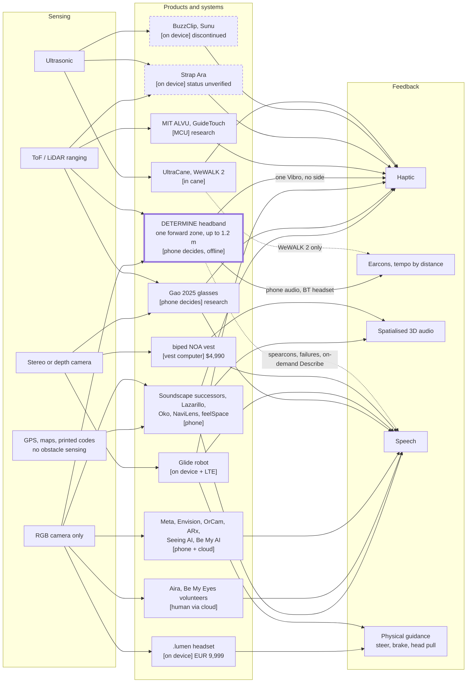
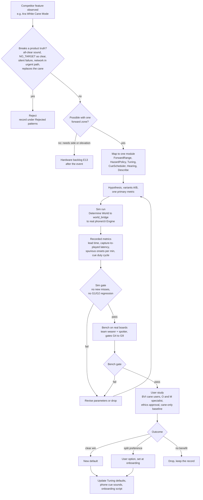
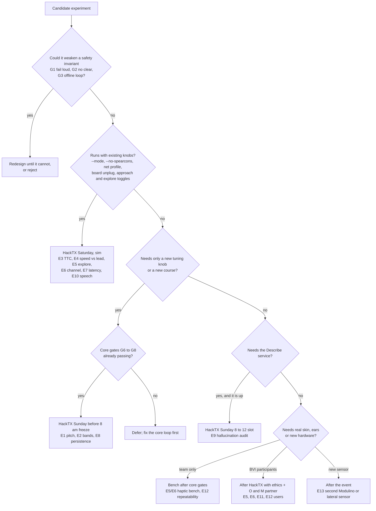

# Competitive landscape → experiments for Determine

> Re-grounded on wire v2 (main 65cfa0c, 2026-10-24). The v1 design this note was first written against (8×8 ToF
> grid, stereo bone conduction on the cue board, left/right regions, 1/2/3 m bands) is superseded.

Research note for Determine World. Sources retrieved **2026-10-24** unless marked. Vendor pages state vendor claims;
prices drift; `[INFERENCE]` marks reasoning that no source states. Nothing here is a Determine measurement.

## 1. Conclusion

Determine is a **hands-free, head-mounted, near-field warning for whatever is straight ahead at head height, used
with the cane, where the phone makes every decision**. Be honest about range first: v2 has ONE forward single-zone
ToF (Modulino Distance, VL53L4ED, ~18° diagonal, vendor maximum up to 1.2 m, usable warning distance unvalidated,
per `protocol/PROTOCOL.md`). That is **shorter** than most ultrasonic competitors (BuzzClip 2 m setting, Sunu up to
14 ft, Glide up to 50 ft) and it cannot tell left from right. At 1.4 m/s, 1.2 m is about 0.86 s of warning before
latency `[INFERENCE: arithmetic]`. Determine therefore does not compete on range or spatial detail. Its
differentiators are elsewhere: **the phone decides** (no network in the urgent path), **calibrated phone audio on a
Bluetooth headset plus a haptic pulse**, **failure is announced** (lost board → board watchdog vibration plus phone
speech; NO_TARGET never reads as clear; UNKNOWN is announced), **camera Describe on demand only**, an **open wire
protocol** with golden vectors, and **low-cost commodity parts** (BOM total deliberately unquoted). Products that
warn hands-free at head height are expensive, heavy or not shipping: biped NOA ($4,990 vest; cut body contacts vs
cane-only in the one controlled BVI comparison we found, n = 13, but 8/13 found it heavy or bulky), .lumen (€9,999,
Romania only), Strap Ara (sale status unconfirmed), GuideTouch (VL53L5CX research scarf). Cane-mounted ultrasonics
(WeWALK 2, UltraCane) take over the cane hand. BuzzClip and Sunu are discontinued; BuzzClip gave no mobility benefit
because its weak, frequent vibration was confused with the cane tip. Camera glasses and apps (Ray-Ban Meta,
Envision, winding down by 31 Dec 2026, OrCam, ARx, Seeing AI, Be My AI, Aira) describe but do not warn, and AFB
documents left/right hallucinations. Orientation apps (Soundscape successors, Lazarillo, Oko, NaviLens) detect no
obstacles. We found no product or paper that designs cues for asymmetric hearing loss; that is absence of
evidence, not a verified gap `[INFERENCE]`. First experiments follow the competitors' failure modes (haptics lost
in the cane signal; BuzzClip-style weak, frequent buzz) and the one v2 limit that matters most: lead time at 1.2 m.
Gao et al. 2025 report under 320 ms end to end for a glasses-plus-phone split; that is the latency bar.

**HackTX rule.** HackTX rules (Architecture §11) say "All work must be done at the event. You can't demo
something you didn't build." The engine, firmware, simulator and Determine World are built at the event; any
experiment here is presented to judges as event-built work, measured numbers only.

**Meta overlap.** Be My Eyes runs on Ray-Ban Meta glasses, and Meta's Wearables Device Access Toolkit (DAT) could
become an alternative camera/audio route for Describe. Neither replaces the forward ToF warning. See
[`meta-fit.md`](meta-fit.md).

## 2. Comparison table

Column key: **Head?** = warns of head/chest-level obstacles. **Compute** = where the hazard or answer is computed.
"None found" = no user study surfaced in this pass, not proof that none exists.

| Product (link) | Status 2026-10-24 | Form factor | Sensing | Head? | Feedback | Compute | Price (source) | User-test evidence | Notable UX decisions |
|---|---|---|---|---|---|---|---|---|---|
| **Determine** ([README](../../README.md), [PROTOCOL v2](../../protocol/PROTOCOL.md)) | Prototype, untested with BVI users; sensor bench-checked 231→28 mm on a hand only | Headband: one forward ToF + ESP32-CAM; XIAO ESP32-C3 cue board | ONE forward single-zone ToF (Modulino Distance, VL53L4ED: ~18° diag, vendor max up to 1.2 m, 15 Hz) + ESP32-CAM JPEG for Describe only | Yes, directly ahead only; no left/right | Phone-synthesised earcons on a Bluetooth headset (integrated bone conduction unresolved), tempo by band (FAR 900–1200, MID 500–899, NEAR <500 mm); one Modulino Vibro, side BOTH; optional spearcons | Phone decides offline; cloud only for on-demand Describe | Modulino Distance + C3 + ESP32-CAM; total unquoted (Arch §12) | None yet | No all-clear; NO_TARGET ≠ clear; fail loud (watchdog LSS + phone speech); per-ear calibrated gain on the phone; range shorter than ultrasonic rivals |
| **biped NOA** ([RealSense case study](https://www.realsenseai.com/case-studies/real-time-guidance-for-the-visually-impaired), [biped FAQ](https://biped.ai/faq)) | Sold via resellers; reseller listing "sold out" | Shoulder vest, ~1.2 kg (user report) | 3× RealSense D430 depth cameras; vendor: 170° FOV | Yes: foot, chest, head | Spatialised audio over bone-conduction headphones; tone conveys chest vs head; GPS speech; generative descriptions on button press | Vest computer `[INFERENCE: obstacle loop on device]`; description path unspecified | $4,990 ([Florida Vision Tech](https://floridareading.com/products/noa)) | [Pittet 2026](https://pmc.ncbi.nlm.nih.gov/articles/PMC12909938/), n=13 BVI: body contacts 1.62 vs 2.92 (cane-only); 12/13 preferred; 8/13 heavy/bulky; 4 could not read the spatialisation. biped CEO is a co-author | App setting to warn only at head/chest level ([AppleVis](https://www.applevis.com/forum/assistive-technology/my-sightcity-impressions-about-noa-mobility-device-biped-ai)) |
| **Glidance Glide** ([product](https://www.glidance.io/product)) | Pilot rollout; waitlist until orders re-open | Two-wheel robot with handle, 4 kg | Dual IR-enhanced stereo depth cameras; ground, overhead and cliff detection; up to 50 ft | Yes (overhead) | Physically steers and brakes; haptic; speaker or BT headset | On device + LTE "fleet-wide model" | $1,499 preorder + $30/month connectivity | Vendor-hosted early-user posts; [AppleVis demo 2024](https://www.applevis.com/forum/assistive-technology/i-drove-glide-my-thoughts). No peer-reviewed trial found | Positioned as a primary aid; when fully blocked, brakes and talks |
| **WeWALK Smart Cane 2** ([product](https://wewalk.io/en/product/)) | Selling | Smart handle on a white cane | Ultrasonic (55° above chest on v1, per [Lighthouse Guild](https://lighthouseguild.org/news/the-white-cane-and-beyond/)) | Yes: chest/head | Vibration and/or audio (user-selectable); voice navigation; Gemini Q&A | Cane + phone; AI in the cloud | $850 package ([reseller](https://floridareading.com/products/wewalk-smart-cane-2), sold out); vendor shows installments, total not displayed | None found | Every control on the cane, no phone in hand; alert channel is user-chosen |
| **UltraCane** ([DLF listing](https://livingmadeeasy.org.uk/product/ultracane), [JAN](https://askjan.org/products/UltraCane.cfm)) | Listed by UK supplier; production status unverified | Electronic long cane | Dual-range narrow-beam ultrasound, 2 transducers | Yes: head/chest + forward | Two vibrating buttons in the handle | On device | From £635 (DLF) | None reviewed | Separate tactile buttons per range |
| **iMerciv BuzzClip** ([AFB review](https://afb.org/aw/18/3/15228)) | Discontinued by maker per Pittet 2026; one reseller still lists it ([Bapin](https://www.bapingroup.com/buzzclip.html)) | Clip-on (clothing or cane) | Single ultrasonic | Waist to head when chest-worn | Vibration; rate and intensity rise, strongest at ~50 cm | On device | $249 | Pittet 2026: no mobility gain; highest frustration; vibration too weak/frequent, confused with the cane tip | 1 m / 2 m range button (indoor/outdoor); sleep after 5–7 s still, wakes on >10 cm change |
| **Sunu Band** ([APH brochure](https://sites.aph.org/files/Annual-Meeting-Brochures/Sunu%20Band-Innovations%20Line-accessible%209-19.pdf)) | Discontinued (Pittet 2026); company ceased 2023 ([Seedtable](https://seedtable.com/companies/sunu), secondary) | Wristband | Ultrasonic, up to 14 ft | Upper body | Wrist haptics | On device | Resale only | None reviewed | Watch form factor; aimed partly at social distance |
| **Strap Tech Ara** ([Lighthouse Guild](https://lighthouseguild.org/news/the-white-cane-and-beyond/), [2020 launch](https://wearable-technologies.com/news/strap-technologies-announces-groundbreaking-hands-free-device-to-replace-cane-for-the-visually-impaired)) | Unverified: strap.tech did not resolve on 2026-10-24 | Mid-torso strap, ~0.35 kg | LiDAR + ultrasonic + IMU | Yes: low, chest, head | Haptic patterns prioritised by size, speed, proximity | On device | $500 intro preorder (2020) | CES hands-on only | **White Cane Mode** damps low-level alerts |
| **feelSpace naviBelt** ([vendor](https://feelspace.de/en/home-page)) | Selling (DE) | Waist belt, 16 motors, 360° | None (phone GPS, compass) | No | Directional vibration; pause and intensity buttons | Phone | Not listed; German health insurance covers with prescription | [Brandebusemeyer et al. 2021](https://pmc.ncbi.nlm.nih.gov/articles/PMC8587958/) | Silent channel "relieves the ears"; ≥8 h battery |
| **.lumen Glasses** ([vendor](https://www.dotlumen.com/glasses)) | Orders; ships only in Romania, 3–6 months; Japan pilot ([TMF](https://www.dotlumen.com/post/lumen-toyota-mobility-foundation-pilot-in-japan)) | Head-worn headset | Cameras + on-board AI; sensor details not published | Yes ("above or below the ground") | Forehead haptics that "pull your head" | On device | €9,999 incl. VAT | Vendor: "400+ users, 40 countries"; no independent trial found | Guides rather than warns; "better than the guide dog" is unvalidated marketing |
| **Envision Glasses / Ally Solos** ([status post](https://www.letsenvision.com/blog/all-we-had-as-far-as-we-could)) | **Winding down**: development stops 31 Dec 2026 without a partner; final offline update promised | Camera smart glasses | RGB camera | No | Speech | Phone/cloud; offline subset promised | Ally Solos $699 (Arch §3, 24 Oct, not rechecked) | None reviewed | Business-model lesson: hardware sales did not sustain the company |
| **OrCam MyEye 3 Pro** ([vendor](https://www.orcam.com/en-us/orcam-myeye-3-pro)) | Selling | 22.5 g clip-on, 13 MP | RGB camera | No | Speech | On device; "Just Ask" uses outside information | $4,250 ([reseller](https://nelowvision.com/product-category/low-vision-products/wearables/)) | None reviewed | Gesture, voice, touch-bar triggers |
| **ARx AI Gen1.5** ([vendor](https://arx.vision/products/arx-ai-gen1-5)) | Selling | 95 g headset; wired to phone; **no battery** | RGB camera (Sony IMX179) | No | Bone-conduction speech | Phone; Q&A online, short text offline | $599 sale ($799 list) | Distributor demo ([Vision Australia](https://www.visionaustralia.org/why-get-arx-ai-headset)) | Closest "dumb head, phone decides" hardware, but with no ranging |
| **Ray-Ban Meta Gen 3 + Meta AI / Be My Eyes** ([Meta](https://www.meta.com/ai-glasses/blind-visually-impaired/)) | Selling | Camera glasses, open-ear speakers | 12 MP RGB | No | Speech; hands-free volunteer calls; Live AI | Phone + cloud | From $449 ([Meta store](https://www.meta.com/ai-glasses/ray-ban-meta/)) | [AFB review](https://afb.org/aw/fall2025/meta-glasses-review): "accessibility tool only by coincidence"; placed a lamp on the wrong side; not fit for street crossings | "Detailed Responses" verbosity switch |
| **Be My AI** ([help](https://support.bemyeyes.com/hc/en-us/articles/18133134809105-Using-Be-My-AI)) | Selling (free) | Phone app | Phone camera (still photo) | No | Speech/text; volunteer fallback | Cloud (OpenAI); **needs internet** | Free | None reviewed | "Call a sighted volunteer" from any answer; tells users not to rely on it for medicine or safety; not supported on wearables |
| **Seeing AI** ([site](https://www.seeingai.com/)) | Selling (free) | Phone app | Phone camera | No | Speech | Not stated on vendor page | Free | None reviewed | Task "channels" (text, scene, products) |
| **Aira** ([plans](https://aira.io/subscriptions/)) | Selling | Phone app (+ Meta glasses) | Phone/glasses camera to a human agent | Agent-dependent | Live human speech | Human + cloud | $26/mo (20 min) to $1,160/mo; free at partner sites | None reviewed | Trained interpreters; minute-metered |
| **Microsoft Soundscape → VoiceVista / Soundscape (STA) / Soundscape Community** ([MS](https://www.microsoft.com/en-us/research/product/soundscape/), [VoiceVista](https://drwjf.github.io/vvt/index.html), [STA](https://github.com/Scottish-Tech-Army/Soundscape), [Community](https://apps.apple.com/us/app/soundscape-community/id6449701760)) | MS retired it (open-sourced Jan 2023); successors active, iOS | Phone app + headphones | GPS, map data | No | 3D audio beacons, callouts | Phone | Free | None reviewed | Callout rate rises near the beacon "like a radar"; per-callout **enqueue vs interrupt** setting |
| **NaviLens** ([vendor](https://www.navilens.com/en)) | Deployed (MTA, EMT Madrid…) | Phone app + printed codes | Phone camera reads colour codes; vendor: up to 100 ft, 160° | No | Speech | Phone | Free to users | Transit deployments, not trials | Detects without precise aiming |
| **Lazarillo** ([Play](https://play.google.com/store/apps/details?id=com.lazarillo)) | Selling (free) | Phone app | GPS + indoor maps | No | Speech | Phone + cloud maps | Free | None reviewed | Venues pay for indoor maps |
| **Oko** ([App Store](https://apps.apple.com/us/app/oko-cross-streets-and-maps/id1583614988)) | Selling; developer now Polara Engineering | iPhone app | Phone camera (walk signal) + GPS | No | Haptic, audio, colour; countdown | Phone | Free (subscription added Jan 2025, then removed) | Apple Design Award 2024; reviews | Speaks up when the signal changes state; the subscription backlash is on record |
| **MIT ALVU** ([Katzschmann 2018](https://dspace.mit.edu/handle/1721.1/115073)) | Research | Waist sensor belt + haptic strap | Array of ToF sensors | Yes: low and high-hanging | Abdomen haptics | On device | n/a | 12 blind users, 162 trials | Distances mapped to a vibration array |
| **GuideTouch** ([Kozlov 2026](https://arxiv.org/html/2601.13813v1)) | Research | Shoulder scarf, <500 g, est. $100 | **2× VL53L5CX**, 30° apart (90° vertical FOV), ESP32 | Yes: knee to head | 4 shoulder/chest motors; "parking sensor" | On device (ESP32) | n/a | 22 sighted: 92.9% correct for 1–2-motor patterns vs 78.4% when 3–4-motor patterns are included; 14 VI: 93.75%; 28 VI interviews ranked head-level hazards most dangerous | Self-cleaning optical cover; drop alarm |
| **Gao et al. WOAD** ([Nat Commun 2025](https://pmc.ncbi.nlm.nih.gov/articles/PMC11933268/)) | Research | ~400 g glasses + **smartphone** | IR camera + ToF, 0.1–5 m, FPGA compression | Yes | 3 motors (forehead + temples): 200 Hz <3 m, 150 Hz >3 m; audio hazard levels | **Phone decides**; glasses compress | n/a | 12 VI, 7 months; E2E <320 ms; users accepted false alerts (snow, shadows) as the price of safety | Closest architecture to Determine |
| **CMU BBeep / CaBot** ([BBeep CHI'19](https://dl.acm.org/doi/10.1145/3290605.3300282), [CaBot](https://www.cs.cmu.edu/~NavCog/cabot.html)) | Research | Suitcase | RGB-D camera; detects, tracks and predicts pedestrians | Partly | Sonic alert for the traveller and nearby pedestrians (per title) | Not re-read in this pass | n/a | Not re-read in this pass | Sound aimed at bystanders, not only the wearer |
| **Hu et al. sonification** ([Sensors 2020](https://pmc.ncbi.nlm.nih.gov/articles/PMC7309097/)) | Research | Depth camera ETA | Depth camera | — | Depth-image vs obstacle vs path sonification | — | n/a | 12 VI: no single method best for everyone; users need time to choose | Supports user-selectable cue sets |

## 3. Feature patterns worth testing, mapped to Determine v2

Modules are the current `phone/core` packages: `range/ForwardRange`, `policy/HazardPolicy`, `cue/CueScheduler`,
`hearing`, `describe`, and the runtime knobs in `Tuning.kt`.

| # | Pattern (seen in) | Determine module | Fits product truths? | Experiment |
|---|---|---|---|---|
| P1 | Leave low obstacles to the cane (Ara White Cane Mode; NOA head/chest-only setting) | No row mask in v2: the single ~18° zone is aimed by **head-band pitch** | Yes; aim is physical, so it must be fitted and explained | E1 |
| P2 | Range presets per setting (BuzzClip 1 m indoor / 2 m outdoor) | `Tuning.nearMm/midMm/farMm` (500/900/1200; capped by the 1.2 m envelope) | Yes, within 1.2 m only | E2 |
| P3 | Priority by approach speed, not only distance (Ara: size, speed, proximity; Gao: hazard levels) | `Tuning.approachEnabled` (EXPERIMENTAL, off): one-band escalation when TTC < 1.5 s at ≥ 300 mm/s | Yes; never drops a NEAR | E3 |
| P4 | Repetition rate encodes distance (BuzzClip; GuideTouch "parking sensor"; VoiceVista "radar" callouts) | `Tuning.far/mid/nearPeriodMs` (1000/400/200); `Tuning.exploreEnabled` pulse train (EXPERIMENTAL) | Already the core metaphor | E5 |
| P5 | At most 1–2 motors; frequency or rate for distance (GuideTouch; Gao 200/150 Hz) | One Modulino Vibro plays `max(haptic_l, haptic_r)`; patterns PULSE40/60/BUZZ150/LSS | Rate and intensity only; no lateral haptic | E5, E6 |
| P6 | Strong and sparse beats weak and frequent (BuzzClip failure in Pittet 2026) | PROFILE `haptic_max`; `Tuning.exploreMinIntensity` | Yes; the 120 ms explore train is the risk case | E5, E6 |
| P7 | Precise clock-face phrasing beat generative phrasing for locating a target (Pittet 2026, NOA DL vs AI) | `describe` | Partly: the v2 ToF has no bearing, so Describe must not invent positions | E9 |
| P8 | Separate tone for head vs chest (NOA) | Not possible with one zone | Deferred to a second sensor | E13 |
| P9 | Sleep when stationary, wake on change (BuzzClip) | `HazardPolicy` repeat suppression | Only if onsets still fire and the user knows the rule; must never read as "clear" | E11 |
| P10 | "Fully blocked" brake + announce (Glide) | Needs lateral sensing | Deferred to a second sensor | E13 |
| P11 | Enqueue vs interrupt for speech (VoiceVista) | `CueScheduler` interrupt flag; spearcon queue | Yes; speech must never pre-empt NEAR (G6) | E10 |
| P12 | Human fallback offered beside AI answers (Be My AI, Aira) | `describe` failure text in app UI | Yes; outside the hazard loop | E9 |
| P13 | Glasses compress, phone decides, <320 ms (Gao WOAD) | `ingest`, `clock`; ToF path separate from camera | Yes; matches ADR-001 | E7 |
| P14 | Phone-powered headset, no battery on the head (ARx) | Hardware | Hardware option for later | — |
| P15 | Per-ear loudness calibration | `hearing/CalibrationSession`, `HearingProfile` (phone → BT headset; not on iOS yet) | Determine-only in this survey; sets audibility per ear, not obstacle side (obstacle cues are side BOTH) | E12 |

Rejected patterns: periodic reassurance or "way is clear" sounds (violates G2/ADR-007), including treating NO_TARGET
as clear. Generative navigation (AFB lamp error; 22.2% wrong answers in Arch [30]). Positioning as a cane
replacement (Glide, the 2020 STRAP launch, .lumen copy). An LTE/fleet dependency or subscription gate in the safety
path (Glide connectivity plan, the Oko subscription backlash). Auto-describe while walking (Arch §7.3 "never
automatically"). Labelling the ToF reading with a camera object such as "person" (PROTOCOL v2: the zone is never
associated with a camera object by identity). Left/right obstacle cues from one zone.

## 4. Experiment backlog

Every simulator run uses Determine World → `tools/sim/world_bridge.py` → real `phone/cli` Engine, or
`tools/sim/e2e.py` scenarios (`approach_centre`, `person_ahead`, `glass_unknown`, `approach_then_unknown`,
`cue_board_dropout`, `cam_dropout`, `wifi_jitter`, `idle_open_space`, `hover_boundary`). Metrics available today:
bridge `alert` (with `distMm`), `audio`, `cueTx`, `played` (status, `lateUs`, `src`), `speak`, `state` and `diag`
(`range_mm`, `range_status`, `closing_mm_s`, `approach`, `exploring`) per `world/src/contract.ts`. Knobs today:
bridge `--mode`/`--ceiling`, World `setNet`, board unplug, and `EngineTuning {approach, explore}`. **Not exposed
yet:** band thresholds, periods and `bandEnterMs` (in `Tuning`, but not in `EngineTuning` or the cli), and a run
recorder joining world ground truth (true distance to the surface hit) with `played` timestamps. Bluetooth headset
latency is outside every simulator. Effort: S < 2 h, M ≈ half day, L = multi-day or needs participants. Any run at
HackTX is on event-built code (§1).

| ID | Experiment | Module | Effort | When |
|---|---|---|---|---|
| E1 | Head pitch of the single zone | Hardware fit, ForwardRange | S / L | **HackTX** sim + bench |
| E2 | Band thresholds within 1.2 m | Tuning bands | S (+ knob) | **HackTX** sim if the knob lands; else after |
| E3 | TTC approach escalation A/B | `Tuning.approachEnabled` | S | **HackTX** (sim, runs today) |
| E4 | Walking speed vs warning lead time at 1.2 m | HazardPolicy, latency | S | **HackTX** (sim, runs today) |
| E5 | Explore pulse train vs band cues | `Tuning.exploreEnabled` | S / L | **HackTX** sim + team bench; users after |
| E6 | Haptic-only vs audio + haptic | Hearing mode, CueScheduler | S / L | **HackTX** sim + team bench; users after |
| E7 | Latency budget (Wi-Fi + BT headset) | Ingest, ClockSync, CUE TTL | S | **HackTX** (sim now; BT on hardware) |
| E8 | Band persistence (`bandEnterMs`) | Tuning | S (+ knob) | After unless the knob lands |
| E9 | Describe hallucination audit against world ground truth | Describe, cloud/describe-api | M | **HackTX** if Describe is up; else after |
| E10 | Speech load: spearcons on/off, enqueue vs interrupt | CueScheduler | S | **HackTX** (sim); users after |
| E11 | Stationary (queue) repeat suppression | HazardPolicy | M | After |
| E12 | Per-ear calibration benefit and repeatability | CalibrationSession, HearingProfile | S / L | Bench with a headset; users after |
| E13 | Second Modulino or lateral sensor | Hardware, wire v3 | L | **After the event** |

**E1 Head pitch.** Source: P1. *Hypothesis:* with the axis level at 1.6 m, the 9° half-angle cone spans only about
±0.19 m at 1.2 m, so a head-height sign is seen only inside that band, and a few degrees of head-down pitch
(looking at a phone, stairs) can lose it `[INFERENCE: geometry]`. The floor never enters the cone within 1.2 m
unless pitch exceeds ~44° down `[INFERENCE: geometry]`, so low clutter stays cane territory. *A:* 0°. *B:* −10°.
*C:* +5°. *Metric:* first-onset distance on a head-height sign; miss rate; onsets from waist-height objects. *Sim:*
World head pitch on the approach course (needs a pitch field: `WearerPose` in `contract.ts` has none). *Bench:* team
wearer, tape-measured sign. *Risk:* fit drift; users must be told the sensor sees a narrow cone, not "everything ahead".

**E2 Band thresholds within 1.2 m.** Source: P2. *Hypothesis:* moving FAR's start from 900 to 800 mm lowers
FAR→MID churn at walking pace without delaying NEAR. *A:* 500/900/1200 (default). *B:* 400/800/1200. *C:*
600/1000/1200. *Metric:* lead time at NEAR onset, band changes per approach. *Sim:* needs band fields in
`EngineTuning` (contract change) or a cli flag. *Risk:* the 1200 mm vendor limit is unvalidated; bands near it may be
noise-dominated.

**E3 TTC approach escalation.** Source: P3. *Hypothesis:* `approachEnabled` (TTC < 1500 ms at ≥ 300 mm/s, least
squares over 300 ms) raises the cue one band earlier at 1.2–1.6 m/s with no extra escalations when standing still.
*A:* off (default). *B:* on. *Metric:* time from first MID-or-higher cue to contact; escalations on
`idle_open_space` and `hover_boundary`; `diag approach` share. *Sim:* World `setTuning {approach}` today. *Risk:*
head bob makes closing speed noisy; escalation stays EXPERIMENTAL and off until this passes.

**E4 Walking speed vs lead time.** Source: the v2 range limit. *Hypothesis:* lead time ≈ (1.2 m − v · (latency +
150 ms band entry)) / v: about 0.55 s at 1.4 m/s and 0.45 s at 1.6 m/s with 150 ms latency `[INFERENCE: arithmetic,
not measured]`. *A:* 0.6, 1.0, 1.4, 1.6 m/s. *Metric:* seconds from first played cue to contact; distance at NEAR.
*Sim:* scenario `speed` and the World wearer speed. *Use:* sets an honest demo pace and the pitch sentence on range.

**E5 Explore pulse train.** Source: P4, P6, BuzzClip failure. *Hypothesis:* the distance-proportional train
(PULSE40 every 120 ms, intensity rising as range falls, no audio) gives better distance estimates than three bands
but is harder to separate from cane-tip vibration. *A:* band cues. *B:* `exploreEnabled`. *Metric:* distance-estimate
error; false "felt cue" reports while sweeping a cane; `played` duty cycle. *Sim:* World `setTuning {explore}`.
*Risk:* the BuzzClip finding (weak and frequent) applies directly; one Vibro has no side.

**E6 Haptic-only vs audio + haptic.** Source: P5, P6. *Hypothesis:* the single Vibro alone keeps NEAR detection but
loses band accuracy against headset audio plus haptic. *A:* `--mode STEREO`. *B:* `--mode HAPTIC_ONLY`. *Metric:*
band accuracy, reaction time, cane confusion. *Sim:* check every obstacle `cueTx` is side BOTH and HAPTIC_ONLY emits
no `audio`. *Bench:* team wearer with spotter. *Risk:* skin contact varies with fit (GuideTouch saw participant
effects).

**E7 Latency budget.** Source: P13 (Gao < 320 ms), Arch §6.3. *Hypothesis:* `wifi_jitter` keeps capture→played p95
under 250 ms and costs < 35 cm of lead at 1.4 m/s, which is ~30% of the 1.2 m envelope. Bluetooth headset audio adds
a further delay that no simulator models `[INFERENCE]`. *A:* `clean`. *B:* `wifi_jitter`. *Metric:* p50/p95
`lateUs`, share of `EXPIRED`. *Hardware:* audio onset vs haptic onset with a microphone and an accelerometer.

**E8 Band persistence.** Source: Gao (false alerts accepted), Arch §10 fatigue. *Hypothesis:* `bandEnterMs` 100 vs
150 moves NEAR onset ~7 cm earlier at 1.4 m/s but raises spurious onsets under noise. *Metric:* spurious onsets/min
on `idle_open_space`; first-onset distance. *Needs:* the knob exposed and a ToF noise model.

**E9 Describe hallucination audit.** Source: AFB lamp error, Pittet DL > AI for locating, P12. *Hypothesis:* the
current prompt (two sentences, surroundings first, no positions) has a lower left/right error rate than one asking
for positions. *A:* current. *B:* "give positions". *C:* A plus "do not state left, right or distances". The ToF
reading is never appended (no bearing; no camera-object association). *Metric:* object hallucination and side error
rate scored against the World object list; p50/p95 time by backend (`timings`, `backend`, `silicon`). *Risk:*
rendered scene ≠ real images; label results "sim". Never on the urgent path.

**E10 Speech load.** Source: P11, May & Walker masking (Arch [52]). *Hypothesis:* spearcons add ≤ 15% cue-on time on
`approach_centre` and `person_ahead` and never delay a NEAR earcon. *A:* default. *B:* `--no-spearcons`. *Metric:*
cue-on duty cycle (`audio` + `speak`), NEAR delay behind speech. *Risk:* Android TTS latency differs.

**E11 Stationary suppression.** Source: P9. *Hypothesis:* in a queue (person static at 0.8 m for 20 s), one repeat
per 5 s after 5 s unchanged cuts cues > 70% without delaying a new onset. *Risk:* the cue board has no IMU; motion
must come from ToF change or the phone IMU `[INFERENCE]`. Users must learn that fewer repeats ≠ clear.

**E12 Calibration benefit.** Source: P15 (no competitor). *Hypothesis:* in asymmetric hearing loss, calibrated
per-ear headset gain makes cues audible in both ears within the ceiling, and repeat calibrations land within ±3 dB
(G5). Obstacle side is not tested: v2 obstacle cues are side BOTH. *Bench:* team repeatability only. *Risk:* not
audiometry; the headset choice is unresolved and iOS has no calibration yet.

**E13 Second sensor (after the event).** Source: P8, P10, GuideTouch's two VL53L5CX. *Hypothesis:* a second
Modulino Distance angled 20–30° to one side or up, or a multizone part, restores a lateral or elevation cue.
*Needs:* a wire change (RANGE carries one reading), firmware, and a second I²C address or the unused TCA9548A.
Not a HackTX claim.

## 5. Diagrams

### 5a. Landscape: sensing → product → feedback (compute in brackets)

Only Determine, NOA, Glide, .lumen, Ara and the research rigs connect a ranging sensor to a warning channel without
occupying the cane hand. Of those, Determine and Gao's WOAD put the decision on the phone; Determine has the
shortest, narrowest sensor of the group. Dashed borders mark discontinued or unverified products.

### 5b. From competitor feature to Determine experiment

The simulator removes bad ideas cheaply and measures timing honestly against the real engine. It cannot establish
perception, comfort or benefit. Only the user stage can, and no Determine result reaches the pitch before then.

### 5c. Which experiments run first

The order follows risk to the demo first, then cost. Anything that could touch fail-loud or offline behaviour is
redesigned before it is run. Experiments that need people are never claimed at HackTX, and every HackTX run is on
event-built code under the "all work must be done at the event" rule.

## 6. Sources

Retrieved 2026-10-24 unless noted. Arch = `Determine-Architecture.html`.

Products:
- biped NOA: https://biped.ai/faq (vendor FAQ text seen in a search index; the direct fetch returned HTTP 404) ·
  RealSense case study https://www.realsenseai.com/case-studies/real-time-guidance-for-the-visually-impaired ·
  reseller https://floridareading.com/products/noa · AppleVis user report
  https://www.applevis.com/forum/assistive-technology/my-sightcity-impressions-about-noa-mobility-device-biped-ai
- Glidance Glide: https://www.glidance.io/product · early-user post
  https://www.glidance.io/news/lets-glide-what-an-ai-guide-does-that-my-cane-cant-guest-post · AppleVis
  https://www.applevis.com/forum/assistive-technology/i-drove-glide-my-thoughts
- WeWALK: https://wewalk.io/en/product/ · https://wewalk.io/en/checkout/ ·
  https://floridareading.com/products/wewalk-smart-cane-2
- UltraCane: https://askjan.org/products/UltraCane.cfm · https://livingmadeeasy.org.uk/product/ultracane
- BuzzClip: https://afb.org/aw/18/3/15228 · https://www.bapingroup.com/buzzclip.html
- Sunu Band: https://sites.aph.org/files/Annual-Meeting-Brochures/Sunu%20Band-Innovations%20Line-accessible%209-19.pdf
  · https://seedtable.com/companies/sunu
- Strap Tech Ara: https://lighthouseguild.org/news/the-white-cane-and-beyond/ ·
  https://wearable-technologies.com/news/strap-technologies-announces-groundbreaking-hands-free-device-to-replace-cane-for-the-visually-impaired
  · https://strap.tech/ (DNS failure on 2026-10-24)
- feelSpace: https://feelspace.de/en/home-page · https://pmc.ncbi.nlm.nih.gov/articles/PMC8587958/
- .lumen: https://www.dotlumen.com/glasses ·
  https://www.dotlumen.com/post/lumen-toyota-mobility-foundation-pilot-in-japan
- Envision: https://www.letsenvision.com/blog/all-we-had-as-far-as-we-could · https://shop.letsenvision.com/collections/solos
- OrCam: https://www.orcam.com/en-us/orcam-myeye-3-pro ·
  https://nelowvision.com/product-category/low-vision-products/wearables/
- ARx: https://arx.vision/products/arx-ai-gen1-5 · https://www.visionaustralia.org/why-get-arx-ai-headset ·
  https://www.visionaid.co.uk/arxvision
- Meta / Be My Eyes: https://www.meta.com/ai-glasses/blind-visually-impaired/ ·
  https://www.meta.com/ai-glasses/ray-ban-meta/ · https://afb.org/aw/fall2025/meta-glasses-review
- Be My AI: https://support.bemyeyes.com/hc/en-us/articles/18133134809105-Using-Be-My-AI
- Seeing AI: https://www.seeingai.com/
- Aira: https://aira.io/subscriptions/
- Soundscape and successors: https://www.microsoft.com/en-us/research/product/soundscape/ ·
  https://drwjf.github.io/vvt/index.html · https://github.com/Scottish-Tech-Army/Soundscape ·
  https://apps.apple.com/us/app/soundscape-community/id6449701760
- NaviLens: https://www.navilens.com/en
- Lazarillo: https://play.google.com/store/apps/details?id=com.lazarillo
- Oko: https://apps.apple.com/us/app/oko-cross-streets-and-maps/id1583614988

Research:
- Pittet et al., "Efficacy of electronic travel aids for the blind and visually impaired during wayfinding",
  Sci Rep 16:6423 (2026). https://pmc.ncbi.nlm.nih.gov/articles/PMC12909938/
- Katzschmann, Araki, Rus, "Safe Local Navigation for Visually Impaired Users With a Time-of-Flight and Haptic
  Feedback Device", IEEE TNSRE (2018). https://dspace.mit.edu/handle/1721.1/115073
- Kozlov et al., "GuideTouch: An Obstacle Avoidance Device for Visually Impaired", arXiv:2601.13813 (2026).
  https://arxiv.org/html/2601.13813v1
- Gao et al., "A wearable obstacle avoidance device for visually impaired individuals with cross-modal learning",
  Nat Commun 16:2857 (2025). https://pmc.ncbi.nlm.nih.gov/articles/PMC11933268/
- Kayukawa et al., "BBeep: A Sonic Collision Avoidance System for Blind Travellers and Nearby Pedestrians",
  CHI 2019. https://dl.acm.org/doi/10.1145/3290605.3300282 · CaBot https://www.cs.cmu.edu/~NavCog/cabot.html
- Hu, Wang, Yang, Cheng, "A Comparative Study in Real-Time Scene Sonification for Visually Impaired People",
  Sensors (2020). https://pmc.ncbi.nlm.nih.gov/articles/PMC7309097/
- Xu, Song, Wang, "Intelligent Head-Mounted Obstacle Avoidance Wearable for the Blind and Visually Impaired",
  Sensors (2023). https://pmc.ncbi.nlm.nih.gov/articles/PMC10708878/
- STMicroelectronics VL53L5CX datasheet (GuideTouch's sensor; Determine v1 only).
  https://www.st.com/resource/en/datasheet/vl53l5cx.pdf
- Determine v2 sensor facts (VL53L4ED, ~18° diagonal, up to 1.2 m, status mapping) are taken from
  `protocol/PROTOCOL.md` and `README.md` at main 65cfa0c, not re-derived from ST datasheets here.
- Cited via Arch §2.4/§16 (not re-read here): Brewster earcon guidelines
  https://www.dcs.gla.ac.uk/~stephen/papers/HCI95.pdf · Walker spearcons https://pubmed.ncbi.nlm.nih.gov/23516800/ ·
  May & Walker bone-conduction masking https://pubmed.ncbi.nlm.nih.gov/28237013/ · Gonzalez et al. MLLM diary study
  https://arxiv.org/abs/2602.13469
