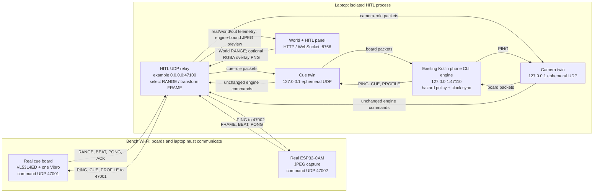
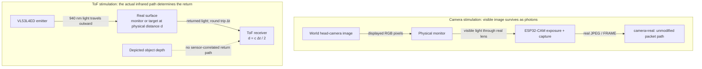

# Hardware in the loop: what is real, what is injected, and what the bench can prove

**Status: implemented software integration; no physical end-to-end HITL validation yet.** No boards were attached for this work. The firmware READMEs contain earlier, separate component bring-up observations; those are not a successful run of the World → real boards → engine → physical warning loop. This document reports code behavior and vendor specifications, not new hardware measurements.

This guide is for an engineer who knows basic networking and electronics and wants to connect the existing Determine World to the purchased cue and camera boards. It explains where to inject a virtual obstacle, why a monitor works for the camera but not as a virtual-distance source for ToF, how to run an isolated bench, and which timestamps support which claims. Physics and cited specifications are distinguished from repository behavior; **[INFERENCE]** marks an engineering prediction that still needs a bench measurement.

## 1. What does putting the hardware “in the loop” actually retain?

In the ordinary simulator, software boards emit protocol packets. In HITL, the **real XIAO ESP32-C3 cue board** emits RANGE/BEAT/PONG/ACK and the **real ESP32-CAM** emits FRAME/BEAT/PONG. The bridge forwards these to the existing Kotlin phone CLI engine. The engine still decides hazards; the browser supplies a scene, not a replacement warning policy.

The real cue board retains its clock, Wi-Fi timing, deadline checks, haptic scheduling, watchdog and physical Modulino Vibro. The purchased Distance module identifies as **VL53L4ED**, not the older assumed VL53L4CD. There is **one forward ToF zone and one motor**: neither can establish a left/right obstacle direction. The module/driver identification and wiring evidence live in the [cue firmware README](../../firmware/cue-board/README.md); capture configuration and power requirements live in the [camera firmware README](../../firmware/cam-board/README.md).

The experiment boundary depends on the selected modes:

| Experiment | RANGE mode | Camera mode | What crosses the physical sensor boundary? | What this does not validate |
|---|---|---|---|---|
| Unmodified hardware baseline | `real` | `real` | Real target returns and real camera photons | Virtual scenarios unless physically staged |
| Virtual proximity injection | `world` or `fuse` | `real` | ToF still runs, but selected distance/status is changed after sensing | Optical ToF response to the virtual object |
| Digital camera augmentation | Any | `composite` | Real camera capture, with virtual pixels added on the laptop | Camera exposure/focus response to those added pixels |
| Monitor camera stimulation | Any | `real` | Camera photographs the rendered scene on a physical monitor | Real scene depth, outdoor appearance, or ToF depth of depicted objects |
| Physical ranging experiment | `real` | Either, recorded explicitly | ToF illuminates a real target at a measured position | A mechanically synchronized scene unless separately implemented |

Why keep both injection and stimulation? Packet injection makes a repeatable virtual obstacle available while exercising real board communications and actuation. Physical stimulation tests the sensor's front end too, but introduces optics, displays or target mechanics that must be measured. Neither is a substitute for the other.

## 2. Where do the packets go?

Figure 1 follows the two UDP directions. Pay attention to the *twin sockets*: the engine learns a stable loopback endpoint for each real board role, while the relay knows the physical board address.



*Figure 1. The relay changes selected sensor content, not ownership of decisions or board clocks. Ports shown are an isolated bench example; the physical board command ports remain 47001/47002. Source: browser contract, relay implementation and firmware READMEs; topology schematic, not a measured timing diagram.*

With `--hitl`, the bridge does **not** start the simulated LiveRig boards. Mixing a simulated and real board for one role would give the engine competing identities and undermine the experiment. Current HITL uses a locally spawned engine; it is not the external-phone `--phone` path.

By default firmware sends telemetry to the Wi-Fi gateway on UDP **47000**. This works when the laptop is the hotspot gateway. If a phone/router is the hotspot, its gateway address is **not** the laptop: use the HITL firmware destination override. Merely binding a laptop socket cannot redirect packets already addressed to the gateway. Access-point client isolation or firewall rules can also prevent board-to-laptop traffic.

Board roles are learned from packet content: BEAT board identity, RANGE/ACK for cue, FRAME for camera, and known source address for PONG. Optional `--hitl-cue IP` / `--hitl-cam IP` restrict discovery to specified IPv4 addresses; these pins are not authentication. Use a trusted bench network, not a public UDP exposure.

### Which data are allowed to change?

RANGE rewriting retains its real packet sequence and board timestamp; only `mm`/`status` change. Engine commands, clock-sync exchanges and other real board packets pass through. Camera `real` forwards original FRAME datagrams; `composite` preserves frame identity, capture timestamp and dimensions while replacing the JPEG and rebuilding chunks of at most 1400 payload bytes. Transformed chunk sequences begin at the original first chunk's sequence.

A real board must actually transmit to drive the loop. A continuing browser scene does not cause replacement heartbeats, readings or frames to be manufactured for a silent board. Thus an unplugged board remains an outage rather than becoming a healthy virtual board.

## 3. Why can a monitor stimulate the camera but not spoof ToF depth?

**Predict first:** show a picture of a sign “500 mm ahead” on a monitor physically 1000 mm from both sensors. Should both sensors report the depicted sign at 500 mm?

No. A camera samples the light pattern arriving through its lens. The monitor emits a two-dimensional pattern that can resemble the rendered head-camera view, so the real camera can expose, capture and JPEG-encode it. The ToF sensor instead emits its own invisible **940 nm** light and estimates distance from the returning light's travel time [1, 2]. Drawing a perspective picture does not change that return path.

The generic direct-ToF relation in ST's explanation is `d = c Δt / 2`: light travels to the target **and back**, hence the factor of two [2]. Here `c` has units m/s and round-trip delay `Δt` has units s, producing distance in m. A zero-delay ideal return gives zero distance; a target at 1 m gives a round trip of about **6.67 ns** (calculated from `c = 299792458 m/s`, not measured here). Monitor refresh and pixel color do not encode the sensor-correlated nanosecond return needed to put an apparent reflector at a chosen distance.

Figure 2 contrasts the paths. The same monitor may return the ToF emitter's infrared from its physical surface, transmit some light toward a background, or give an unusable return; it does not make the rendered depth physically present.



*Figure 2. A display substitutes the camera's incoming image, not the ToF emitter-to-target path. Sources: ST's ToF principle and VL53L4ED specification [1, 2]; optical schematic, not to scale.*

**Misconception:** “Because the camera sees a virtual obstacle, the distance sensor should see it too.” The temptation comes from equating visual perspective with physical depth. The correct model is two different measurements of two different incoming signals. Ordinary monitor imagery cannot provide arbitrary ToF depth. This is not a claim that all specialized optical sensor emulators are impossible: a synchronized infrared return emulator would be a separate instrument, with timing, spectral, power and eye-safety requirements. It is not implemented here. Do not point external lasers at the receiver or modify the module's optics to improvise one.

### How is the camera monitor mode used?

Open the main World page and a **same-origin** second window at `?view=camera`, then put the latter fullscreen on the monitor facing the camera. The main page broadcasts course time, virtual target settings and the course-overlay toggle over `BroadcastChannel`; different origins/browser contexts do not share that channel. The camera view renders at display resolution with four corner fiducials and an animation-frame counter.

Select camera **`real`**, not `composite`, for this experiment. Otherwise virtual pixels could be photographed once and added digitally a second time. Position the camera so the fiducials and counter are legible in the real engine-bound preview; the counter helps reveal a frozen rendering or capture path but is not a calibrated exposure timestamp.

**[INFERENCE]** Display pixel grids sampled by the camera can produce moiré; display modulation combined with sequential sensor exposure can produce brightness bands or flicker. Basler explains spatial grid interference and mitigation [4], and line-by-line rolling-shutter exposure [5]. Inspect the actual JPEGs while changing distance, focus, angle, brightness and refresh settings one at a time. Record these settings instead of assuming a clean monitor view represents a real scene. The screen also cannot reproduce motion parallax, real object depth, outdoor infrared illumination, or the dynamic range of every physical scene.

## 4. How are virtual measurements injected without hiding their origin?

### RANGE: real, world, or conservative fusion?

The browser sends its forward raycast over the existing `range` message. For selection, World data must be no more than **500 ms** old according to bridge receipt time, not a claimed cross-device synchronization of scene time and sensor exposure.

| Mode | Output at each real RANGE arrival |
|---|---|
| `real` | Original real reading |
| `world` | Fresh World distance/status replaces real distance/status, including real UNKNOWN; stale/missing World falls back to real |
| `fuse` (default) | Fresh World **VALID** wins if real is NO_TARGET, or if both are VALID and World is nearer; otherwise real wins |

In `fuse`, a real **UNKNOWN stays UNKNOWN**, a tie retains real, and a World UNKNOWN does not invent a nearer valid obstacle. A stale World sample falls back to real with source `real-stale-world`; an output selected from World is labeled `world`. Non-VALID wire readings carry `mm = 0`, which means no usable distance, **not zero-distance contact**. NO_TARGET means no target reported within the sensor's usable observation, never “path clear.” UNKNOWN is an unusable reading, not a far target.

For example, real VALID 1000 mm plus fresh World VALID 400 mm yields World 400 mm in `fuse`; real UNKNOWN plus that same virtual obstacle remains UNKNOWN. This deliberate asymmetry permits a virtual nearer obstacle but does not let a healthy-looking scene erase a failed physical sensor. `world` is the explicit override for packet-level experiments and must be labeled accordingly.

The panel exposes real, World and output readings, World age, selected source, board address/age/RSSI/faults, camera counters and the engine-bound JPEG preview. Mode controls send a request; the displayed mode follows bridge telemetry, not the operator's unconfirmed choice. A visible old preview is not proof of a live camera: check age, frame rate and changing image content.

### What is the head-locked virtual target?

The target is a thin box kept straight ahead of the simulated brow sensor. Controls set its near-face distance **30–1300 mm**, width/height **20–3000 mm**, and white/grey/glass preset; it starts off. It is both a ToF collider and an overlay mesh. It moves with the simulated head, so it is a repeatable stimulus, not a stationary real-world obstacle that the wearer approaches.

White and grey use model reflectances 88% and 17%; glass is an explicit UNKNOWN fixture. These are **simulation parameters**, not measured reflectance of a particular card or a guarantee that physical glass always yields UNKNOWN. The World retains its **1200 mm** ranging limit even though the target control extends to 1300 mm. ST specifies up to 1300 mm in standard conditions for VL53L4ED [1]; that is not evidence for extending the repository's demo policy or for a useful wearable warning distance.

### What does camera compositing test instead?

The browser sends a transparent **320×240 RGBA PNG**, tagged `0x02`, containing the virtual target and optionally course objects, at up to **8 fps**. The relay reassembles real JPEG chunks, alpha-blends an overlay received within **1 s**, resizes it to the real frame, re-encodes JPEG at quality 80, and re-chunks. Incomplete frames expire after **150 ms**; stale/missing overlay leaves the real image unmodified. Missing Pillow explicitly refuses composite mode rather than silently claiming it worked. The `0x11` preview carries an engine-bound JPEG at up to **4 fps**, not the camera's complete delivery rate.

This exercises transport, downstream image consumption and virtual scene content while retaining a real camera stream. It does **not** make added objects pass through the sensor's exposure, lens, noise or original JPEG encoder. Nor does scaling establish camera/display calibration, occlusion or object identity correspondence. The retained `t_cap_us` describes the real capture, **not** the later virtual overlay's exposure; the latest acceptable overlay and camera frame need not describe one instant. Espressif documents why JPEG and adequate PSRAM matter for the real capture path [3]; compositing does not remove those hardware constraints.

## 5. How should a physical ToF target be staged?

To exercise the actual range measurement, set range **`real`** and move a real, stable, matte target in front of the module. Start with a broad white card normal to the sensor axis, then compare grey/dark cards, angle and ambient illumination. Measure from a consistent sensor reference plane and record any fixture offset. The reflectance of visible white paint is not a measurement of its 940 nm reflectance.

ST specifies an approximately **18° field of view** [1]. For a simple full-angle cone, the footprint width at distance `d` is `2 d tan(18°/2)`, from the two right triangles on either side of the axis. At 1 m this is approximately **317 mm** (geometric calculation, not a measured acceptance pattern). The expression has length units and tends to zero at the cone origin. A card that only covers a small part of that footprint may leave the wall or fixture in view; “nearest object in the camera image” is not necessarily the source of the scalar ToF reading. This is a placement guide, not proof of a hard-edged beam or uniform sensitivity.

Figure 3 shows the physical alternative to signal injection. Start with manual marked positions; an encoder-controlled translation stage is a possible future instrument, **not implemented World control**.

```mermaid
flowchart LR
  REF["Ruler / measured position marks<br/>independent distance reference"] -->|"target near-face position in mm"| TARGET["Broad matte physical target<br/>manual translation along sensor axis"]
  TOF["Real VL53L4ED"] -->|"940 nm outward light"| TARGET
  TARGET -->|"real reflected return"| TOF
  TOF -->|"RANGE mm/status, board t_us"| RELAY["Relay range=real"]
  RELAY -->|"unchanged sensor reading"| ENGINE["Real engine"]
  ENGINE -->|"CUE seq + deadline"| VIBRO["Cue firmware + single Vibro"]
  VIBRO -->|"measured acceleration / current, not ACK alone"| RECORD["Independent acquisition record"]
  REF -->|"reference distance + observation time"| RECORD
```



*Figure 3. Independent target position and actuator measurements let the bench distinguish optical error from transport and actuation delay. This is a proposed measurement arrangement, not an attached or validated motion rig.*

Do not use a moving person as the first fixture, bring brittle glass against the sensor lens, or use a motorized stage without travel stops and a clear exclusion zone. If comparing physical and virtual targets, record their registration and motion timing; matching their nominal millimeters does not synchronize them.

## 6. Safe, isolated bench procedure

This is a procedure to perform when hardware is available, **not a record of steps already exercised**. Keep the apparatus on a table, un-worn, with accessible power removal. This is not a mobility aid validation or permission for unsupervised walking trials.

1. **Preserve the running simulator.** Do not stop or reconfigure the existing bridge on TCP **8765**, engine UDP **47000**, or simulated boards **47001/47002**. Use a separate HITL bridge/engine pair. The example below uses TCP 8766, relay UDP 47100 and engine UDP 47110; confirm those new ports are free before launching. Real remote boards may still receive commands on their own 47001/47002 without conflicting with laptop loopback sockets.
2. **Inspect wiring while unpowered.** Follow the firmware READMEs, not older two-motor diagrams. The XIAO's Distance → pull-up breakout → Vibro I²C chain is **3.3 V only**. The DRV2605L breakout is retained for bus pull-ups and is not the motor driver in this configuration. Never feed this shared rail 5 V or connect the complete Vibro module to DRV motor outputs. The ESP32-CAM is a separate power case: its README specifies adequate **5 V on 5V**, with **3.3 V UART logic**, not 5 V logic. Avoid unverified parallel power sources. Arduino specifies Vibro motor current of 67 mA typical / 85 mA maximum at 3.3 V [6]; these are vendor figures, not measured supply headroom.
3. **Select the real destination.** On the trusted hotspot, determine the laptop's reachable IPv4 address. In ignored `firmware/common/include/secrets.h`, configure credentials and the HITL macros, using the actual laptop address instead of the example:

   ```c
   #define DT_HITL_PHONE_IP "192.168.43.10"
   #define DT_HITL_PHONE_PORT 47100
   ```

   Build/flash `xiao_esp32c3_hitl` and `esp32cam_hitl` using each firmware README's upload instructions. The HITL environments require an explicit IP; an unparsable address logs an error and sends nothing, not a gateway fallback. Normal environments retain gateway:47000 behavior.
4. **Prepare the documented software prerequisites.** Follow the [sim tools README](../../tools/sim/README.md) and [World README](../../world/README.md) for the existing CLI engine and web assets. From the repository root, an isolated launch is:

   ```sh
   python3 tools/sim/world_bridge.py \
     --port 8766 --engine-port 47110 \
     --hitl 0.0.0.0:47100 --serve world/dist
   ```

   This assumes the documented engine and `world/dist` assets already exist. Keep HTTP bound to its default loopback and expose the relay only to the bench network. Do not pass `--phone` or start a second simulated rig for this loop. Add optional physical board IP pins if needed.
5. **Establish a real baseline before injecting.** Open `http://127.0.0.1:8766/`. Confirm the HITL panel appears and select **range=real, camera=real**; default range is `fuse`, so do not assume a pure baseline at startup. Check both addresses, ages, faults and changing camera frames. Capture firmware boot logs, model identity, PSRAM result and the destination override. Keep haptic intensity modest but perceptible on the fixture; minimum legal intensity is not a perceptibility guarantee.
6. **Exercise one boundary at a time.** First use marked physical target positions in `real`. Then enable the virtual target and select `world` or `fuse`, logging real/World/out/source. Next test digital camera `composite`, or the fullscreen monitor path in `real`, but not both as an unlabeled experiment. Record exact modes and overlay settings with every run.
7. **Observe a controlled failure.** With the board still powered, interrupt its link and record engine availability plus the cue board watchdog. Firmware expects watchdog LSS after 800 ms without PING, or 5 s without a first PING, recurring every 5 s; these are configured behaviors, not timing measured here. An unpowered board cannot announce its own loss by vibrating. Stop for unexpected heating, resets/brownouts, repeated bus faults or uncontrolled motor behavior.
8. **End without altering the original session.** Stop only the isolated process and remove bench power. Before a later ordinary wearable session, deliberately restore the normal destination/build; a HITL build otherwise continues addressing the laptop override.

## 7. What can honestly be called a latency or accuracy measurement?

A measurement needs a defined start event, end event and clock relationship. Figure 1 shows why “the browser moved an object and I saw a pulse” bundles several asynchronous systems. The following observations have different meanings:

| Observation | Supports | Does not establish |
|---|---|---|
| `realMm`, `worldMm`, `outMm`, `source` | Which reading the relay selected | Independent physical distance or sensor accuracy |
| World target distance / `truthM` | Simulator geometry or model ground truth | Physical target position or optical ground truth |
| Real RANGE `t_us`, FRAME `t_cap_us` | Board-side report/capture timing as defined by firmware | Wall-clock equivalence, exact photon arrival, or overlay generation time |
| PING/PONG offset and RTT | Engine estimate of board/engine clock relation | Elimination of Wi-Fi asymmetry or synchronization uncertainty |
| `cueTx` / real ACK | Engine command and board's reported disposition | Motor rotation, tactile perception, or headphone acoustic onset |
| `played` with `source:'real'` | Compatibility UI event derived from an accepted real CUE ACK | A physical onset sensor; `lateUs=0` is not measured zero latency |
| `[haptic] onset seq=… t_us=…` | Firmware task timestamp after its initial motor-on write attempts | Successful actuation or physical vibration onset by itself |
| Independent accelerometer/contact pickup, current trace or suitable video | Physical response under the stated mounting and sampling conditions | Wearer perception without a separate perceptual study |

The serial label says `onset`, but the implementation logs after software write attempts; a fault can prevent the hardware write from succeeding. Its board `t_us` is more useful than the host time when a buffered serial line is printed, but still needs actuator evidence. The single Vibro implements the maximum requested left/right level, so an ACK carrying a side does not demonstrate lateralized vibration.

For a defensible **command-to-commanded-drive** interval, pair the CUE sequence with that serial timestamp, transform clocks using the engine's offset estimate, and state the uncertainty and failed-write exclusions. For **command-to-physical-vibration** latency, capture an independent vibration signal and a correlated timing reference on a common acquisition clock. For **hazard-to-warning** latency, also measure when a physical target crosses a predeclared position; browser control time is not a physical crossing. Record drops, rejected/expired cues and unavailable intervals rather than reporting only successful pairs.

The phone CLI's audio event is a software event, and browser playback is a demo representation. Neither measures the actual phone → Bluetooth → bone-conduction acoustic path. That requires the real audio route and an independent acoustic/mechanical pickup. No such end-to-end haptic or headset result is reported here.

### Software bench verification

The implemented path was exercised with explicitly **emulated**, not physical, boards sending UDP to ingress
`127.0.0.1:47100`, a real Kotlin CLI engine on `47010`, and the browser on HTTP `8766`.
The dashboard showed a virtual reading near 454 mm selected over an emulated real reading near 1000 mm;
in an open-plaza scene a valid world reading of 1127 mm lost to a 1001 mm real reading. Accepted CUE ACKs
returned through the relay and appeared with the explicit “physical onset unmeasured” label.

Camera compositing counts increased, and a browser canvas read of the engine-bound JPEG preview observed the
lit target's centre pixel `[209,205,194,255]`. The same-origin camera-screen window visibly followed the target
and course, with four corner markers and a running counter. An initial black-overlay defect was corrected by
including scene lights in the overlay render layer. These observations validate the software rendering/transport
path, not camera optics or ToF response.

Verification: all **114 simulator tests passed**, including 16 HITL tests; the World TypeScript/Vite build passed.
The suite also emitted two unclosed-socket `ResourceWarning`s outside the HITL test run. Temporary board
emulation was stopped after verification; no physical warning-latency or sensor-accuracy result is claimed.

## 8. Evidence map and primary sources

Repository implementation homes:

- [Browser contract](../../world/src/contract.ts): modes, telemetry, range statuses and binary image tags.
- [Browser link](../../world/src/link/link.ts): `/ws` transport, tagged images, dropping rather than queuing while unavailable/backed up.
- [HITL panel](../../world/src/hitl/hitlPanel.ts), [screen view](../../world/src/hitl/screenView.ts), [virtual target](../../world/src/hitl/virtualTarget.ts): operator controls, same-origin screen synchronization and target geometry.
- [HITL relay](../../tools/sim/hitl.py) and [bridge](../../tools/sim/world_bridge.py): selection, packet forwarding, compositing and isolated engine integration.
- [Wire protocol](../../protocol/PROTOCOL.md), [cue firmware](../../firmware/cue-board/src/main.cpp) and the two firmware READMEs linked above: board status mapping, deadlines, watchdog, serial timing and actual wiring. Source-level behavior is not physical validation.

Primary hardware/optical references, consulted 23 October 2026:

1. **STMicroelectronics, [VL53L4ED product specification](https://www.st.com/en/imaging-and-photonics-solutions/vl53l4ed.html)**; [datasheet DS14256](https://www.st.com/resource/en/datasheet/vl53l4ed.pdf). ST specifies 940 nm VCSEL emission, Class 1 certification, 18° FoV and up to 1300 mm under standard conditions. Product claims were available through indexed ST text; the direct ST page/PDF fetch timed out during research. The rating applies to the manufacturer's specified device use, not to modified optics or an invented infrared emulator.
2. **STMicroelectronics, [FlightSense: ST time-of-flight ranging products](https://www.st.com/resource/en/product_presentation/SensorsLive_LiDAR_Chip.pdf)**. Manufacturer presentation gives measured distance as speed of light × photon travel time / 2; the relation was available through indexed source text, while direct retrieval timed out. The 1 m example here is an ideal physical calculation, not a claim about internal timestamp resolution.
3. **Espressif, [esp32-camera driver documentation, v2.1.3](https://components.espressif.com/components/espressif/esp32-camera/versions/2.1.3/readme)**. Documents supported sensors, JPEG capture, PSRAM requirements above low-resolution exceptions, and frame-buffer tradeoffs. This is hardware context, not a claim that this repo uses that exact driver release.
4. **Basler, [Reducing the Moiré Effect](https://docs.baslerweb.com/knowledge/reducing-the-moire-effect)**. Explains interference between regular scene/display structure and the camera's photosite grid; suggests angle, focus and position changes. This supports the sampling mechanism, not a measured ESP32-CAM artifact rate.
5. **Basler, [CMOS Rolling Shutter Cameras](https://www.baslerweb.com/en-us/learning/cmos-rolling-shutter-cameras)**. Manufacturer explanation of sequential, line-by-line exposure; retrieved through indexed text because the direct page returned HTTP 406. The display-flicker consequence above is marked as an inference to inspect on this bench.
6. **Arduino, [Modulino Vibro user manual/datasheet, ABX00130](https://docs.arduino.cc/resources/datasheets/ABX00130-datasheet.pdf)**. Documents the onboard controller, motor, 3.3 V operation and current requirements. Address tables are not used to override the repository's observed unit address; use the firmware bring-up evidence for that unit.

### Questions to answer before claiming the bench result

- If a real UNKNOWN becomes VALID in the output, which selected mode permits that, and how is it disclosed in the recording?
- If a virtual card moves from 1000 mm to 400 mm but `range=real` is selected, what physical event would make the actual ToF reading follow it?
- If an ACK arrives but no vibration is measured, which clocked observations distinguish deadline acceptance, task scheduling, I²C failure and actuator response?
- If the camera sees the monitor clearly, what evidence is still missing before calling the virtual scene an optical ToF test or a real-world warning-distance validation?
