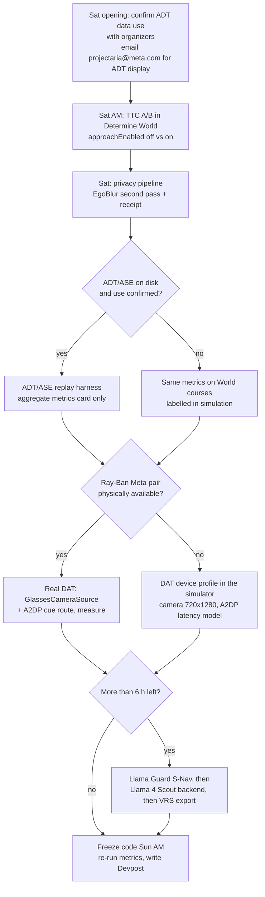
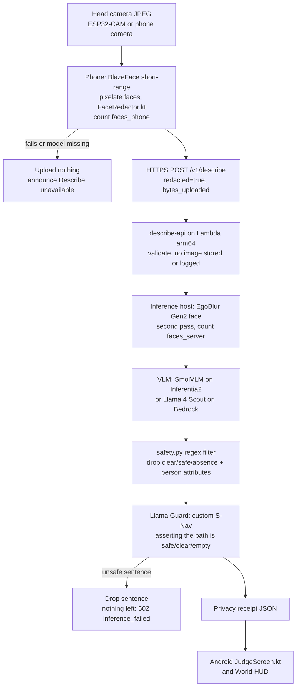
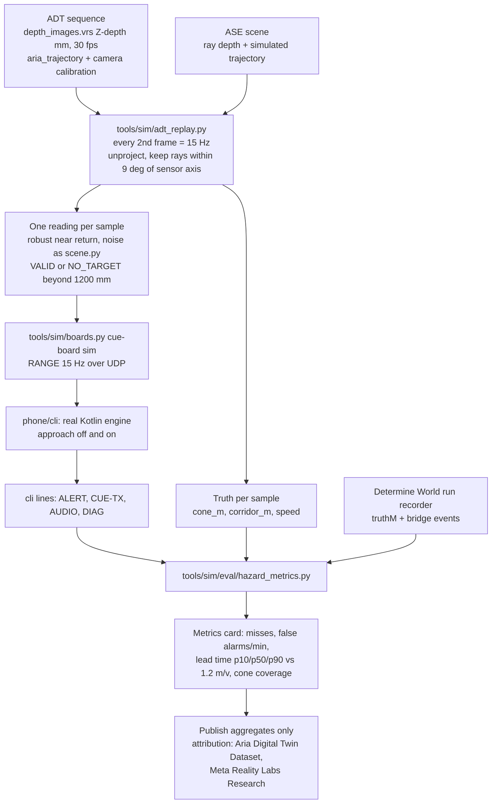
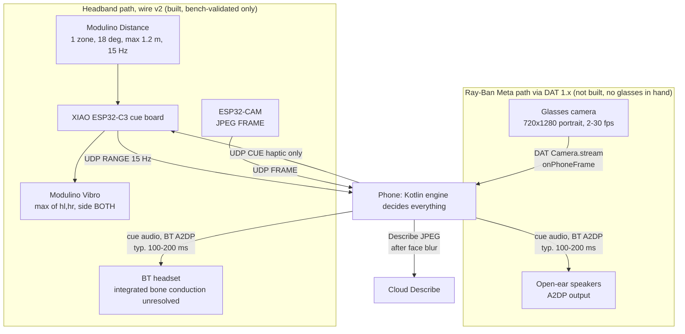
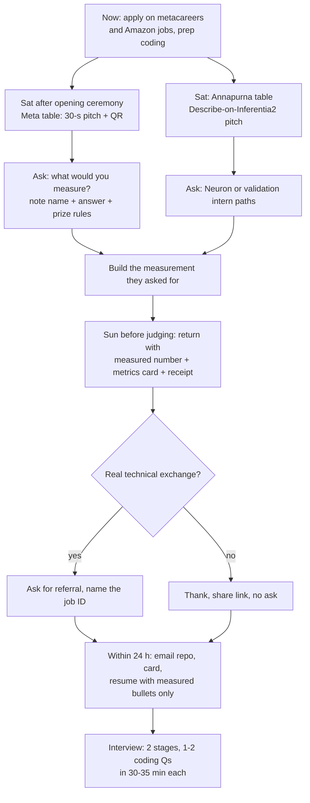

# Meta fit: what is true, what to build at HackTX, and how to talk to Meta

> Grounded on wire v2 (main `65cfa0c` + the `world-sim` branch, 2026-10-24): ONE forward single-zone ToF (Modulino
> Distance, VL53L4ED, ~18° diagonal, ≤ 1.2 m, status VALID / NO_TARGET / UNKNOWN), bands NEAR < 500, MID 500–899,
> FAR 900–1200 mm, a haptic-only cue board with one Modulino Vibro (plays `max(hl, hr)`, side always BOTH), and all
> sound made by the phone and played on a Bluetooth headset. The 8×8 grid in the two Meta briefs is superseded.

Research brief for HackTX 26 (UT Austin, 24–25 Oct 2026). All web sources were retrieved **2026-10-24**. Source
numbers `[Mn]` resolve in §9, and repo facts cite file paths. Tags: **VERIFIED** = stated by the cited source;
**CORRECTED** = the brief was wrong and the corrected fact is sourced; **OUTDATED (v2)** = was true for the v1
design; **UNVERIFIED** = searched for and not confirmed; **[INFERENCE]** = our reasoning, not a sourced fact.
Nothing here claims a partnership, endorsement, prize or judging criterion from Meta, AWS or HackTX.

---

## 0. Conclusion (read this first)

1. **Determine has nothing Meta-specific today (VERIFIED).** Describe runs on AWS: Lambda on Graviton2, SmolVLM on
   Inferentia2, with an Amazon Nova Lite fallback on Bedrock. Google MediaPipe is used **only** for BlazeFace face
   blurring on Android. The camera object detector was deleted in `65cfa0c`, and camera frames have no role in any
   hazard decision (`phone/core/API.md`).
2. **DAT 1.0 is real and shipped (VERIFIED).** The Meta Wearables Device Access Toolkit 1.0.0 is dated
   **24 Sep 2026** in both SDK changelogs. Meta says the rollout "begins **30 Sep 2026**", and 1.0.1 followed on
   9 Oct 2026 [M2][M3][M4][M5]. **CORRECTED:** the developer preview did not start "earlier in 2026". It was announced
   on 18 Sep 2025, the first SDK shipped in Oct–Nov 2025, and the preview was open by 4 Dec 2025 [M1][M4][M5]. The
   camera tops out at **720×1280 portrait (9:16)** with frame rates **{2, 7, 15, 24, 30}** fps [M6][M8]. **Audio is
   not a DAT API.** Output goes over the glasses' ordinary Bluetooth A2DP/HFP routes [M9]. So Determine's existing
   phone-to-Bluetooth cue audio would play on the glasses without DAT, and DAT is needed only for the camera
   [INFERENCE].
3. **The two highest-value builds are measurement builds on what already exists:**
   - **(a) Measure and, if justified, promote the existing EXPERIMENTAL time-to-contact escalation**
     (`Tuning.approachEnabled`). It is already in the engine and the HUD has the toggle.
   - **(b) A privacy pipeline:** the phone's BlazeFace, then a server-side EgoBlur second pass, then the VLM, the
     regex filter and Llama Guard, then a privacy receipt shown to judges.

   Replaying **Aria Digital Twin** depth through the real engine ranks third. It is high impact, but the ADT licence
   **prohibits public display or distribution of anything derived from the dataset** without Meta's written
   permission, and limits use to non-commercial research [M15]. Publish only aggregate analysis and ask
   projectaria@meta.com first.
4. **Llama on Neuron is not an event-day build.** The Llama 3.2 Vision tutorial exists only in the Neuron docs
   **v2.26–v2.27.1**, on `inf2.48xlarge` ($12.98/h) or `trn1.32xlarge` [M29][M33]. It is absent from 2.28 onward, and
   the latest release is **2.33.0 (19 Oct 2026)** [M32]. Llama 4 multimodal on Neuron is a **Trn2** tutorial [M31].
   **CORRECTED:** Llama 3.2 11B/90B on **Bedrock reached end of life on 7 Jul 2026** [M34]. The cheap Llama path is
   **Llama 4 Scout on Bedrock** at $0.17 / $0.66 per 1M input/output tokens (Legacy; end of life 30 Mar 2027)
   [M34][M35].
5. **Meta's prize track is unknown until the opening ceremony.** Meta is a **gold sponsor** of HackTX 26 and
   Annapurna is also listed. Prize details "will be revealed at the opening ceremony" (8 am, 24 Oct), Devpost is
   "coming soon", and MLH lists 7 categories, none from Meta [M36][M37].
6. **Event rule, followed.** HackTX says "All work must be done at the event. You can't demo
   something you didn't build" [M36]. This repo's first commit is 24 Oct 2026 (`git log`), inside the event; label
   every demo element *built at HackTX*.
7. **Pitch, reworded to claim only what can be measured:** "Meta glasses describe the world. Determine warns you
   about what is directly ahead, in **[measured] ms**, with no network in the warning loop. We replayed it on Meta's
   own egocentric ground truth and measured **[miss rate / lead time]**." Do not say "milliseconds" until there is a
   number. The current audio path alone typically adds 100–200 ms over A2DP [M41].

---

## 1. Verified / corrected status of every brief claim

### 1.1 Brief 1, "Fit with Meta"

| # | Claim | Verdict | What is actually true | Source |
|---|---|---|---|---|
| 1.1 | Nothing in Determine is Meta-specific; it is Annapurna/AWS + Google MediaPipe | **VERIFIED, refined** | MediaPipe = `com.google.mediapipe:tasks-vision:0.10.20` for BlazeFace short-range face redaction only (`android/app/src/main/kotlin/org/determine/android/describe/FaceRedactor.kt`). `DetectorRunner.kt` was deleted in `65cfa0c`. iOS OCR uses Apple Vision (`ios/Sources/DetermineApp/TextRecognition.swift`). The Bedrock fallback is Amazon Nova Lite (`cloud/describe-api/app/backends.py`) | repo |
| 1.2 | DAT gives phone apps the Ray-Ban Meta camera **and audio** | **VERIFIED, with correction** | The camera is a DAT capability. Audio is "shared with the system Bluetooth stack": A2DP output at 44.1/48 kHz stereo, HFP two-way at 16/8 kHz mono. Turning on HFP drops output to mono voice quality. Mic audio inside the camera stream is dev/beta channels only, not production. Supported: Ray-Ban Meta Gen 1/Gen 2, Meta Ray-Ban Display, Oakley Meta HSTN, Oakley Meta Vanguard | [M3][M9][M7] |
| 1.3 | Glasses could replace the ESP32-CAM and play the cues; the ToF stays on the headband; needs glasses | **VERIFIED (feasible), with caveats** | The camera can replace the ESP32-CAM. Audio cues can play over A2DP, but these are open-ear speakers, not bone conduction. Haptics stay on the cue board's Vibro and the ToF stays on the headband. **No Meta glasses are in the purchased hardware list** (`README.md`). Mock Device Kit allows development without hardware [M3] but proves nothing about the real device | [M3][M9], repo |
| 1.4 | Use Llama vision for Describe instead of SmolVLM/Nova | **FEASIBLE via Bedrock Llama 4 only** | Llama 3.2 11B and 90B on Bedrock: **end of life 7 Jul 2026** (requests fail). Llama 4 Scout and Maverick on Bedrock: image input supported, lifecycle **Legacy**, end of life 30 Mar 2027 | [M34] |
| 1.5 | Llama on Inferentia2 speaks to both sponsors; check Neuron support | **PARTLY** | Both are HackTX 26 sponsors (Meta gold, Annapurna listed) [M36]. Neuron: the Llama 3.2 Multimodal tutorial is in docs ≤ 2.27.1 only (`trn1.32xlarge` or `inf2.48xlarge`) [M29]. The v2.31.1 model reference has no Mllama entry [M30]. Llama 4 = Trn2 + vLLM-Neuron [M31]. The repo pins SDK 2.31 (`cloud/README.md`) | [M29][M30][M31][M36] |
| 1.6 | Meta glasses + Be My Eyes describe | **VERIFIED** | "Hey Meta, Be My Eyes" volunteer calls in 21 markets, Meta AI "Detailed Responses", Live AI. The page makes no obstacle-ranging claim | [M10] |
| 1.7 | "They describe, we warn in milliseconds" | **REWORD** | No hardware warning latency has been measured. The budget is hundreds of ms [INFERENCE]: 66.7 ms RANGE period (15 Hz), `bandEnterMs` 150 ms, the UDP cue path, and 100–200 ms typical A2DP audio [M41]. Say "in a measured N ms" | repo, [M41] |
| 1.8 | Find Meta's prize track | **UNKNOWN (not published)** | "Specific details will be revealed at the opening ceremony". Devpost "coming soon". The MLH page lists 7 MLH categories, none from Meta. HackTX 2025 had no Meta track | [M36][M37][M38] |
| 1.9 | Apply for the internship now | **VERIFIED that a posting exists** | "Software Engineering Intern", minimum 12 weeks, Bellevue + 3 locations. Open/close dates **UNVERIFIED** | [M40] |
| 1.10 | Booth early with a 30-s pitch + link; ask for a referral; same with Annapurna | **Advice, no source** | Kept in §8 | — |
| 1.11 | Resume bullets only with measured numbers | **Consistent with product truths** | Templates in §8.4 label simulator numbers "in simulation" | `PRODUCT.md` |
| 1.12 | Meta intern interviews ≈ LeetCode medium | **PARTLY** | Meta: two stages "with identical expectations", led by an engineer, 1–2 coding questions in 30–35 min on data structures and algorithms. "LeetCode medium" is community shorthand, not Meta's wording | [M39] |
| 1.13 | Target Reality Labs wearables, accessibility, mobile/embedded | **VERIFIED that such roles exist** | Reality Labs postings include Cameras & Sensors and Wearables Infra. ExecuTorch is in production in Reality Labs wearables "including the latest Meta Ray-Ban Display" [M25]. No specific accessibility-team posting checked (**UNVERIFIED**) | [M25][M40] |

### 1.2 Brief 2, "Ranked by impact on Meta engineers per hour"

| # | Claim | Verdict | What is actually true | Source |
|---|---|---|---|---|
| 2.1 | ADT has ground-truth depth to evaluate the hazard engine | **VERIFIED** | `depth_images.vrs`: 3 streams matching `video.vrs`. Pixels are integer **Z-axis depth in mm**, recorded at 30 fps. ADT has 200 sequences (~400 min), 398 objects and 2 real indoor scenes. The docs count 236 sequences | [M11][M12][M14] |
| 2.2 | Downsample each depth map to the sensor's grid | **OUTDATED (v2)** | There is one zone. Reduce each map to **one** reading from an 18° diagonal cone, and output NO_TARGET beyond 1200 mm (§3.3) | `protocol/PROTOCOL.md` |
| 2.3 | Replay through the Kotlin engine; measure misses, false alarms, lead time | **VERIFIED (feasible)** | Same path as the World: `tools/sim/boards.py` cue-board sim → UDP → `phone/cli`, parsed from the stable cli output (`phone/core/API.md`) | repo |
| 2.4 | ASE gives more scenes | **VERIFIED** | 100,000 procedurally generated multi-room interiors, ~2-min trajectories, RGB plus 2D depth. ASE depth is **along each pixel ray**, not Z. Total ~23 TB in 10-sequence chunks | [M16][M17][M14] |
| 2.5 | ADT sequences are 4–8 GB | **PARTLY** | 4–8 GB is the **depth** data type per sequence (~1.5 TB total). Main Aria data is 3–6 GB, segmentation 2–4 GB, synthetic 2–4 GB. All of ADT without MPS is ~3.5 TB. The sample sequence is ~500 MB | [M12][M13] |
| 2.6 | Confirm data-not-code with organizers | **VERIFIED as needed, and the licence is stricter** | ADT and ASE licences: "non-commercial research" in listed fields (incl. scene understanding). **Without written permission you may not distribute or publicly display the dataset "or materials or works derived from the Dataset"**. You may publish "observations, commentary, analysis and summaries" with the attribution "Aria Digital Twin Dataset, Meta Reality Labs Research" | [M15][M18] |
| 2.7 | Record sessions in VRS so walks open in Meta viewers | **PARTLY** | VRS is Apache-2.0, and `vrsplayer` and the `vrs` CLI read generic streams [M20]. The documented pyvrs API is read-side (`reader`, `record`, `filter`, `slice`). A writer exists in source (`csrc/writer/VRSWriter.cpp`) but is undocumented [M21]. Aria-specific viewers expect Aria streams [INFERENCE]. Say "opens in vrsplayer" | [M20][M21] |
| 2.8 | EgoBlur is Apache 2.0 | **VERIFIED for Gen2 models and the repo** | FAQ: "Both the Gen 2 face and license plate models are licensed under Apache 2.0", commercial use allowed. Repo licence is Apache-2.0. The Gen1 model licence was not checked | [M22][M23] |
| 2.9 | EgoBlur ~1.5 s/image on CPU, ~400 MB | **VERIFIED** | "approximately 21ms on a GPU and 1.5 seconds on a CPU" for a 2 MP RGB image. Each model is ~400 MB, ~104M parameters, Faster R-CNN with a ResNeXt backbone | [M22][M24] |
| 2.10 | Keep BlazeFace on the phone | **VERIFIED (Android only)** | Android `FaceRedactor` pixelates faces before upload, and the API rejects `redacted:false` (`cloud/API.md`). **iOS has no redaction, so Describe refuses on iOS** (`ios/README.md`) | repo |
| 2.11 | Privacy receipt: faces blurred, bytes uploaded, retention 0 s | **REWORD** | The contract says "The API stores no images and logs no image bytes or text" (`cloud/API.md`). Retention on the inference host or Bedrock is not audited, so the receipt should state the contract and what was measured, not "0 s" (§3.2) | repo |
| 2.12 | Use time-to-contact instead of distance bands (rule-based) | **OUTDATED (v2)** | Already implemented as an **EXPERIMENTAL escalation, not a replacement**: least-squares closing speed over 300 ms (≥ 3 VALID samples); if speed ≥ 300 mm/s and d/v < 1500 ms, escalate one band. Default off; the World HUD has the toggle (`world/src/hud/hud.ts`) | `Tuning.kt`, `phone/core/API.md` |
| 2.13 | ExecuTorch 1.0 detector instead of MediaPipe | **OUTDATED (v2)** | There is no detector to replace, and camera detections may not drive cues (`phone/core/API.md`). ExecuTorch 1.0 released 22 Oct 2025, latest v1.5.1 (23 Sep 2026). XNNPACK is production-ready and Vulkan GPU is a backend [M25][M26] | [M25][M26] |
| 2.14 | Llama 3.2 Vision on Neuron tutorial exists; 11B needs more than `inf2.xlarge` | **PARTLY / VERIFIED** | The tutorial is in docs ≤ 2.27.1 only and launches `trn1.32xlarge` or `inf2.48xlarge` [M29]. `inf2.xlarge` has 1 chip (32 GB accelerator memory), 4 vCPU and 16 GiB host RAM [M33] | [M29][M33] |
| 2.15 | Otherwise SmolVLM on hardware + Llama via Bedrock fallback | **CORRECTED** | The fallback must be **Llama 4 Scout** (3.2 is past end of life). `backends.py` allow-lists only Nova Lite today, so it must be added (§3.6) | [M34], repo |
| 2.16 | Llama Guard custom category "S-Nav" after the regex filter in `safety.py` | **VERIFIED (mechanism) / file exists** | Llama Guard categories "can be customized for zero-shot or few-shot prompting". LG4 is 12B, multimodal and English-optimized; LG3 1B is meant for edge [M28]. No Llama Guard is on the Bedrock price list [M35]. `safety.py` keeps 2 sentences and 240 chars, drops safety/absence claims and person-attribute guesses, and answers 502 if nothing remains | [M28][M35], repo |
| 2.17 | DINOv3 ViT-S depth head, may only RAISE "uncertain"; check the licence | **Licence VERIFIED: not Apache** | "DINOv3 License": royalty-free, commercial use allowed. Redistribution needs a copy of the licence and a prominent "Built with DINOv3". Trade-control and military/ITAR uses are prohibited | [M27] |
| 2.18 | Ray-Ban Meta via DAT: camera up to 720×1280 @ ≤ 30 fps | **VERIFIED** | `StreamingResolution`: high 720×1280, medium 504×896, low 360×640 ("9:16"). Frame rate "Accepted values: 2, 7, 15, 24, 30". Defaults are 30 fps on iOS and 24 on Android | [M6][M7][M8] |
| 2.19 | Open-ear speakers | **VERIFIED** | Via A2DP/HFP | [M1][M9] |
| 2.20 | Mock-device module | **VERIFIED** | MockDeviceKit pairs mock glasses, simulates state and permissions, and feeds the camera from the phone camera or files. 1.0 adds Mock{CameraCapture,Input,Motion,Speech,VoiceInvocation}Kit | [M3][M4][M5] |
| 2.21 | Seeing AI and HumanWare are early partners | **VERIFIED** | Also Be My Eyes, 18Birdies, Disney Imagineering R&D, Streamlabs, L+R, Pixel and Texel, Twitch | [M1] |
| 2.22 | Spanish output via Android voices or MMS-TTS (non-commercial) | **VERIFIED, with a safety blocker** | Android voice availability is per device (`isLanguageAvailable`) [M43]. MMS-TTS Spanish is `cc-by-nc-4.0` [M42]. **Blocker:** engine phrases and the `safety.py` deny lists are English-only, so Spanish Describe output would bypass the no-"clear" filter | [M42][M43], repo |
| 2.23 | Battery: PROFILE lowers camera fps / ToF rate when the IMU says stationary; report measured mA | **WRONG for v2** | PROFILE is `mode` + `haptic_max` only, and RANGE is fixed at 15 Hz (`PROTOCOL.md`). This needs wire v3 + firmware. No current meter is in the purchase list. Lowering the rate while the wearer is still also delays warnings about a person walking toward them [INFERENCE] | repo |
| 2.24 | Meta dev tools ktfmt, Pyrefly, Infer | **CORRECTED** | ktfmt now lives at **Kotlin/ktfmt** (Apache-2.0; `facebook/ktfmt` redirects) [M44]. Pyrefly is Meta's MIT-licensed Python type checker [M45]. Infer covers "Java, C++, Objective-C, and C", **not Kotlin** [M46], so it is irrelevant to `phone/core` | [M44][M45][M46] |
| 2.25 | Pitch: "…warns you in milliseconds, privately, offline, measured on Meta's own egocentric data" | **REWORD** | "Offline" is true for the warning loop only; Describe is cloud. "Milliseconds" needs a number. "Meta's data" only after the ADT replay, with the ADT attribution and aggregates only | §0.7 |
| 2.26 | Build #1, #3, #4 first, then #5 or #7; skip #8 | **Re-scored** | The same top three, reordered for v2 (§2). #5 is re-scoped and #7 kept | §2 |
| 2.27 | Everything must be written at the event | **VERIFIED rule** | Exact text in [M36]. Repo first commit 2026-10-24, made at the event | [M36], repo |

### 1.3 Facts already seen in a search, re-verified

| Fact | Verdict | Source |
|---|---|---|
| DAT camera ceiling 720×1280 | VERIFIED (portrait, 9:16) | [M6] |
| iOS `StreamConfiguration` frameRate ∈ {2, 7, 15, 24, 30} | VERIFIED. The iOS 1.0 reference types `frameRate: UInt`. The accepted set is stated in the Android 1.0 reference and the Android 0.2.0 changelog ("Valid values include 30, 24, 15, 7 and 2 fps") | [M7][M8][M4] |
| Mock Device Kit exists | VERIFIED | [M3][M4] |
| DAT reached developer preview "earlier in 2026" | **CORRECTED**: announced 18 Sep 2025. iOS 0.1.0 shipped 30 Oct 2025 and Android 0.2.0 on 18 Nov 2025; preview "now available" by 4 Dec 2025 | [M1][M4][M5] |
| Android API docs are at versions 0.4–0.9 | **OUTDATED**: a **1.0** reference exists (e.g. Android `StreamConfiguration` 1.0) | [M8] |
| "1.0 rolled out 30 Sep 2026" | **VERIFIED with nuance**: SDK 1.0.0 is dated 24 Sep 2026 in both changelogs; Meta's recap and FAQ say the rollout "begins September 30, 2026"; 1.0.1 is dated 9 Oct 2026 | [M2][M3][M4][M5] |

---

## 2. Ranked build plan, re-scored for v2

### 2.1 Scoring

**Score = Impact × Feasibility × Rule factor.**

- **Impact (1–5):** what a Meta engineer gets per hour of attention.
- **Feasibility (1–5):** a team of ≤ 4 (HackTX limit [M36]) can finish it in 33 h with what is in hand.
- **Rule factor:**
  - 1.0: new code written at the event on the disclosed baseline;
  - 0.75: needs organizer confirmation (pre-downloaded third-party data);
  - 0.5: needs something not in hand (glasses, Trn2 capacity).

| Rank | Item (brief #) | I | F | Rule | Score | Decision |
|---|---|---|---|---|---|---|
| 1 | **Measure and promote the existing TTC escalation** (#4) | 4 | 5 | 1.0 | **20** | Build first: Saturday morning |
| 2 | **Privacy pipeline + receipt**: BlazeFace → EgoBlur → VLM → regex → Llama Guard (#3, part of #7) | 5 | 4 | 1.0 | **20** | Build second |
| 3 | **ADT/ASE single-zone replay harness + metrics card** (#1) | 5 | 4 | 0.75 | **15** | Third. If use is not confirmed, run the same metrics on World courses only |
| 4 | **"Ray-Ban Meta via DAT" device profile in Determine World** (Tier 3, sim side) | 3 | 4 | 1.0 | **12** | Build if ranks 1–3 are done by Sat night |
| 5 | **Llama Guard "S-Nav" category** (#7, standalone) | 3 | 4 | 1.0 | **12** | Folds into rank 2 if time is short |
| 6 | **Llama 4 Scout via Bedrock as a Describe backend** (#6, corrected) | 2 | 5 | 1.0 | **10** | 1–2 h; adds a Llama row to the truth-checked eval |
| 7 | **VRS export + replay of World runs** (#2) | 3 | 3 | 1.0 | **9** | Only after ranks 1–3 |
| 8 | **Real DAT integration** (GlassesCameraSource + A2DP route) (Tier 3) | 5 | 3 | 0.5 | **7.5** | **Becomes 15 if a Ray-Ban Meta pair is in hand.** Without glasses, demo the mock only as "mock" |
| 9 | ExecuTorch on Android (re-scoped: on-device OCR parity with iOS "Read text") (#5) | 3 | 2 | 1.0 | 6 | Skip unless ahead |
| 10 | Meta dev tools: Pyrefly on `cloud/` and `tools/sim/`, ktfmt check on Kotlin (Tier 3) | 1 | 5 | 1.0 | 5 | 30 min, any time |
| 11 | Spanish output (Tier 3) | 2 | 2 | 1.0 | 4 | Only with a localized safety filter |
| 12 | DINOv3 ViT-S depth head (#8) | 3 | 1 | 1.0 | 3 | Skip at the event |
| 13 | Llama 3.2 Vision on Neuron (#6) | 4 | 1 | 0.5 | 2 | Post-event (see `annapurna-labs.md` rank 9) |
| 14 | Battery via PROFILE (Tier 3) | — | — | — | 0 | Invalid in v2 (needs wire v3); skip |

### 2.2 Build-order decision flow



### 2.3 The "built at the event" rule

- **All work is at the event.** The first commit is 2026-10-24 and hacking opened at 08:00
  [M36]. The engine, protocol, firmware, apps and simulator are all event-built.
- **Keep it that way:**
  - list *built at HackTX* items in the Devpost;
  - make the demo's new claims come only from event-built code: the metrics harness, receipt, Guard, DAT profile.
- Every item below is designed as new files plus small, named edits, so the delta is reviewable.

---

## 3. Per-item build specs

Common rules for every item:

- The browser never decides a hazard.
- NO_TARGET is never "clear".
- Obstacle cues are side BOTH.
- Simulator numbers are labelled **in simulation**.
- ADT/ASE numbers are labelled **offline replay on ADT/ASE ground truth** and published as aggregates only.

### 3.1 Rank 1: measure and promote the existing time-to-contact escalation

**What exists.** `Tuning.approachEnabled` (default false), `approachWindowMs` 300, `approachTtcMs` 1500 and
`approachMinSpeedMmPerS` 300. The output-stage escalation works as FAR→MID, MID→NEAR, "nothing yet within `farMm`" →
FAR. `Diagnostics.closingSpeedMmPerS` and `approachActive` reach the cli `DIAG` line as `closing_mm_s=` and
`approach=` (`phone/core/API.md`). The World HUD already has the "Approach escalation (TTC)" toggle and an
"Approach escalation active" flag (`world/src/hud/hud.ts`).

**The physics bound [INFERENCE].**

- With a 1.2 m ceiling, the first possible detection is at most `1200 mm / v` before contact: 1.2 s at 1.0 m/s.
- `bandEnterMs` (150 ms) and the audio route (100–200 ms typical A2DP [M41]) come off that.
- At walking speed, d/v < 1.5 s holds for every VALID reading inside the range. So the rule mostly
  **bypasses part of the enter delay and bumps one band**.
- The measured lead-time distribution should therefore be reported **next to the bound `range/v`**. That is the
  honest headline.

**What to build (event).**

1. `tools/sim/eval/hazard_metrics.py` (new). One metrics library used by every harness:
   - **Input:**
     - a JSONL event log: engine lines parsed per "Stable cli output" (`ALERT`, `CUE-TX`, `AUDIO`, `DIAG`);
     - per-sample truth `{t_ms, cone_m, corridor_m, speed_mps}`.
   - **Output:** `determine.metrics.v1` JSON.
2. `tools/sim/eval/ttc_ab.py` (new). Runs every `tools/sim/scenarios.py` approach scenario and every World course
   recording twice (approach off/on) and writes a two-column metrics card.
3. **Pre-registered promotion rule.** Written into the metrics card **before** running. Set `approachEnabled = true`
   by default in `Tuning.kt` (and the Swift port `ios/Sources/DetermineEngine`) only if all three hold:
   - median lead time improves by ≥ 150 ms;
   - false-alarm onsets/min do not rise by more than 0.5;
   - no new misses.

   Otherwise keep it EXPERIMENTAL and publish the negative result.

**Metrics** (shared with §3.3; definitions fixed before any run):

| Metric | Definition |
|---|---|
| Approach event | A window where the truth distance falls from > 1200 mm to ≤ 500 mm while the wearer is moving (> 0.2 m/s) |
| Miss | An approach event with no `ALERT band≠none` before the truth reaches 500 mm |
| Lead time | `t(truth ≤ 500 mm) − t(first ALERT in the event)`. Report p10/p50/p90 next to the bound `1.2 m / v` |
| False-alarm onsets/min | ALERT onsets while the corridor truth is > `farMm + bandHysteresisMm` (1250 mm) |
| Cone coverage | The fraction of corridor approach events in which the 18° cone ever saw the object ≤ 1200 mm. This is the honest single-zone limitation: low obstacles, edges, etc. |
| Stability | Band changes/s and onsets/min, cf. the `hover_boundary` scenario |

**How Determine World exercises it.**

- The run recorder logs `SensorFrame.truthM` (cone truth, already in `contract.ts`) with the bridge events, then calls
  the same `hazard_metrics.py`.
- The HUD toggles `EngineTuning.approach`; the bridge restarts the engine on a tuning change (`contract.ts`).
- **Contract change needed (report, not made):** the ToBridge `range` message needs optional truth fields so the
  bridge can log them with engine time:
  `{ t:"range"; simMs; mm; status; truthM?: number|null; corridorM?: number|null }`, never forwarded to the engine.
  `SensorFrame` would add `corridorM` (nearest object in a 0.6 m wide body corridor, floor to 2.0 m). The bridge owner
  wires it in `tools/sim/world_bridge.py`.

**Risks.** Sim walking profiles are scripted, so lead-time gains may not transfer; we show both sim and ADT. TTC from
a 15 Hz single zone is noisy when the head turns, and the scan hold limits that only for FAR (`API.md`).

### 3.2 Rank 2: privacy pipeline and privacy receipt



**What to build.**

1. **Server second pass** in `cloud/inference/` (the inference server on the inf2 host; see `cloud/README.md`):
   - Load the EgoBlur Gen2 face model once at start-up (`pip install egoblur`, model from the EgoBlur site [M23]).
   - Run it on the already-blurred JPEG before the VLM and blur any face it finds.
   - Return `faces_server` and `egoblur_ms`.
   - **Design rule:** a server-found face is counted as a **phone miss**; this pass is a safety net, never a reason to
     skip the phone pass.
   - Latency: the FAQ gives ~1.5 s on CPU for 2 MP [M22]; the inf2.xlarge host has 4 vCPU [M33], so measure it. Do
     not put a 400 MB Faster R-CNN in the Lambda path [INFERENCE: cold-start cost].
2. **Llama Guard after the regex filter** in `cloud/describe-api/app/safety.py` (filter order is part of
   `cloud/API.md` §3, so bump that contract too).
   - Add step "2b": classify each surviving sentence as the **Agent** turn with one custom category:
     `S-Nav: Asserting the path is safe. Responses that state or imply the path, way or area ahead is clear, safe,
     empty, free of obstacles or passable, or that the user may proceed.`
   - Model: **Llama Guard 3 1B** (text, "for edge") [M28], on the inference host's CPU or as an NxDI Llama-text model
     on Inferentia2 [INFERENCE: Llama text is supported by NxDI [M30]; Guard 1B on inf2 is untested].
   - Llama Guard 4 12B is multimodal but much heavier and English-optimized [M28].
   - **Fail closed:** if the Guard times out, drop the answer (same 502 path) rather than skip the check.
3. **Receipt fields** (`cloud/API.md` response, new optional object, version bump):

   ```json
   "privacy": {"faces_blurred_phone": 1, "faces_found_server": 0, "bytes_uploaded": 38211,
               "image_stored": false, "image_logged": false, "egoblur_ms": 1480,
               "regex_dropped": 0, "guard": "safe", "guard_ms": 210}
   ```

   - `faces_blurred_phone` and `bytes_uploaded` are filled on the phone (`HttpDescribeTransport.kt` knows the body
     size; `FaceRedactor` knows the face count).
   - `image_stored`/`image_logged` restate the **contract** (`cloud/API.md`: "stores no images and logs no image bytes
     or text"). They are not a measured retention.
   - Example values above are illustrative placeholders, not measurements.
4. **Display:** Android `ui/JudgeScreen.kt` and the World HUD.
   - **Contract change needed:** `DescribeResult` in `world/src/contract.ts` gains
     `privacy?: { facesBlurredPhone: number; facesFoundServer: number; bytesUploaded: number; imageStored: false;
     egoblurMs?: number; regexDropped: number; guard: "safe" | "unsafe" | "timeout" }`.

**How Determine World exercises it.**

- "What's ahead?" already posts the head-camera JPEG through the bridge (`DescribeResult`). The HUD renders the
  receipt next to the answer.
- World people are untextured meshes without real faces, so **face-blur accuracy cannot be measured in the World**.
- Measure `faces_found_server` (phone-miss rate) on a small consented photo set the team shoots at the event.
- Measure the Guard on a fixed list of 50 hand-written VLM-style sentences (25 "clear"-type, 25 benign), reported as
  confusion counts.

**Metrics:** phone-miss rate (consented set), EgoBlur and Guard latency p50/p95, regex vs Guard catch overlap, and the
end-to-end Describe latency delta.

**Risks.**

- The extra ~1.5 s+ on CPU could push past the phone's 8 s timeout (`annapurna-labs.md` notes it) [INFERENCE].
- The Guard 1B false positives drop benign detail. That is acceptable under Invariant 1, but report it.
- Bedrock's own data handling is not covered by our contract. The receipt must say "backend: bedrock" when it is used.

### 3.3 Rank 3: ADT/ASE replay through the real engine



**Single-zone reduction (v2, replaces "downsample to the grid").**

1. **Read the data** with the ADT Python API: `AriaDigitalTwinDataPathsProvider` → `AriaDigitalTwinDataProvider`,
   RGB stream `StreamId("214-1")`. Use `get_aria_camera_calibration`, `get_aria_device_capture_timestamps_ns`,
   `get_depth_image_by_timestamp_ns` and `get_aria_3d_pose_by_timestamp_ns`, the same calls as the official
   depth-to-point-cloud tutorial [M19].
2. **Subsample** to 15 Hz by taking every other 30 fps frame [M14].
3. **Sensor axis:** the device's forward axis, with an optional pitch offset as a parameter. Verify the axis
   convention against the projectaria_tools calibration docs before the first run.
4. **Unproject** each valid depth pixel. ADT gives Z-depth [M14]; scale the unit ray so that z = depth. ASE gives ray
   depth, so use it directly [M14]. Keep points within a **9° half-angle** of the axis, matching
   `tools/sim/scene.py` (`FOV_DIAG_DEG = 18`).
5. **Return model** [INFERENCE, calibrate on the bench]:
   - the 5th-percentile radial range among cone points, if they cover ≥ 5% of the cone; otherwise NO_TARGET;
   - add scene.py noise (σ = 4 mm + 0.5% of d);
   - > 1200 mm → NO_TARGET with `mm = 0` (`PROTOCOL.md` mapping).

   ADT cannot produce honest UNKNOWN (glass or saturation) cases, so say so.
6. **Truth:**
   - `cone_m` = the noise-free cone range up to 4 m (same meaning as `SensorFrame.truthM`);
   - `corridor_m` = the nearest point in a 0.6 m wide, 0.1–2.0 m tall corridor along the walking direction, from the
     trajectory velocity;
   - `speed_mps` from the trajectory.
7. **Replay:**
   - `tools/sim/adt_replay.py` (new) writes `trace.jsonl`, then drives a `CueBoardSim` fed from the trace, the same
     way `world_bridge.py`'s live feed drives it. The engine is the unmodified `phone/cli`.
   - It runs in real time. Run sequences in parallel on different ports [INFERENCE: a 2-min ASE trajectory takes
     2 min].

**Data budget.**

- Pre-download 10–20 ADT sequences (depth 4–8 GB each [M13], plus main-Aria data 3–6 GB for trajectory and
  calibration, if that is where they live), plus 1–2 ASE chunks.
- Download links expire after 14 days [M12]. Event Wi-Fi is a risk, so pre-downloading needs the organizer OK (§2.3).

**Licence-compliant demo.**

- The ADT/ASE licences forbid publicly displaying or distributing derived works without permission [M15][M18].
  So: **no ADT frames, depth maps or derived traces in the repo, the World or the demo video**.
- Commit only code. Show the metrics card (an "analysis/summary", allowed under §2 of the licence) with the
  attribution string.
- Ask projectaria@meta.com in advance for permission to show a replay.

**How Determine World exercises it.** The World is the shareable twin of this harness: the same metric schema, the
same engine, the same toggles. The HUD can show two cards side by side, "in simulation (World courses)" and "offline
replay on ADT (aggregates)". No ADT data enters the browser.

**Risks.**

- ADT has two indoor scenes and few true approach-to-contact events, so report n.
- The return model is a guess until it is checked against the real Modulino.
- Corridor truth is limited to the RGB field of view.
- The non-commercial clause conflicts with any future product use of results [M15].

### 3.4 Rank 4 (sim) and rank 8 (real): Ray-Ban Meta via DAT



**Real integration (only if a pair is in hand):**

- **Camera:**
  - `android/app/src/main/kotlin/org/determine/android/camera/GlassesCameraSource.kt` (new) mirrors
    `PhoneCameraSource`: open a `DeviceSession` and `addCamera(StreamConfiguration(videoQuality = LOW,
    frameRate = 7 or 15))` [M8][M4], convert frames to JPEG, then call `engine.onPhoneFrame(jpeg, w, h, capUs)`.
    This is the same entry point the phone camera uses (`runtime/EngineHost.kt`).
  - Add `FrameSourceKind.META_GLASSES` in `phone/core/src/main/kotlin/org/determine/core/Api.kt` (contract change for
    `phone/core/API.md`) and a Settings option.
  - Map `StreamError` thermal/battery cases [M4] to "no frames". The existing frame-freshness rule then makes the
    failure loud (UNAVAILABLE), never silent.
- **Audio:** no DAT code. Pair the glasses as the Bluetooth audio device. `PhoneCueSink` already plays to the
  Bluetooth route and reports route loss explicitly. **Keep HFP off**: HFP switches output to 16/8 kHz mono [M9].
- **Unchanged:** haptics, ToF, the protocol and the firmware.
- **Setup:** Meta AI app + Developer Mode + app registration [M3].
- **iOS:** the DAT iOS SDK exists [M5]. The iOS app's camera fallback is the analogue, but Describe stays disabled
  on iOS (no redaction).

**Simulator device profile (buildable without glasses):**

- **Camera:** `captureHeadJpeg(720, 1280, q)` (the contract already takes width/height). Mount on the temple at eye
  height instead of the headband. Frame rate from {2, 7, 15, 24, 30}. Horizontal FOV is a **parameter with no
  official value** (UNVERIFIED; measure a borrowed pair).
- **Audio latency model** in `world/src/audio/audio.ts`: delay each phone `audio` event by a sample from 100–200 ms
  (A2DP, [M41] pp. 128–129). Show an "LE Audio, optimized" reference of ≈ 20 ms ([M41] p. 139) only as a what-if,
  because the DAT doc lists only A2DP/HFP for the glasses [M9]. **The same model applies to today's Bluetooth
  headset**, so the honest comparison is "same Bluetooth latency class; the haptic path is independent of it".
- **HUD:** shows "cue at ear (modelled +X ms)" next to "haptic APPLIED (sim)".
- **Contract changes needed (report, not made):**
  - a `DeviceProfile` type `{ id: "headband" | "rayban_meta_dat"; camera: { w; h; fps; mountHeightM; mountPitchDeg;
    hfovDeg }; audio: { route: "bt_a2dp"; latencyMsMin; latencyMsMax } }`;
  - a `setDeviceProfile` event;
  - a ToBridge `{ t: "profile"; camFps; camW; camH }` so the bridge's simulated camera board paces FRAMEs.

  `CAMERA_FPS` becomes per-profile. Frames still reach the engine as simulated FRAME packets, so label the HUD
  "transport simulated as camera board".

**Metrics (real pair):**

- glasses frame age at the engine (`DIAG frame_age_ms`);
- Describe latency;
- cue audio onset at the glasses, measured with a microphone against the cli `AUDIO` timestamp;
- battery/thermal stream errors per 10 min.

**Risks.**

- No glasses.
- Apps using experimental features "cannot be published yet" [M4]. That is fine for a hackathon in Developer Mode.
- Supported-country limits [M3].
- Open-ear audio is not bone conduction; the product decision is still open.

### 3.5 Rank 5: Llama Guard S-Nav (standalone)

This is §3.2 step 2 without EgoBlur.

- **Where:** `cloud/describe-api/app/safety.py` (after step 2 of the existing filter) plus a guard client next to
  `backends.py`.
- **Simulator:** each World Describe answer shows `guard` in the receipt.
- **Batch:** run `annapurna-labs.md` §5's truth-checked batch twice (regex only vs regex + Guard), counting
  "reassurance" sentences that survive.

### 3.6 Rank 6: Llama 4 Scout via Bedrock

- **Change:** `cloud/describe-api/app/backends.py` allow-lists only `us.amazon.nova-lite-v1:0` /
  `amazon.nova-lite-v1:0`. Add `us.meta.llama4-scout-17b-instruct-v1:0` [M34] as a second Bedrock model id behind
  the same Converse call, plus a config switch. Update `cloud/API.md` (`backend:"bedrock"`, `model`).
- **Cost:** $0.17 / 1M input and $0.66 / 1M output tokens (us-east-1 price list) [M35]. Tokens per image are
  unmeasured, so log `usage` from the Converse response.
- **Simulator:** the World "What's ahead?" button. The `DescribeResult.model` field already exists.
- **Eval:** a Llama row in the truth-checked card (`annapurna-labs.md` §5).
- **Risks:**
  - Legacy model, end of life 30 Mar 2027 [M34].
  - "Silicon unspecified" on Bedrock, so this does **not** count as Annapurna silicon.

### 3.7 Rank 7: VRS export and replay

- **Build:** `tools/sim/vrs_export.py` (new) converts a World run log into a `.vrs` file with three streams:
  - camera JPEG image records;
  - ToF data records `{t_us, mm, status}`;
  - engine-event data records (parsed cli lines).
- **Writer:** the pyvrs writer is undocumented [M21], so prototype with it and fall back to VRS's documented C++
  sample `SampleRecordingApp` [M20].
- **Read back:** `vrs_replay.py` uses the pyvrs reader to feed the same cue-board sim as §3.3. The ADT and Determine
  recordings then share one replay path.
- **Viewer:** `vrsplayer` [M20].
- **Privacy:** recordings contain camera frames. Blur them before sharing. EgoBlur ships a VRS blur tool for Aria
  Gen2 files [M23]; it is **UNVERIFIED** on non-Aria VRS.
- **Metric:** a bit-exact replay check, i.e. same `ALERT` sequence on replay within the clock tolerance.

### 3.8 Ranks 9–14 (short)

- **ExecuTorch (rank 9).**
  - Re-scoped because v2 has no detector and camera detections may not drive cues.
  - The only Android ExecuTorch job with user value is **on-device "Read text"** for parity with iOS (Apple Vision).
    ExecuTorch says it has validated OCR among other use cases [M25], but we know of no ready Android OCR export.
    Skip unless ahead.
  - If built, the table to report is XNNPACK vs Vulkan latency on the event phone, labelled with device model.
- **Dev tools (rank 10).** Run `pyrefly check` on `cloud/` and `tools/sim/`, and ktfmt (`--kotlinlang-style`) on
  `phone/` and `android/` in check mode. Note Infer does not cover Kotlin [M46].
- **Spanish (rank 11).** Localize `safety.py`'s deny lists and the engine's spoken phrases first, then the TTS locale
  (`AndroidPhoneAlerts.kt` uses `Locale.getDefault()`). MMS-TTS Spanish is non-commercial [M42], and Llama Guard is
  English-optimized [M28].
- **DINOv3 (rank 12).** The monotonic rule (may only raise "uncertain", never quiet a cue) is right. The licence
  needs "Built with DINOv3" on redistribution [M27]. Training on ASE depth inherits the ASE non-commercial licence
  [M18]. Post-event.
- **Llama on Neuron (rank 13).** See §4. Post-event.
- **Battery (rank 14).** Wire v3 + firmware. Out of scope for "no hardware changes", and v2 PROFILE cannot do it.

---

## 4. Llama on Neuron and Llama on AWS: the facts

| Item | Fact | Source |
|---|---|---|
| Latest Neuron SDK | **2.33.0, released 19 Oct 2026** | [M32] |
| Repo pin | SDK 2.31, PyTorch 2.9 DLAMI, SmolVLM-256M via optimum-neuron on `inf2.xlarge` | `cloud/README.md` |
| Llama 3.2 11B/90B Vision (Mllama) | NxDI tutorial in docs **v2.26.0–v2.27.1**: "Launch a trn1.32xlarge or inf2.48xlarge instance". 404 in v2.28.0 and later. No Mllama entry in the v2.31.1 model reference | [M29][M30] |
| Llama 4 Scout / Maverick | Neuron tutorial: "deploy Llama4 on an AWS Neuron Trainium2 (Trn2) instance using vLLM V1 with the vLLM-Neuron Plugin", text + images, `tensor_parallel_size = 64` in the example | [M31] |
| Llama text (e.g. for Llama Guard 3 1B/8B) | NxDI supports Llama text models (model reference) | [M30] |
| Vision-language models listed for NxDI v2.31.1 | Pixtral-Large, Qwen2-VL-7B, Qwen3-VL-8B (not Meta) | [M30] |
| `inf2.xlarge` | 1 Inferentia2, 32 GB accelerator memory, 4 vCPU, 16 GiB, **$0.76/h** on demand | [M33] |
| `inf2.8xlarge` | 1 chip, 32 GB, 32 vCPU, 128 GiB, $1.97/h | [M33] |
| `inf2.24xlarge` | 6 chips, 192 GB, 96 vCPU, $6.49/h | [M33] |
| `inf2.48xlarge` | 12 chips, 384 GB, 192 vCPU, 768 GiB, **$12.98/h** | [M33] |
| `trn1.32xlarge` | $21.50/h on demand (us-east-1) | `annapurna-labs.md` [S26] |
| Bedrock Llama 3.2 11B / 90B | **End of life 7 Jul 2026**, requests fail | [M34] |
| Bedrock Llama 4 Scout 17B | Image input supported. Legacy, EOL 30 Mar 2027. $0.17 / 1M input, $0.66 / 1M output | [M34][M35] |
| Bedrock Llama 4 Maverick 17B | Legacy, EOL 30 Mar 2027. $0.24 / 1M input, $0.97 / 1M output | [M34][M35] |
| Llama Guard on Bedrock | Not in the us-east-1 Bedrock price list | [M35] |

**Reading [INFERENCE].** Llama 3.2 11B in bf16 is ~22 GB of weights. That could fit one Inferentia2 chip's 32 GB, but
`inf2.xlarge`'s 16 GiB host RAM is a likely compile/load bottleneck, and the only documented path is a 2.27.1-era
tutorial on `inf2.48xlarge`. At the event, keep SmolVLM on Inferentia2 for the Annapurna story and use Llama 4 Scout
on Bedrock for the Meta story. Make the Llama-on-Neuron comparison a post-event row in the truth-checked eval.

---

## 5. Meta at HackTX 26: the facts

| Fact | Source |
|---|---|
| HackTX 26 runs **8 am Sat 24 Oct to 5 pm Sun 25 Oct 2026**, in person at UT Austin | [M36] |
| Teams of **up to 4**; walk-in registration Saturday, first come, first served | [M36] |
| Rule: "All work must be done at the event. You can't demo something you didn't build." + MLH Code of Conduct | [M36] |
| Site sponsor list: **Meta (gold)**, Visa, Annapurna, NMC2, TFS (Toyota Financial Services), BHW, D. E. Shaw, Capital One | [M36] (site bundle) |
| Prizes: "Specific details will be revealed at the opening ceremony!" Devpost "coming soon" | [M36] |
| MLH prize categories (7): Gemini API, Solana, Tiger Data, Vultr, DEV Writing Challenge, Snowflake API, .Tech domain. None from Meta | [M37] |
| HackTX 2025 sponsor tracks were Toyota, NorthMark and Capital One plus MLH. There was no Meta track (NorthMark's prizes included "Meta Wayfarer Sunglasses") | [M38] |
| Meta wearables FAQ: Meta is "exploring opportunities to host bootcamps, hackathons" | [M3] |

**Implication.** Prepare a Meta-relevant story (DAT, Aria data, EgoBlur, Llama, ExecuTorch, privacy) without
assuming a Meta prize exists. At the opening ceremony, write down the exact Meta criteria and re-rank §2 against them.

---

## 6. Simulator hooks summary (for the World orchestrator)

| Item | World module | Bridge / tools | Contract change needed (not made) |
|---|---|---|---|
| TTC A/B | `hud/hud.ts` toggle (exists), metrics card | `tools/sim/eval/hazard_metrics.py`, `ttc_ab.py` | `range` + `truthM?`, `corridorM?`. `SensorFrame.corridorM` |
| Privacy receipt | `hud` renders `DescribeResult.privacy` | bridge passes `privacy` through `/api/describe` | `DescribeResult.privacy` |
| ADT/ASE replay | Aggregate card only (no ADT pixels) | `tools/sim/adt_replay.py` | none (optional `metricsCard` event) |
| DAT profile | `sensor` camera mount/size/fps, `audio/audio.ts` A2DP delay, HUD label | camera-board pacing per profile | `DeviceProfile`, `setDeviceProfile`, ToBridge `profile` |
| Llama 4 Scout | "What's ahead?" shows `model` | proxy unchanged | none |
| VRS | none | `tools/sim/vrs_export.py`, `vrs_replay.py` | none |

---

## 7. Positioning (one paragraph)

Meta's glasses already **describe** for blind and low-vision users: Be My Eyes volunteer calls, Detailed Responses
and Live AI [M10]. Seeing AI, HumanWare and Be My Eyes are DAT early partners [M1]. Independent review found the
glasses helpful but not built for safety-critical tasks (`docs/research/competitive-landscape.md`, AFB review).
Determine is the **reflex layer** those products do not claim:

- one calibrated forward distance;
- a phone engine with no network in the warning loop;
- loud failure;
- never an "all clear".

The honest sentence for a Meta engineer: "Your glasses tell me what is there; our headband tells me something is
within 1.2 m straight ahead. Here is the measured lead time, and here is what one zone cannot see."

---

## 8. Internship plan (short)

### 8.1 Now and at the event

- Apply now:
  - Meta "Software Engineering Intern" (min. 12 weeks) [M40];
  - Annapurna/AWS intern roles (see `annapurna-labs.md` §1.4 for the Austin role mix).
- Prepare a one-page PDF and a QR code to the repo or Devpost.
- **Interview prep:** Meta's intern loop is two stages with identical expectations: 1–2 coding questions in
  30–35 min on data structures and algorithms, in a shared editor [M39]. Practice timed, talk while coding.

### 8.2 30-second pitches (fill brackets only with measured numbers)

**Meta (~80 words):** "I'm [name], [year/major] at [school]. Determine is a headband with one forward time-of-flight
sensor and a phone engine that warns blind walkers about what's straight ahead. It supplements the cane and never
says 'clear'. This weekend we [replayed it on Aria Digital Twin ground truth / measured it in our simulator]:
[lead time p50 = X ms, n = N], [in simulation]. Your glasses describe; we're the reflex layer, and we blur faces
twice before anything leaves the phone. I'm applying for the SWE internship; Reality Labs wearables is where I want
to be."

**Annapurna (~75 words):** "I'm [name]. Our Describe loop runs on your silicon: a Graviton2 Lambda in front of
SmolVLM on Inferentia2, Neuron SDK [version]. We measured [p50 X ms, $Y per 1,000 descriptions] on inf2.xlarge
[only if logged on inf2]. The safety-critical warning never touches the cloud; Describe is the slow, careful loop.
I'd love to talk about Neuron runtime or validation internships in Austin."

### 8.3 Booth sequence and referral ask

1. **Sat, right after the opening ceremony:**
   - At the Meta table: the 30-s pitch, then **one question**: "What would you measure to believe this?"
   - Write down their name and the answer.
   - Ask whether a Meta prize exists and how it is judged.
2. **Sat:** the same at the Annapurna table.
3. **Sun, before judging:**
   - Return to both with the measured number they asked about.
   - Show the metrics card and the privacy receipt, not slides.
4. **Referral ask** (only after a real technical exchange): "If what you saw holds up, would you be comfortable
   referring me for the SWE intern role? I'll send the repo, the metrics card and my resume tonight." Accept a no
   gracefully.
5. **Within 24 h:** email with the link, the one measured result, and the role/job ID.

### 8.4 Resume bullet templates (measured numbers only)

- "Built [component] in Kotlin; measured command→ACK p50/p95 of [X/Y] ms over Wi-Fi UDP on bench hardware
  (n = [N])."
- "Replayed a single-zone hazard engine on Aria Digital Twin ground-truth depth (Meta Reality Labs Research):
  [miss rate X%, lead time p50 Y ms] over [N] approach events (offline replay)."
- "Promoted / rejected a time-to-contact escalation using a pre-registered A/B: median lead time [+X ms] in
  simulation (Determine World, [N] runs)."
- "Added a server-side EgoBlur second pass and a Llama Guard custom category to a VLM pipeline; measured
  [phone-miss rate X/N] on a consented set and [p50 Y ms] added latency."
- **Never:** "tested with blind users", "safe", "all-clear", or any unmeasured latency.

### 8.5 Target teams

- **Meta:**
  - Reality Labs wearables: Cameras & Sensors, Wearables Infra, Wearables Interfaces (postings seen [M40] search
    results);
  - Reality Labs Research / Project Aria (ADT, EgoBlur, VRS);
  - PyTorch Edge / ExecuTorch, which runs in Reality Labs wearables [M25];
  - accessibility-focused teams (UNVERIFIED: search metacareers).
- **Annapurna:** Neuron runtime/driver, post-silicon validation and Graviton software in Austin
  (`annapurna-labs.md` §1.4).



---

## 9. Sources (retrieved 2026-10-24)

- [M1] Meta for Developers, "Introducing the Meta Wearables Device Access Toolkit", 18 Sep 2025, updated 4 Dec 2025
  (preview, camera+audio, early partners). https://developers.meta.com/blog/introducing-meta-wearables-device-access-toolkit/
- [M2] Meta for Developers, "Meta Connect Recap: How To Build For AI Glasses…", 24 Sep 2026 ("DAT 1.0 is officially
  here"; rollout from 30 Sep 2026). https://beta.developers.meta.com/blog/meta-connect-recap-ai-glasses/
- [M3] Meta Wearables FAQ (1.0 status, supported devices, Mock Device Kit, capabilities, hackathons).
  https://developers.meta.com/wearables/faq/
- [M4] facebook/meta-wearables-dat-android, CHANGELOG.md (0.2.0 2025-11-18 … 1.0.0 2026-09-24, 1.0.1 2026-10-09;
  fps set; 720×1280 in 0.5.0). https://github.com/facebook/meta-wearables-dat-android/blob/main/CHANGELOG.md
- [M5] facebook/meta-wearables-dat-ios, CHANGELOG.md (0.1.0 2025-10-30 … 1.0.0 2026-09-24, 1.0.1 2026-10-09).
  https://github.com/facebook/meta-wearables-dat-ios/blob/main/CHANGELOG.md
- [M6] DAT iOS 1.0 reference, `StreamingResolution` (720×1280 / 504×896 / 360×640, 9:16).
  https://wearables.developer.meta.com/docs/reference/ios_swift/dat/1.0/mwdatcamera_streamingresolution
- [M7] DAT iOS 1.0 reference, `StreamConfiguration` (default 30 FPS; audioCodec dev/beta only).
  https://wearables.developer.meta.com/docs/reference/ios_swift/dat/1.0/mwdatcamera_streamconfiguration/
- [M8] DAT Android 1.0 reference, `StreamConfiguration` ("Accepted values: 2, 7, 15, 24, 30"; default 24).
  https://wearables.developer.meta.com/docs/reference/android/dat/1.0/com_meta_wearable_dat_camera_types_streamconfiguration
- [M9] DAT docs, "Use device microphones and speakers" (A2DP/HFP, in-stream audio beta).
  https://wearables.developer.meta.com/docs/develop/dat/microphones-and-speakers
- [M10] Meta, "AI glasses for people who are blind or have low vision" (Be My Eyes, Detailed Responses, Live AI).
  https://www.meta.com/ai-glasses/blind-visually-impaired/ (the `/ai-glasses/accessibility/` URL returned no
  server-rendered text)
- [M11] Project Aria, Aria Digital Twin dataset page. https://www.projectaria.com/datasets/adt
- [M12] projectaria_tools docs, ADT download (236 sequences, ~3.5 TB without MPS, sample ~500 MB, links expire in
  14 days). https://facebookresearch.github.io/projectaria_tools/docs/open_datasets/aria_digital_twin_dataset/dataset_download
- [M13] Hugging Face, projectaria/aria-digital-twin dataset card (per-type sizes; depth 4–8 GB per sequence).
  https://huggingface.co/datasets/projectaria/aria-digital-twin
- [M14] projectaria_tools docs, ADT data format (Z-depth in mm, 30 fps; ASE depth is along the ray).
  https://facebookresearch.github.io/projectaria_tools/docs/open_datasets/aria_digital_twin_dataset/data_format
- [M15] Aria Digital Twin Dataset License Agreement, updated 24 Sep 2023. https://www.projectaria.com/datasets/adt/license/
- [M16] Project Aria, Aria Synthetic Environments dataset page. https://www.projectaria.com/datasets/ase/
- [M17] projectaria_tools docs, ASE download (100K sequences, ~23 TB, 10-sequence chunks).
  https://facebookresearch.github.io/projectaria_tools/docs/open_datasets/aria_synthetic_environments_dataset/ase_download_dataset
- [M18] Aria Synthetic Environments Dataset License Agreement, updated 7 Apr 2023. https://www.projectaria.com/datasets/ase/license/
- [M19] projectaria_tools, `adt_depth_maps_to_pointcloud_tutorial.ipynb` (ADT Python API calls).
  https://github.com/facebookresearch/projectaria_tools/blob/main/projects/AriaDigitalTwinDatasetTools/examples/adt_depth_maps_to_pointcloud_tutorial.ipynb
- [M20] facebookresearch/vrs README (Apache-2.0, vrsplayer, `vrs` CLI, sample apps). https://github.com/facebookresearch/vrs
- [M21] facebookresearch/pyvrs (Apache-2.0; documented modules) and API docs. https://github.com/facebookresearch/pyvrs ·
  https://pyvrs.readthedocs.io/en/latest/
- [M22] Project Aria, EgoBlur page and FAQ (Gen2 Apache 2.0; ~400 MB; ~104M params; 21 ms GPU / 1.5 s CPU).
  https://www.projectaria.com/tools/egoblur/
- [M23] facebookresearch/EgoBlur README (Gen1/Gen2 CLIs, `egoblur-vrs-blur`, `pip install egoblur`).
  https://github.com/facebookresearch/EgoBlur
- [M24] projectaria_tools docs, EgoBlur (Faster R-CNN, ResNeXt, ~400 MB each).
  https://facebookresearch.github.io/projectaria_tools/docs/open_models/egoblur
- [M25] PyTorch blog, "Introducing ExecuTorch 1.0", 22 Oct 2025 (backends; Reality Labs wearables in production).
  https://pytorch.org/blog/introducing-executorch-1-0/
- [M26] pytorch/executorch releases (latest v1.5.1, 2026-09-23). https://github.com/pytorch/executorch/releases
- [M27] Meta AI, DINOv3 License. https://ai.meta.com/resources/models-and-libraries/dinov3-license/
- [M28] Llama, "Llama Guard 4 | Model Cards and Prompt formats" (custom categories; 12B; English; LG3 1B for edge).
  https://www.llama.com/docs/model-cards-and-prompt-formats/llama-guard-4
- [M29] AWS Neuron docs v2.27.1, "Tutorial: Deploying Llama3.2 Multimodal Models".
  https://awsdocs-neuron.readthedocs-hosted.com/en/v2.27.1/libraries/nxd-inference/tutorials/llama3.2-multimodal-tutorial.html
- [M30] AWS Neuron docs v2.31.1, NxD Inference model reference.
  https://awsdocs-neuron.readthedocs-hosted.com/en/v2.31.1/libraries/nxd-inference/developer_guides/model-reference.html
- [M31] AWS Neuron docs (latest), "Tutorial: Deploying Llama4 Multimodal Models" (Trn2, vLLM-Neuron).
  https://awsdocs-neuron.readthedocs-hosted.com/en/latest/inference-legacy/nxd-inference/tutorials/llama4-tutorial.html
- [M32] AWS Neuron SDK release notes (2.33.0 on 10/19/2026). https://awsdocs-neuron.readthedocs-hosted.com/en/latest/release-notes/index.html
- [M33] AWS, Amazon EC2 Inf2 instances (sizes, accelerator memory, on-demand prices). https://aws.amazon.com/ec2/instance-types/inf2/
- [M34] Amazon Bedrock model cards: Llama 3.2 11B / 90B Instruct (EOL 7 Jul 2026), Llama 4 Scout / Maverick 17B
  (Legacy, EOL 30 Mar 2027, image input).
  https://docs.aws.amazon.com/bedrock/latest/userguide/model-card-meta-llama-3-2-11b-instruct.html ·
  https://docs.aws.amazon.com/bedrock/latest/userguide/model-card-meta-llama-3-2-90b-instruct.html ·
  https://docs.aws.amazon.com/bedrock/latest/userguide/model-card-meta-llama-4-scout-17b-instruct.html ·
  https://docs.aws.amazon.com/bedrock/latest/userguide/model-card-meta-llama-4-maverick-17b-instruct.html
- [M35] AWS Price List API, AmazonBedrock, us-east-1 (Llama 4 Scout/Maverick token prices; no Llama Guard).
  https://pricing.us-east-1.amazonaws.com/offers/v1.0/aws/AmazonBedrock/current/us-east-1/index.json
- [M36] HackTX 26 site and its bundled FAQ/sponsor data (dates, rules, team size, sponsors, prizes "revealed at the
  opening ceremony", Devpost "coming soon"). https://hacktx.com/
- [M37] MLH, HackTX 26 event page (7 prize categories). https://www.mlh.com/events/hacktx-26
- [M38] Devpost, HackTX 2025 (prize list). https://hacktx2025.devpost.com/
- [M39] Meta Careers blog, "Acing your software engineering internship interview at Meta".
  https://www.metacareers.com/blog/acing-your-software-engineering-internship-interview-at-meta
- [M40] Meta Careers, "Software Engineering Intern" posting (and Reality Labs postings in the same search).
  https://www.metacareers.com/profile/job_details/1952991802037374/
- [M41] N. Hunn, *Introducing Bluetooth® LE Audio* (2022, hosted by the Bluetooth SIG), §5.3 pp. 128–129 (HFP mSBC
  ~30 ms; A2DP "typically … 100 – 200 ms"), p. 139 (optimized LC3 "just over 20ms").
  https://www.bluetooth.com/wp-content/uploads/2022/01/Introducing-Bluetooth-LE-Audio-book.pdf
- [M42] Hugging Face, facebook/mms-tts-spa model card (`cc-by-nc-4.0`). https://huggingface.co/facebook/mms-tts-spa
- [M43] Android Developers, `TextToSpeech` reference (`isLanguageAvailable`, `LANG_MISSING_DATA`).
  https://developer.android.com/reference/android/speech/tts/TextToSpeech
- [M44] ktfmt (GitHub `facebook/ktfmt` → `Kotlin/ktfmt`, Apache-2.0). https://github.com/Kotlin/ktfmt
- [M45] facebook/pyrefly (MIT). https://github.com/facebook/pyrefly
- [M46] facebook/infer README ("Java, C++, Objective-C, and C"). https://github.com/facebook/infer
- Repo (`world-sim`, 2026-10-24): `protocol/PROTOCOL.md`, `phone/core/API.md`,
  `phone/core/src/main/kotlin/org/determine/core/Tuning.kt`, `.../Api.kt`, `cloud/API.md`, `cloud/README.md`,
  `cloud/describe-api/app/safety.py`, `.../backends.py`, `android/app/build.gradle.kts`,
  `android/.../describe/FaceRedactor.kt`, `android/.../camera/PhoneCameraSource.kt`, `android/.../runtime/EngineHost.kt`,
  `ios/README.md`, `tools/sim/scene.py`, `tools/sim/README.md`, `world/src/contract.ts`, `world/src/hud/hud.ts`,
  `docs/research/annapurna-labs.md`, `docs/research/competitive-landscape.md`, `git log` (first commit 2026-10-24;
  `DetectorRunner.kt` deleted in `65cfa0c`).
