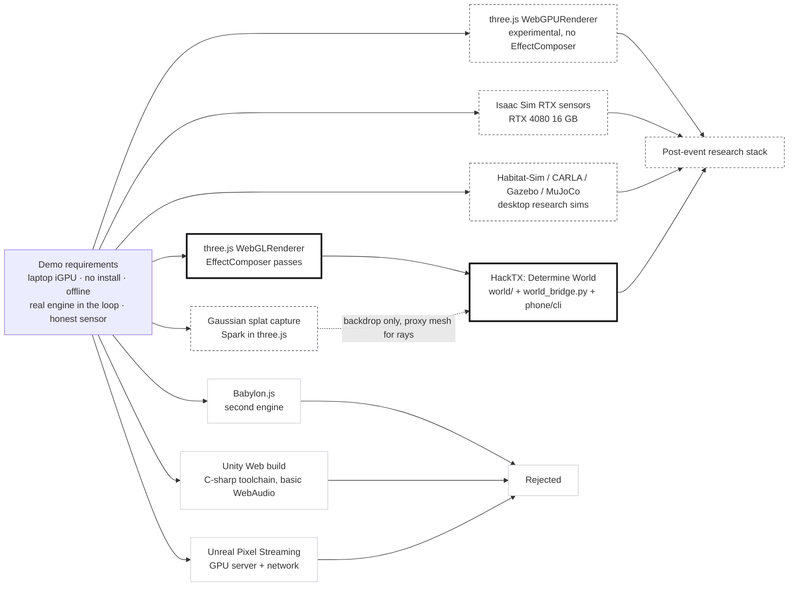
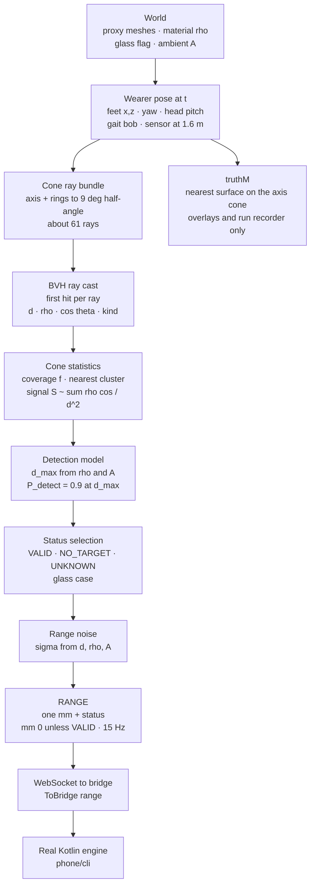
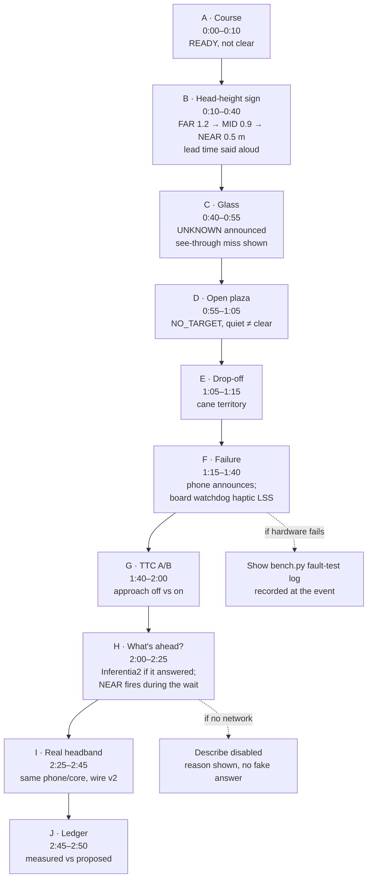
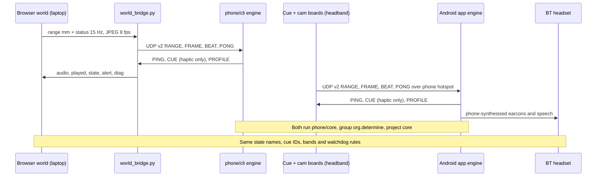
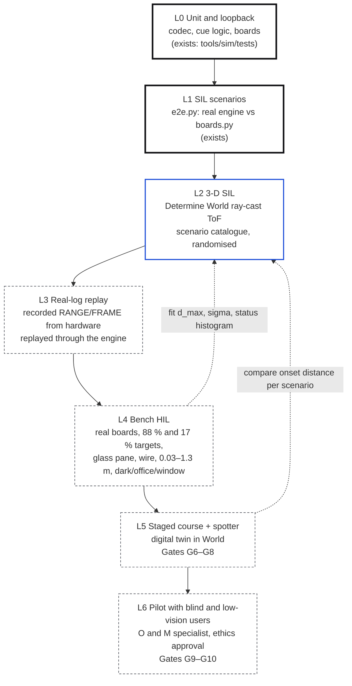

# Simulating and demonstrating Determine

> Re-grounded on wire v2 (main 65cfa0c, 2026-10-24). The v1 design this note first modelled (VL53L5CX 8×8 grid,
> 63° FOV, 4 m, stereo audio on the cue board, left/right regions) is superseded; v1 facts survive only where
> labelled "v1".

Research note for Determine World (`world/`) and the HackTX 26 demo. Sources retrieved 2026-10-24 unless noted
(v2 sensor and audio sources 2026-10-24). Claim labels follow the Architecture: **FACT** (sourced), **DESIGN** (our
decision), **PROPOSED** (target, unmeasured), **[INFERENCE]** (our reasoning, not a sourced fact). Nothing here reports
a measurement of Determine hardware.

**HackTX rule.** "All work must be done at the event. You can't demo something you didn't build" (Architecture §11).
Determine World, the bridge, `phone/core`, the firmware and `cloud/` were built at the event. The demo keeps the
ledger chapter (§6.1) on screen and presents only measured, event-built work as HackTX work.

---

## 0. Conclusions first

1. **HackTX stack: keep three.js r186 + `WebGLRenderer` + `EffectComposer`, Vite, the existing bridge, and the real
   Kotlin engine.** It is the only option on the table that runs on a judge-facing laptop iGPU, needs no install, talks
   WebSocket to `tools/sim/world_bridge.py`, and ships today's stable post-processing passes (GTAO, SMAA). Do not use
   `WebGPURenderer` for the event: three.js calls it "still in an experimental state" and it does not support
   `EffectComposer` passes ([three.js WebGPURenderer manual][t-webgpu]). Unity/Unreal/Isaac/CARLA are wrong for a
   two-day, laptop-only, browser demo (§2). DESIGN
2. **Post-event research stack: Determine World stays the scenario front-end (same contract, same engine), plus a
   headless Python/TS batch runner over a versioned scenario catalogue, plus a log-replay path for real RANGE data.**
   Add Isaac Sim RTX sensors only if we need physically based IR returns from glass and specular surfaces
   ([Isaac Sim RTX sensors][isaac-rtx]) and have an RTX 4080-class 16 GB GPU ([Isaac Sim requirements][isaac-req]).
   Use Gaussian-splat captures of real corridors as *visual context only*, never as ray-cast geometry (§2.3). DESIGN
3. **The sensor model must get honest before it gets pretty.** v2 wears ONE forward single-zone ToF (Modulino
   Distance; the module identifies as VL53L4ED). ST's VL53L4CD datasheet, the nearest fully readable sibling, gives
   the numbers that matter ([DS13812][ds-l4cd]); `tools/sim/scene.py` is optimistic against them in four ways:
   - It detects every surface to 1.2 m. The datasheet's 90 %-detection range at a 33 ms budget is **1200 mm for a
     white 88 % target indoors but only 450 mm for grey 17 %**, and 550 mm (white) / 400 mm (grey) under 5 klux-
     equivalent IR. Firmware runs a **20 ms** budget (`TOF_TIMING_BUDGET_MS`), shorter than the table's 33 ms
     [INFERENCE: range likely shorter still]. Dark clothing and dark poles may first appear in NEAR only. FACT → DESIGN
   - Its noise is σ = 4 mm + 0.5 % of range. The datasheet bound is ±3 % (white) / ±4 % (grey) beyond 200 mm indoors
     and ±8 % in overcast daylight, for ≥ 90 % of readings. FACT
   - It treats glass only as a scripted UNKNOWN fixture. The physically likely failure is worse: the sensor ranges
     *through* clear glass and reports what is behind it, or nothing (NO_TARGET). Both must exist as KNOWN_MISS.
     [INFERENCE]
   - Its cone is a vertical line: a box counts only if it spans exactly 1.6 m. It has no head pitch and no floor. At
     1.2 m the 9° half-angle covers ±0.19 m around the axis; pitch decides whether a head-height sign is seen at all.
     [INFERENCE: geometry]
4. **Audio: the phone plays it, on a Bluetooth headset.** The v2 cue board makes no sound; it plays one Modulino
   Vibro at `max(haptic_l, haptic_r)`. The phone synthesises every earcon and spearcon and plays them on a Bluetooth
   headset (integrated bone conduction unresolved; OpenRun not approved). The world renders the bridge's `audio`
   events (what the phone played, per-ear gain) and draws `played` (what the Vibro did). Obstacle cues are always side
   BOTH. Bluetooth adds latency the simulator does not model (A2DP buffering and coding typically 150–200 ms per a
   chip vendor, [TI E2E][ti-a2dp]) — on a 1.2 m envelope that is up to ~0.28 m at 1.4 m/s [INFERENCE: arithmetic].
   DESIGN
5. **Visual language: architectural maquette.** Warm off-white matte surfaces, one soft key light with PCF shadows,
   GTAO (or N8AO half-res), a depth+normal edge pass drawn in ink `#131316`, SMAA, `NeutralToneMapping`
   (Khronos PBR Neutral). Colour only for meaning (hazard yellow; L blue / R red only for the phone's per-ear audio
   channels), always paired with text/position/shape. Eased, purposeful camera moves that honour
   `prefers-reduced-motion` (§5).
6. **Demo: a 2 min 50 s, seven-chapter storyboard** (§6): near-field approach to a head-height sign at walking pace
   (≈0.6 s of warning, said aloud) → glass reads UNKNOWN and is announced → open plaza stays quiet, which is not
   "clear" → drop-off is cane territory → unplug the cue board (phone announces; board watchdog vibrates) → TTC
   approach A/B → "What's ahead?" on Inferentia2 while a NEAR cue still fires → same engine on the real headband.
7. **Validation ladder** (§7): unit/loopback → SIL scenarios (exist) → 3-D SIL in Determine World → real-log replay →
   bench HIL with 88 %/17 % targets inside 1.2 m → staged course with spotter (Gates G6–G8) → pilot with blind and
   low-vision participants and an O&M specialist (G9–G10). Simulation evaluates the *cue pipeline and failure
   behaviour*; it cannot validate usefulness — the VR-ETA literature says the same ([Ricci 2023][ricci23]).

---

## 1. What exists today (repo facts)

| Piece | Fact | Source |
|---|---|---|
| Scene → reading | Axis-aligned boxes; one forward cone, half-angle 9°; a box counts if it spans the 1.6 m beam height and its nearest edge is inside the cone; nearest hit; σ = 4 mm + 0.005·d; > 1200 mm or nothing → NO_TARGET, mm 0; scripted glass/saturation fixtures → UNKNOWN | `tools/sim/scene.py` |
| Scenarios | `approach_centre`, `person_ahead`, `glass_unknown`, `approach_then_unknown`, `cue_board_dropout`, `cam_dropout`, `wifi_jitter`, `idle_open_space`, `hover_boundary` | `tools/sim/scenarios.py`, `tools/sim/README.md` |
| Status rule | Raw VL53L4ED `range_status` 0 → VALID; 2 and 4 → NO_TARGET (mm 0; never "clear"); anything else or a read error → UNKNOWN (mm 0; announced) | `protocol/PROTOCOL.md` RANGE, `dt_range_status_from_tof` |
| Watchdog | Cue board plays haptic LSS every 5 s when no PING for 800 ms (no sound); phone: 500 ms without BEAT → UNAVAILABLE and announces it | `protocol/PROTOCOL.md` §Watchdog, §Rates |
| Firmware ToF config | ST VL53L4ED ULD 1.0.1; `SetRangeTiming(20 ms, 0)` continuous; RANGE at 15 Hz | `firmware/cue-board/src/main.cpp` |
| World contract | `ToBridge` range (one `mm` + `status`)/board/net/engine/tuning; `FromBridge` state/alert/audio/cueTx/played/speak/vibrate/systemOff/diag; `EngineTuning {approach, explore}`; `SensorFrame.truthM` ground truth | `world/src/contract.ts` |
| Same engine on hardware | Android app pulls `phone/core` via `includeBuild("../phone")`; `phone/cli` drives the sim | `android/settings.gradle.kts`, `phone/settings.gradle.kts` |
| Describe | CPU path measured p50 2.0 s; Inferentia2 unmeasured until quota | `README.md`, Arch §7.3 |

---

## 2. Simulation platforms

### 2.1 Options compared

| Platform | What it offers Determine | Cost / risk for us | Verdict |
|---|---|---|---|
| **three.js r186, `WebGLRenderer`** | Browser, no install; `EffectComposer` with `GTAOPass`, `SMAAPass`; `NeutralToneMapping`/`AgXToneMapping` constants; WebGL 2 only since r163 ([WebGLRenderer][t-webglr], [constants][t-global], [GTAOPass][t-gtao], [SMAAPass][t-smaa]) | We write sensor/camera models ourselves (we already have one in Python) | **HackTX: yes** |
| three.js `WebGPURenderer` | WebGPU with automatic WebGL 2 fallback, TSL node materials, new post stack incl. SSGI ([manual][t-webgpu]) | "Still in an experimental state"; `EffectComposer` and `ShaderMaterial`/`onBeforeCompile` unsupported ([manual][t-webgpu]) | Post-event, once passes are ported |
| Babylon.js | WebGL 1/2 + WebGPU, Havok physics for the web, Gaussian-splat support ([specifications][babylon]) | Second engine and convention in a repo that already chose three.js | No: no capability we need that three.js lacks [INFERENCE] |
| Unity (Web build) | Mature editor; used by both NYU VR-ETA studies ([Ricci 2023][ricci23], [NYU 2024][nyu24]) | No managed threads, no raw sockets, "basic" Web Audio only, physics not bit-identical to editor ([Unity Web limitations][unity]); C# toolchain unrelated to our TS/Python/Kotlin repo | No for the demo |
| Unreal (Pixel Streaming) | Cinematic rendering streamed to a browser over WebRTC | Needs a server with specific hardware video encoders (NVIDIA NVENC-class) and a network path ([Pixel Streaming reference][pixel]) — venue Wi-Fi becomes a single point of failure | No |
| NVIDIA Isaac Sim / Omniverse RTX sensors | RTX Lidar models returns from "transparent or reflective surfaces"; non-visual material DB; Sensor Processing Graphs for custom effects ([RTX sensors][isaac-rtx]) | Minimum GeForce RTX 4080 16 GB ([requirements][isaac-req]); USD toolchain; open bug: material reflectance ignored for water in RTX Lidar ([issue 547][isaac-547]) | Post-event, only for glass/IR physics studies |
| CARLA | Unreal-based driving sim; ray-cast LIDAR, depth camera ([sensors][carla]) | Dedicated GPU "NVIDIA 2070 or better with at least 8Gb" ([quick start][carla-req]); road-vehicle world, not corridors | No |
| Habitat-Sim / Habitat 3.0 | Fast embodied-AI sim with humanoid avatars in homes ([Habitat 3.0][hab3]); pluggable sensor noise models incl. Redwood depth, Gaussian, Poisson, salt-and-pepper ([noise models][hab-noise]) | Python/C++, scanned-home datasets; not a judge-facing visual | Post-event: large-scale scenario mining and crowd/person behaviour |
| Gazebo | Ray sensors with per-beam Gaussian noise clamped to min/max range ([sensor noise tutorial][gazebo]) | ROS-centric; desktop app | No: our noise model needs more than Gaussian |
| MuJoCo | `rangefinder` sensor: distance along a site's +Z ray, or one distance per camera pixel ([XML reference][mujoco]) | Physics engine first; no corridor assets | No |
| Gaussian splats (Spark / gsplat) | Photoreal capture of the actual venue; Spark renders splats *inside* a three.js scene, WebGL 2, mixed with meshes ([Spark README][spark]); Spark 2.0 adds LoD streaming ([World Labs][spark2]) | Splats are not surfaces: no clean ray hits; "most consumer devices can only render 1–5M splats at interactive frame rates" ([World Labs][spark2]) | Optional backdrop; sensor uses proxy mesh |
| WebXR | Immersive VR/AR in the browser; W3C Candidate Recommendation Draft (9 June 2026) ([WebXR][webxr]); not Baseline ([MDN][webxr-mdn]) | Headset logistics; sighted judges in VR do not validate a BLV aid ([Arch §2.1 via Pittet 2026][pittet]) | Post-event, for cue-training studies only |



### 2.2 Why not a game engine for this demo

- The product claim is about **where decisions happen and how failure is announced**. The winning artefact is the real
  engine reacting to a simulated sensor, not image quality. A browser page that runs on the judges' laptop is the
  shortest path to that. [INFERENCE]
- Unity Web builds give only basic Web Audio, no raw sockets and no managed threads ([Unity][unity]); Pixel Streaming
  needs specific encoder hardware and a network ([Epic][pixel]). Both add failure modes during judging. FACT → DESIGN
- Stripe's three.js globe shipped on the same budget class we face: they required 60 fps or a static fallback, found
  iGPU laptops on 5K displays "struggling", and fixed it by turning off renderer `antialias`
  ([Stripe engineering][stripe]). FACT

### 2.3 Gaussian-splat capture of the venue

- Capture: Scaniverse captures splats on iOS/Android and exports open `.spz`, "about 10x smaller" than PLY
  ([SPZ][spz], [nianticlabs/spz][spz-gh]). Spark loads `.spz`, `.ply`, `.splat`, `.ksplat`, `.sog` ([Spark][spark]).
  Training on a laptop GPU: gsplat, CUDA ([gsplat][gsplat]). Method origin: [Kerbl 2023][3dgs].
- Geometry: 3DGS is a radiance representation; Huang et al. note it "fails to accurately represent surfaces"
  and propose 2DGS for geometry ([2DGS][2dgs]). So the ToF ray cast must run against a **hand-built proxy mesh**
  (walls, doors, a bar) registered to the splat, and the HUD must say so. [INFERENCE from 2DGS]
- Use: one chapter "this is the actual hallway" is persuasive; the maquette style (§5) is the default because splats
  bring photographic colour that competes with the meaning colours. DESIGN
- Timing: capturing the venue needs on-site time (event rule: build at the event). Treat as optional Sunday-morning work. DESIGN

---

## 3. Sensor fidelity

### 3.1 VL53L4ED / VL53L4CD facts that the model must respect

The purchased Modulino Distance identifies as **VL53L4ED** (0xECAA; `README.md`). ST's L4ED datasheet did not load
in this pass; the distributor summary gives 18° FoV and 1–1300 mm "in standard conditions", 1150 mm under extended
temperature ([Mouser L4ED][mouser-l4ed]). The tables below are from the **VL53L4CD** datasheet DS13812 Rev 5
([DS13812][ds-l4cd]), the same-family sibling that `scene.py` and `Tuning.kt` already cite; treating them as valid for
the L4ED is an **[INFERENCE]** to check on the bench.

| Property | Value | Source |
|---|---|---|
| Zones | One. One distance and one status per measurement; no bearing, no left/right | [DS13812 §2.6][ds-l4cd], `PROTOCOL.md` |
| Field of view (detection volume) | 18° at 1000 mm, 22° at 100 mm (white 88 %, dark, default driver); collector exclusion cone 25° | [DS13812 Table 16][ds-l4cd] |
| Ranging rate | Up to 100 Hz; Determine runs a 20 ms timing budget and sends RANGE at 15 Hz | [DS13812][ds-l4cd], `firmware/cue-board/src/main.cpp` |
| Max range, 33 ms budget, full FoV covered | White 88 %: indoor 1200 mm @ 90 % detection, 1300 mm @ 50 %; overcast 550 / 600 mm. Grey 17 %: indoor 450 / 475 mm; overcast 400 / 450 mm | [DS13812 Table 14][ds-l4cd] |
| Accuracy, 33 ms budget | 1–100 mm ±7 mm; >200 mm ±3 % (white) / ±4 % (grey) indoor, ±8 % overcast; ≥ 90 % of readings within | [DS13812 Table 15][ds-l4cd] |
| Ambient reference | "Outdoor overcast" = 10 kcps/SPAD ≈ 1.2 W/m² at 940 nm ≈ 5 klux daylight | [DS13812 §5.1][ds-l4cd] |
| Minimum distance | Detection from 0 mm; linear from 1 mm | [DS13812 §5.2][ds-l4cd] |
| Detection rate meaning | "1000 measurements with 90 % detection rate gives 900 valid distances"; the rest carry an error status | [DS13812 §5.3][ds-l4cd] |
| Status → wire | Raw 0 → VALID; 2 (signal below threshold) and 4 (phase out of limits) → NO_TARGET, mm 0; everything else (wrap-around, saturation, sigma, minimum range, read error) → UNKNOWN, mm 0 | `PROTOCOL.md` RANGE; `dt_range_status_from_tof` |
| Bench evidence | Readings tracked a hand from 231 mm to 28 mm after adding I²C pull-ups. Not warning performance | `README.md` |

Consequence for the demo: 1.2 m is the white-target, indoor, 90 % figure. A dark coat or a grey pole may not be
detected until ~0.45 m, which is already NEAR. The sim must show that, not a uniform 1.2 m bubble. FACT → DESIGN

### 3.2 Current model versus datasheet

| Aspect | `scene.py` today | Datasheet / physics | Effect on demo | Fix |
|---|---|---|---|---|
| Max range | 1200 mm for any surface | 450 mm (grey) to 1200 mm (white) indoors at 90 %; 400–550 mm overcast | Sim warns FAR on dark objects the real sensor sees only at NEAR | Per-material ρ and ambient A; interpolate Table 14 |
| Cone | Vertical line at 1.6 m; lateral 9° half-angle | 18° detection volume, both axes | Low or high edges inside the cone are missed; the wrong objects are seen | Ray bundle over a 9° half-angle cone (§3.3) |
| Noise | σ = 4 mm + 0.5 % d | ±3–4 % at ≥ 90 % indoors (σ ≈ 1.8–2.4 % d if Gaussian [INFERENCE]); ±8 % overcast | Band edges (500/900 mm) crossed too cleanly; 50 mm hysteresis untested | σ(d, ρ, A) from Table 15; fit from logs |
| Invalid readings | Only scripted UNKNOWN fixtures | Up to 10 % non-valid at the 90 % range; more beyond | `bandEnterMs` never sees status churn | Probabilistic status model (§3.4) |
| Glass | Scripted UNKNOWN | See-through to what is behind, NO_TARGET, or a specular VALID [INFERENCE] | Overstates what the phone can know | Three glass outcomes; KNOWN_MISS expectation |
| Pitch / floor | None | Pitch moves a ±0.19 m window at 1.2 m; floor enters only beyond ~44° down [INFERENCE: geometry] | Head-height misses under pitch never tested | Head pitch and gait bob in the pose |
| Motion during integration | Instantaneous | 20 ms budget; at 1.4 m/s ≈ 3 cm [INFERENCE] | Negligible | None at HackTX |

### 3.3 Cone ray-cast pipeline (for `world/src/sensor`)



Model details (all **[INFERENCE]** unless cited; every coefficient is a calibration target for §7 rung L4):

- **Rays.** One axis ray plus rings at 3°, 6° and 9° (6, 18, 36 rays ≈ 61 total), all from the sensor at the head
  pose including pitch. Ray-cast with `three-mesh-bvh` and `raycaster.firstHitOnly = true`; its README demonstrates
  500 rays against an 80 000-polygon model at 60 fps ([three-mesh-bvh][bvh]). 61 rays × 15 Hz ≈ 900 rays/s — trivial.
- **Signal.** For an extended diffuse target, returned signal scales as ρ·cosθ/d². Anchor to the datasheet instead of
  a radiometric model: `d_max(ρ, A)` by log-linear interpolation between the 17 % and 88 % rows and between indoor
  and overcast in Table 14 ([DS13812][ds-l4cd]). Beyond overcast, collapse `d_max` and label the run "outside
  datasheet". Cap at 1200 mm (`RANGE_LIMIT_MM`): beyond it the reading is NO_TARGET, matching firmware and `scene.py`.
- **Partial fill.** Table 14 assumes the target fills the FoV. Weight signal by the fraction of rays that hit, so a
  narrow pole at 1 m (which fills a small part of a 0.32 m-wide cone) is detected later than a wall.
- **Detection.** `P_detect(d) = 1 / (1 + exp((d − d_max)/w) · (1/0.9 − 1))`, so P = 0.9 at d_max (the datasheet's
  90 % detection-rate definition); w ≈ 5 % of d_max.
- **Reported distance.** The nearest hit cluster weighted by signal. Two clusters (a thin sign in front of a wall)
  give one distance — whichever dominates — and the sim must not pretend otherwise.
- **Noise.** `σ(d, ρ, A) = max(7 mm, k · d) / 1.645` with k = 3 % (white) / 4 % (grey) indoor, 8 % overcast (the
  datasheet's ≥ 90 % bound read as a two-sided Gaussian [INFERENCE]). Spec bounds; fit real σ from logs.
- **Truth.** `SensorFrame.truthM` is the nearest surface along the cone up to 4 m, computed without noise or
  detection. It feeds overlays and the run recorder; it never reaches the engine.

### 3.4 Status model

| Condition | Raw status (VL53L4CD/ED ULD class) | Wire | Probability (initial guess, calibrate) |
|---|---|---|---|
| Nothing hit in the cone, or nearest hit beyond 1200 mm | 2 (signal below threshold) or 4 (phase out of limits) | NO_TARGET, mm 0 | — |
| Detected within d_max | 0 | VALID, mm | P_detect |
| Hit below d_max but not detected | 2 | NO_TARGET, mm 0 | 1 − P_detect |
| Saturation (very close, bright), sigma failure, minimum range, wrap-around | other nonzero | UNKNOWN, mm 0 (announced) | small; scripted for glass/saturation fixtures |

Why this matters: a missed detection reads as NO_TARGET, which the phone treats as "no claim", not as clear, so the
engine stays quiet. `bandEnterMs` (150 ms ≈ 2–3 readings at 15 Hz) then delays onset after every dropout. Record the
real status histogram on the bench before tuning anything. DESIGN

### 3.5 Glass, sunlight, reflectance

- **Glass** [INFERENCE, physics]: at normal incidence uncoated glass reflects ≈ 4 % per surface ((n−1)/(n+1))², n ≈ 1.5;
  most 940 nm light passes through. Three outcomes, chosen by incidence angle and what lies behind:
  (a) **see-through**: VALID at the surface behind if within range, else NO_TARGET — the dangerous case; expected
  result "no warning", KNOWN_MISS; (b) **unusable return** (saturation, sigma) → UNKNOWN, which the phone announces;
  (c) **specular hit** at near-normal incidence: VALID at the glass distance. PRODUCT.md already lists glass as
  "cannot reliably detect"; the sim must show (a), not only the comfortable (b).
- **Sunlight / ambient**: the datasheet only characterises indoor (no IR) and overcast (≈ 5 klux) ([DS13812][ds-l4cd]).
  Outdoor sun is far brighter; collapse `d_max` and flag "outside datasheet" rather than invent numbers.
- **Reflectance**: give every material a 940 nm ρ (white ≈ 0.88, grey ≈ 0.17 per the datasheet's Munsell charts;
  black fabric lower [INFERENCE]). Show ρ in the plan-view inspector so judges see why a dark pole is detected late.

### 3.6 Camera model (ESP32-CAM / OV2640)

FACTS ([OV2640 datasheet][ov2640], [esp32-camera][esp32cam]): 1/4" optical format, 2.2 µm pixels, UXGA 15 fps / SVGA 30 fps /
CIF 60 fps, S/N 40 dB, dynamic range 50 dB, max exposure 1247 × t_ROW, AEC/AGC/AWB on chip; without PSRAM the driver
supports only JPEG at CIF or lower; YUV/RGB "might be missing" data with Wi-Fi on, so capture JPEG.

Model for the world's head camera (contract `CAMERA_FPS = 8`), cheapest first:

1. Render the head camera into a 320×240 (QVGA) render target, no post-processing, every 125 ms.
2. In one full-screen shader: exposure × gain (simple AEC toward 18 % grey), a tone curve that clips to a 50 dB range
   (windows blow out, shadows crush), additive Gaussian noise at ≈ 1 % of full scale (40 dB S/N), mild vignette.
3. Motion blur and rolling shutter [INFERENCE: row-indexed exposure in the datasheet implies an electronic rolling
   shutter]: average 2–3 sub-frames over the exposure and shear rows by yaw-rate × row-time during head turns.
4. Encode with `canvas.toBlob('image/jpeg', 0.6)` to reproduce block artefacts, send as binary frame `0x01` per the
   contract. Inject occasional dropped/corrupt frames (esp32-camera warning) under the `wifi_jitter` profile.

In the world this camera feeds Describe only. Hazard warnings come from the single forward ToF reading and fixed
rules on the phone. The ToF zone is never associated with a camera object (`PROTOCOL.md` FRAME).

### 3.7 Phone audio over a Bluetooth headset, and the haptic pulse, in WebAudio

FACTS:
- v2 split: the phone synthesises every sound and plays it on a Bluetooth headset; a lost audio route must be
  reported, never silently moved to the speaker. The cue board only vibrates its one Vibro (`PROTOCOL.md`).
- Bluetooth A2DP buffering and coding is typically 150–200 ms, plus retransmissions ([TI E2E][ti-a2dp], vendor forum
  answer). Determine has not measured its headset path.
- Bone-conduction lateralisation is headphone-like but weak: a 20 dB level difference gave ~75 % correct
  ([Stanley & Walker 2006][stanley], Arch [27]); sound crosses the skull with only ~0–10 dB attenuation and ~40 dB
  between-person variation ([Stenfelt 2012][stenfelt], Arch [26]); bone-conduction audio increased localisation errors
  for real environmental sounds ([May & Walker 2017][may], Arch [52]). With individualised HRTFs, horizontal
  localisation through bone vibrators was "nearly identical" to headphones ([MacDonald 2006][macdonald]). These
  matter only if an integrated bone-conduction output is chosen; v2 obstacle cues carry no side anyway.
- Web Audio: `PannerNode.panningModel` is `equalpower` (default) or `HRTF` ([MDN][mdn-panning], [W3C Web
  Audio][webaudio]); `AudioContext.outputLatency` estimates graph-to-output time ([MDN][mdn-outlat]); audio outside a
  user gesture is subject to autoplay rules ([MDN autoplay][mdn-autoplay]).

DESIGN for Determine World:
- **Render the bridge `audio` events** (the cli `AUDIO` line: what the phone played, with `glDb`/`grDb`): two
  `GainNode`s into a two-input `ChannelMergerNode` (`world/src/audio/audio.ts`). Per-ear gain is the phone's
  calibrated headset level, not direction: obstacle cues are side BOTH. No HRTF, no panner.
- **Draw `played`, never `cueTx`, for the haptic half.** Judges must see what the Vibro did — one motor at
  `max(hl, hr)` — including EXPIRED/BUSY_DROPPED gaps and watchdog LSS (`src: "watchdog"`). A short low "buzz" glyph,
  optionally a quiet low-frequency thump labelled "haptic (illustrative)".
- **Label the latency honestly.** Browser audio on the laptop is not the Bluetooth path. Show
  `baseLatency`/`outputLatency` as "browser estimate" and "headset latency: not measured".
- Unlock the `AudioContext` from the first "Start" click.

---

## 4. Assistive-tech simulation precedents

### 4.1 What others built

| Work | What it simulated | Result / limitation relevant to us |
|---|---|---|
| Canetroller, CHI 2018 ([MSR][canetroller]) | VR white cane: wearable programmable brake, vibrotactile and spatial 3-D audio of cane contacts | Visually impaired participants navigated indoor and outdoor virtual scenes; frames VR as mobility-training tool |
| Siu et al., CHI 2020 ([paper][siu]) | Three-axis brake cane controller, voice-coil textures, wave-based acoustics, 6 m × 6 m worlds | 7 of 8 blind users found all five targets while avoiding collisions |
| Ricci et al., PLOS Digital Health 2023 ([PMC][ricci23]) | Unity VR park + haptic belt ETA; Unity `Raycast` replaced the ETA's camera; simulated AMD/DR/glaucoma on 48 sighted participants | ETA cut completion time and collisions. Authors: VR "can only assess the performance of the feedback component"; the sensing is replaced by a ray cast; no collision consequence in VR |
| Ricci et al., JMIR 2024 ([NYU][nyu24], [JMIR][jmir24]) | Quest 2 VR subway station mapped to a real room, haptic belt + audio beeps that speed up when closer; 72 sighted participants with simulated glaucoma | Haptics reduced collisions; audio smoothed movement; "future studies will involve individuals with actual vision loss" |
| MIT ALVU, TNSRE 2018 ([CSAIL][alvu]) | Real ToF sensor belt + haptic strap (no sim) | 162 trials with 12 blind users; hallways, obstacles, staircases detected — a real-world bar to compare against |
| ETA review (Arch §2.1, [Pittet 2026][pittet]) | — | Of 140 ETA studies, 29 % included blind or low-vision participants; blindfolded sighted testers do not validate an ETA |

Take-aways (DESIGN): Determine World is a **feedback-and-failure** simulator, like Ricci's, with one addition no cited
work has: the *production decision engine* runs unmodified in the loop. Say so, and say what it cannot show
(usefulness, comfort, trust).

### 4.2 Sim-to-real practice worth borrowing

- **Domain randomisation**: randomise rendering/physics so a model trained in sim transfers ([Tobin 2017][tobin]).
  For us: randomise ρ, ambient, head pitch, gait, glass outcome and status churn per run, then report the *distribution*
  of warning-onset distance, not one number. [INFERENCE applied]
- **Explicit noise modules**: Habitat-Sim exposes noise models "to close the gap between simulated observations and
  observations from real sensors" ([Habitat][hab-noise]); Gazebo adds independent per-beam Gaussian noise and clamps to
  range ([Gazebo][gazebo]). Our status/noise model (§3.4) should be a swappable module with a "datasheet" and a
  "fitted-from-logs" profile.

### 4.3 Scenario catalogue, borrowed from automotive

- **Euro NCAP** names each test by actor, relation, age and overlap: e.g. *CPNA-25* = Car-to-Pedestrian Nearside
  Adult, struck at 25 % of vehicle width; *CPLA* longitudinal; *CPNCO* nearside child obstructed; standardised
  ISO 19206 targets; time-to-collision and warning time (TFCW) as metrics; a separate annex for low ambient lighting
  ([Euro NCAP AEB/LSS VRU v4.5][ncap]).
- **Scenario abstraction levels**: functional (natural language), logical (parameter ranges), concrete (one value per
  parameter) ([Menzel 2018][menzel]).
- **ASAM OpenSCENARIO**: XML for concrete scenarios and a DSL for abstract ones ([OpenSCENARIO XML][osc-xml],
  [OpenSCENARIO DSL][osc-dsl]). Determine does not need the format; it needs the discipline. DESIGN

**Determine Scenario Catalogue (PROPOSED, v2).** ID = `<Hazard>-<Variant>` (no region: one forward zone). Every
scenario declares an expected outcome class: **WARN** (band and onset requirement), **SILENT** (no cue, state READY —
never "clear"), **ANNOUNCE** (UNKNOWN reading spoken as a sensor problem, never a distance), **KNOWN_MISS**
(documented limitation: no warning expected, no false reassurance allowed), **FAIL_LOUD** (UNAVAILABLE ≤ 1 s and
spoken, Gate G7).

| ID | Functional description | Logical parameters (ranges) | Expected | Existing sim |
|---|---|---|---|---|
| HS-W | Head-height sign or bar across the path, white | bottom 1.3–1.6 m; ρ 0.88; speed 0.6–1.6 m/s; A indoor–overcast | WARN: FAR → MID → NEAR before contact; report lead time | `approach_centre` |
| HS-G | Same, grey/dark | ρ 0.17 | WARN; report onset distance (expect NEAR only, ~0.45 m) | new |
| HS-P | Same sign, head pitched | pitch −15…+10° | WARN or KNOWN_MISS by pitch; report the miss boundary | new |
| HS-TTC | Same approach, `approach` on vs off | speed 0.6–1.6 m/s | Escalation earlier when on; none when standing | World `setTuning` |
| PE-C | Person standing ahead, then steps aside | ρ 0.17–0.5 | WARN then exit by hysteresis; no "person" label from the ToF | `person_ahead` |
| PE-OFF | Person passing just outside the 9° cone | lateral 0.2–0.6 m at 1 m | SILENT (outside the cone; not "clear") | new |
| GL-T | Glass door, wall behind | incidence 0–30°; wall 0.5–2 m behind | KNOWN_MISS (see-through) | new |
| GL-U | Glass/saturation fixture | — | ANNOUNCE: UNKNOWN, never "far" | `glass_unknown`, `approach_then_unknown` |
| WR | Thin wire/rope at head height | 3–10 mm | KNOWN_MISS | new |
| DO | Drop-off / downward stairs | 0.2–1 m drop | KNOWN_MISS: cane territory | new |
| PL-0 | Open plaza, nothing within 1.2 m in the cone | — | SILENT; READY ≠ clear | `idle_open_space` |
| HV | Wearer hovering at a band edge | ±50 mm around 500/900 mm | No band flicker (hysteresis) | `hover_boundary` |
| FX-CUE / FX-CAM | Cue or camera board drops | 1–5 s | FAIL_LOUD: phone announces; board watchdog haptic LSS if PINGs stop | `cue_board_dropout`, `cam_dropout` |
| FX-ENG | Phone engine stops | — | board watchdog haptic LSS at 800 ms, every 5 s | new (contract `engine: restart`) |
| FX-AUD | Headset route lost | — | FAIL_LOUD: explicit, never silent speaker fallback | hardware only |
| NET-J | Any of the above under Wi-Fi jitter | 3 % loss, 2–30 ms, spikes 60–140 ms | same outcome as clean | `wifi_jitter` |

Metrics per run (borrowing TTC/TFCW): lead time (s) and distance at first onset per band, against `truthM`;
false-alert rate per minute (SILENT); UNKNOWN announcement latency (ANNOUNCE); failure-announcement latency
(FAIL_LOUD); onset rate limit compliance; cue cadence during a pending Describe.

---

## 5. Visual language: credible engineering, not "Unreal slop"

### 5.1 References and what to take

| Reference | What to take | Source |
|---|---|---|
| Waymo rider screen | "A simplified view of the activity our sensors are picking up, which we show at all times, coupled with a status layer" with the reason, e.g. "yielding to pedestrians" | [Waymo design blog][waymo] |
| Bret Victor, *Explorable Explanations* | Let the reader change a parameter and see the consequence ("active reading") — here: drag reflectance or head pitch and watch onset distance change | [worrydream][victor] |
| Stripe globe | One strong 3-D object, hard 60 fps requirement with a static fallback, performance found by testing iGPU laptops | [Stripe][stripe] |
| Architectural line art (Blender Freestyle) | Lines drawn from mesh data and Z-depth on selected edge types — the look of a maquette drawing | [Blender Freestyle][freestyle] |
| Apple product pages, Teenage Engineering, Linear | Near-monochrome product on a quiet field, colour used sparingly as signal, precise type [INFERENCE: visual observation, not a published rule] | [Apple AirPods Pro][apple], [Teenage Engineering OP-1][te], [Linear][linear] |
| Apple HIG Motion | "Add motion purposefully"; "Make motion optional… avoid using it as the only way to communicate important information" | [Apple HIG][hig] |
| Repo design system | Two-stave score; L blue, R red (audiology convention for the two ears), hazard yellow; no rounded cards, blur, glass, shadows on UI | `DESIGN.md` |

### 5.2 Rules

**Palette (scene).** Paper `#ffffff` sky/background; three warm greys for value separation, e.g. floor `#e9e6e0`,
walls `#f4f2ee`, props `#dcd8d0`; ink `#131316` for every edge; `#4a4d55` secondary ink; `#c9cbd1` rules.
Meaning colours only on meaning: the ToF cone gets the hazard field `#ffd000` *behind* ink text only while a NEAR
band is active, never yellow text on white (low contrast). L blue `#a9c0ff` / R red `#ffa9ad` washes appear only on
the audio staves (the phone's two ears), never on the cone or on obstacles: one zone has no side. [INFERENCE on
contrast; DESIGN.md rule "color never carries meaning alone"]

**Materials.** `MeshStandardMaterial` roughness 0.9–1.0, metalness 0, no textures; glass as a thin ink-outlined
plane with 8–12 % opacity and a hatched label "GLASS — cannot see", not a reflective shader.

**Lighting.** One `DirectionalLight` key at ~40° elevation from front-left, intensity tuned so floor reads `#e9e6e0`;
one `HemisphereLight` fill at ~0.6 of key. Shadows: `renderer.shadowMap.type = PCFShadowMap` — in r186
`PCFSoftShadowMap` is deprecated "Use `PCFShadowMap` instead" ([three.js constants][t-global]); avoid `VSMShadowMap`
(all receivers also cast). Shadow map 2048², shadow camera frustum fitted tightly to the course, `shadow.radius` 3–4,
`shadow.bias` ≈ −0.0005, `normalBias` ≈ 0.02.

**Ambient occlusion.** `GTAOPass` ("better quality than SSAOPass but … more expensive") with `OUTPUT.Denoise`
([GTAOPass][t-gtao]); or N8AO in `halfRes` mode ("generally 2x-4x" faster) with "Performance"/"Low" presets meant for
iGPUs/laptops ([N8AO][n8ao]). Radius ≈ 0.3–0.5 m (N8AO: one to two orders below scene scale). Soft, not dirty.

**Ink edges.** Custom full-screen pass over depth + normals (+ optional object/surface IDs) with a Sobel-style
kernel: draw a line where linearised depth or normal angle jumps ([Shehata, outlines][shehata],
[surface IDs][shehata-ids], [repo][shehata-gh]). 1 px at DPR 1, ≈1.5 px at DPR 2, ink `#131316`, fade 30 % with
distance. Do **not** use `OutlinePass` for this look: it is a selection highlighter with glow/pulse parameters
([OutlinePass][t-outline]).

**Antialiasing.** AO and depth passes defeat hardware MSAA in a composer ("hardware antialiasing does NOT work with
ambient occlusion" — [N8AO][n8ao]); create the renderer with `antialias: false` (also Stripe's iGPU fix,
[Stripe][stripe]) and finish with `SMAAPass` ([SMAAPass][t-smaa]).

**Tone mapping.** `NeutralToneMapping` — Khronos PBR Neutral, "faithful reproduction of a product's base color, hue
and saturation" under grayscale lighting; Khronos recommends filmic mappers (ACES, AgX) for strongly HDR scenes or
artistic looks ([Khronos][khronos], [three.js constants][t-global]). Keeps `#ffd000` and the washes true.
Exposure 1.0; no bloom.

**Banned.** Bloom, lens flare, film grain, chromatic aberration, depth of field, vignetting on the main view, neon,
glow, glass-morphism, blur, drop shadows on UI, rounded cards, orbiting "hero" spins. (The camera-sim vignette in §3.6
is inside the camera inset only.)

**Camera language** (contract `CameraMode`):
- `director` — 3/4 rear chase: 2.2 m behind, 0.8 m above head, 18° down, 35–40 mm-equivalent FOV (≈ 50° vertical);
  critically damped follow (no overshoot); cuts only at chapter marks.
- `plan` — orthographic top-down like an architectural plan; draw the ToF cone footprint (9° half-angle, cut at
  1.2 m, with 0.5/0.9 m band ticks), cone rays as hairlines, obstacle labels with ρ; used for course intros and the
  glass chapter.
- `wearer` — first person at 1.6 m with the 18° cone drawn as one hairline circle and its reading in mono beside it.
- `orbit` — free inspection for Q&A only.
- Moves: dolly/truck with ease-in-out cubic 0.8–1.2 s; never move the camera and change the HUD at the same time.
  If `prefers-reduced-motion: reduce` ([MDN][mdn-rmotion]), replace moves with cuts.

**Typography.** Atkinson Hyperlegible Next for labels and captions (weights 400/800); Atkinson Hyperlegible Mono with
tabular figures for mm, ms, Hz, dB. Rehearsal marks: boxed capital letter per chapter (A–J) as in the Brief.
Minimum 14 px body, 11 px mono measurements (DESIGN.md); 24–32 px for the chapter title on a projector.

**Data overlays.**
- **Two-stave score** (bottom): blue L stave, red R stave (the phone's headset ears), five hairline staff lines
  each; a notehead per `audio` event on the ear(s) played, x = time. Obstacle cues are side BOTH, so their notes sit
  on both staves joined by a stem; note density shows the parking-sensor cadence (FAR 1/s, MID 2.5/s, NEAR 5/s). A
  third single-line **haptic stave** under them draws each `played` Vibro pulse (pattern, intensity); watchdog LSS
  drawn there with "BOARD WATCHDOG". Explore mode shows as a dense pulse train on the haptic stave only.
- **State banner** (Waymo pattern): always visible; `READY · nothing to report` (never "clear"); `DEGRADED · <reason>`;
  `UNAVAILABLE · warnings off — use cane` with hatched, greyed staves. Text from `state.reason`.
- **Range readout**: one large mono figure — `870 mm VALID`, `— NO_TARGET (not clear)`, or hatched `UNKNOWN —
  announced` — with a horizontal 0–1200 mm bar marked at 500 and 900 mm. Beside it, small and labelled `TRUTH`:
  `truthM` from the world. Shape, text and pattern, not colour.
- **Truth chain strip**: `SIMULATED SENSOR → bridge → REAL ENGINE phone/cli → board ACK` with live ms from `diag`,
  so judges know what is simulated.

### 5.3 three.js recipe (r186, WebGL)

```ts
const renderer = new THREE.WebGLRenderer({ canvas, antialias: false, powerPreference: "high-performance" });
renderer.setPixelRatio(Math.min(window.devicePixelRatio, 1.5));
renderer.toneMapping = THREE.NeutralToneMapping;
renderer.outputColorSpace = THREE.SRGBColorSpace;
renderer.shadowMap.enabled = true;
renderer.shadowMap.type = THREE.PCFShadowMap;          // PCFSoftShadowMap deprecated in r186
renderer.shadowMap.autoUpdate = false;                  // static course: re-render shadows only when geometry moves

const composer = new EffectComposer(renderer);
composer.addPass(new RenderPass(scene, camera));
const gtao = new GTAOPass(scene, camera, w, h);         // or N8AOPostPass with halfRes = true
gtao.output = GTAOPass.OUTPUT.Denoise;
composer.addPass(gtao);
composer.addPass(inkEdgePass);                          // custom ShaderPass: depth + normal Sobel → #131316
composer.addPass(new SMAAPass());                       // r186 docs: no constructor arguments
composer.addPass(new OutputPass());                     // tone mapping + sRGB at the end
```

The edge pass needs a normal buffer: render the scene once with `scene.overrideMaterial = new MeshNormalMaterial()`
into a half-float target at the start of the frame, or share GTAO's normal target if exposed. [INFERENCE]

### 5.4 Performance budget (laptop iGPU, 1080p projector)

Frame budget 16.7 ms at 60 Hz; RAIL asks for app work within 10 ms per frame ([web.dev RAIL][rail]).

| Item | Budget | Notes |
|---|---|---|
| Main pass | ≤ 5 ms; ≤ 150 draw calls; ≤ 250 k triangles; ≤ 10 materials | Instance repeated props; merge static walls |
| Shadows | 1 caster light, 2048², updated on change only | `shadowMap.autoUpdate = false` |
| AO | ≤ 3 ms | N8AO half-res or GTAO at reduced size |
| Ink edges | ≤ 1 ms | one 3×3 kernel pass [INFERENCE] |
| SMAA | ≤ 1.5 ms | [INFERENCE] |
| ToF cone ray cast | ≤ 0.5 ms per 66.7 ms tick on CPU (~61 rays) | BVH + `firstHitOnly` ([three-mesh-bvh][bvh]) |
| Head camera | QVGA render + encode every 125 ms, off the main pass | no post on the camera |
| DPR | min(DPR, 1.5) | Stripe's iGPU lesson |

Adaptive ladder when the 2-s median frame time exceeds 18 ms: AO half-res → DPR 1.0 → shadow map 1024² → drop AO →
cone rays 61 → 19 (axis + two rings). Never degrade the HUD or the sensor rate (15 Hz is part of the truth chain).
Show the current tier in diagnostics. DESIGN

---

## 6. Demo choreography

### 6.1 Storyboard (2 min 50 s)

Setup: laptop (world + bridge + `phone/cli`) on the left, headband + Android phone (scrcpy mirror; scrcpy mirrors
"video and audio" over USB or TCP/IP with 35–70 ms latency, [scrcpy][scrcpy]) on the right. Two pairs of closed-back
headphones on a splitter for judges play the world's rendering of the phone's audio; the score on screen carries
every cue, including the haptic stave. The ledger opens by separating what is measured at the event from what is still
proposed.

| Time | Chapter | Camera | Screen | What judges hear | Claim made |
|---|---|---|---|---|---|
| 0:00–0:10 | **A · Course** | `plan` → dolly to `director` | Maquette of a UT walkway; truth-chain strip; `READY · nothing to report` | Silence (said aloud: silence = no report) | "Parking sensor for walking, at head height; supplements the cane." |
| 0:10–0:40 | **B · Head-height sign at walking pace** (HS-W) | `director`; cut to `plan` replay | Cane sweeps under the sign; range readout 1200 → 900 → 500 mm; staves accelerate; `TRUTH` beside it. Replay marks first cue and contact | FAR → MID → NEAR, both ears; Vibro pulses on the haptic stave | "One forward zone, up to 1.2 m: at 1.4 m/s that is under a second of warning. Lead time measured here: __ s (sim)." |
| 0:40–0:55 | **C · Glass** (GL-U, then GL-T) | `plan` | Fixture: readout hatched `UNKNOWN`; then a plain pane, rays through to the wall | "Sensor can't read ahead" spoken; then silence | "Unreadable is announced, never 'far'. Clear glass can still be missed — the cane is required." |
| 0:55–1:05 | **D · Open plaza** (PL-0) | `director` | Readout `— NO_TARGET (not clear)`; banner `READY · nothing to report` | Silence | "Quiet is not clear: nothing within 1.2 m in an 18° cone." |
| 1:05–1:15 | **E · Drop-off** (DO) | `director` low angle | Kerb edge; cone passes over it | Silence | "Drop-offs are cane territory. We do not claim them." |
| 1:15–1:40 | **F · Failure** (FX-CUE, FX-ENG) | `director`, held | "Unplug cue board" → `UNAVAILABLE` with measured ms; then "Stop engine" → `BOARD WATCHDOG` LSS on the haptic stave at 800 ms | Phone: "System off"-style announcement on the headset; then no sound — the board only vibrates | "Failure is announced by the phone; a board that loses the phone vibrates. Unplugged boards can't vibrate — so the phone speaks." |
| 1:40–2:00 | **G · Time-to-contact A/B** (HS-TTC) | split `director` | Same approach twice: `approach` off, then on (EXPERIMENTAL tag); `diag closing_mm_s` | Second run escalates one band earlier | "Experimental, off by default; shown as an A/B, not a claim." |
| 2:00–2:25 | **H · What's ahead?** | `wearer` | Press during an approach: JPEG thumbnail, route `bridge → Graviton2 Lambda → <backend>`, timing bars; NEAR cue lands *during* the wait | NEAR cue, then the answer prefixed "May be wrong." | "Urgent warnings never wait on the network; backend label = what answered (Inferentia2 only if it says so)." |
| 2:25–2:45 | **I · Same engine, real headband** | cut to hardware | Teammate walks toward a held board with a spotter; mirrored phone shows the same states | Wearer's Bluetooth headset (judges hear the phone speaker mirror only if allowed; never claimed as the product path); Vibro felt by the wearer | "Same `phone/core`, same wire v2. Bench-checked only." |
| 2:45–2:50 | **J · Ledger** | static | Built at HackTX · Measured · Proposed | — | Only measured numbers quoted |



### 6.2 The failure chapter, precisely

Two different components raise two different alarms; say which is which:

- **Cue board unplugged / dropped** → the *phone* stops receiving BEAT; after 500 ms the engine goes UNAVAILABLE and
  the phone announces it on the headset. An unplugged board cannot vibrate, which is why the phone must speak. In the
  world: `ToBridge {t:"board", board:"cue", down:true}`; HUD shows `systemOff.ms − click time`.
- **Phone engine stopped / link lost** → the *cue board* stops receiving PING; after 800 ms its watchdog plays haptic
  LSS at `haptic_max` every 5 s and sets fault bit 7. It makes no sound (`PROTOCOL.md` §Watchdog). In the world:
  `ToBridge {t:"engine", action:"restart"}` while the bridge keeps the simulated board alive; the haptic stave draws
  `played` with `src:"watchdog"`.
- **Headset route lost** → the phone must report it explicitly and never fall back silently to the speaker
  (`PROTOCOL.md`). Hardware only; not simulated.
- On hardware: pull the C3's power lead; force-stop the app. Run `bench.py --fault-test` beforehand and keep the log.

### 6.3 How the Annapurna / Describe path appears

- Button "What's ahead? (optional · cloud · may be wrong)"; disabled with the reason when `hello.describe` is false.
- Show the request path as a horizontal route diagram: `camera JPEG → bridge → /api/describe → Graviton2 Lambda →
  {Inferentia2 | CPU | Bedrock}`; fill each segment from `DescribeResult.timings` and label silicon from
  `DescribeResult.silicon` exactly as returned. If the CPU path answered, the label says CPU; Inferentia2 is claimed
  only when the response says so (Arch §7.3: Inf2 latency unmeasured until quota; README: CPU p50 2.0 s).
- Choreograph Describe *during* an approach so a NEAR cue visibly lands on the staves while the request is pending.
  That single frame demonstrates "urgent warnings never wait on the network" better than any slide.
- Arch §11.6: Annapurna's judging criteria are unknown until the opening ceremony; this chapter is skippable.

### 6.4 Sim and hardware side by side (same engine)



Keep the two networks separate: the laptop's bridge on 127.0.0.1, the headband on the phone's hotspot. Mixing them
risks the boards answering the wrong engine. [INFERENCE]

### 6.5 Risks

| Risk | Effect | Mitigation |
|---|---|---|
| Venue Wi-Fi down or captive | Describe fails; npm/CDN fetches fail | Everything on localhost (Vite proxies `/ws`, `/api` to 127.0.0.1:8765); fonts bundled via @fontsource; pre-built `phone/cli`; Describe shows "unavailable" honestly |
| 2.4 GHz congestion on the phone hotspot | Hardware RANGE/FRAME loss, UNAVAILABLE during demo | Run the hardware chapter last and short; show the `wifi_jitter` sim run as the controlled version; pin SSID (Arch §13.1) |
| Loud hall | Cues inaudible | Closed-back headphones + splitter; score, haptic stave and banner carry every cue; wearer feels the Vibro |
| Laptop iGPU / thermals / battery saver | Dropped frames, late cues on screen | Adaptive ladder (§5.4), AC power, high-performance GPU preference, close other tabs |
| Projector washes out yellow and washes | Meaning lost | Yellow only as a field behind ink text; every colour paired with L/R ear or NEAR text |
| Browser autoplay policy | Silent first chapter | "Start" click creates the `AudioContext` ([MDN][mdn-autoplay]) |
| Judges conflate sim and hardware | Credibility | Permanent "SIMULATED SENSOR" tag in world view; truth-chain strip; ledger chapter |
| Describe quota not granted | No Inf2 | Show whichever backend answered with its label; never imply Inf2 |
| Over time | Rushed close | Chapters E, G and H are skippable; keep A, B, C, D, F and the ledger |
| HackTX "build at the event" rule | Disqualification or credibility loss | Ledger chapter and README separate measured from proposed; demo claims only event-built work as HackTX work |

---

## 7. Validation ladder



| Rung | Question it answers | Pass criterion (PROPOSED) |
|---|---|---|
| L2 | Does the engine meet each catalogue expectation across randomised parameters? | Every WARN scenario warns in ≥ 95 % of runs; SILENT false-alert rate reported; every FAIL_LOUD ≤ 1 s |
| L3 | Does the engine behave the same on real sensor statistics? | Same outcome class as L2 for the matching concrete scenario |
| L4 | How wrong is the sensor model? | Status histogram (VALID / NO_TARGET / UNKNOWN) and range error vs model per target and light; d_max within the datasheet band; head-pitch miss boundary; refit coefficients |
| L5 | Does the full system work on a physical course? | Arch G6–G8 tables published (latency p50/p95/max, miss/false-alert table) |
| L6 | Is it useful and learnable to the real population? | Arch G9–G10; no claim without it (Arch §2.1) |

What simulation can claim after L2: "the production engine produced these cues and failure announcements for these
simulated sensor inputs". It cannot claim detection performance on real objects (needs L4–L5) or benefit to users
(needs L6) ([Ricci 2023][ricci23]: VR tests the feedback component only). DESIGN

---

## 8. Notes for integration

- **Sensor module** (`world/src/sensor`): implement §3.3–3.5 behind a profile switch `datasheet | legacy-scene.py`,
  default `datasheet`, so the e2e results from `tools/sim` stay reproducible. Put per-material `rho` and `glass` flags on
  meshes via `userData`. Emit only canonical v2 status (0/1/2) with `mm` 0 unless VALID, as `ToBridge range` requires.
- **Contract additions to request (orchestrator's call; this document does not edit `contract.ts`)**: a head
  `pitch` on `WearerPose` (needed for HS-P and the pitch inspector); band thresholds in `EngineTuning` if the band
  A/B is wanted (today only `approach`/`explore`). `FOV_DIAG_DEG = 18` and `RANGE_LIMIT_MM = 1200` already match v2.
- **Course data**: give each `CourseInfo.expect` one of WARN / SILENT / ANNOUNCE / KNOWN_MISS / FAIL_LOUD wording so
  the HUD can show the expectation class next to the result.
- **Docs follow-up for product truth** [INFERENCE]: PRODUCT.md caps the envelope at 1.2 m. The L4CD datasheet implies
  "≈1.2 m for bright surfaces indoors, ≈0.45 m for dark ones, ≈0.4–0.55 m in overcast daylight". Worth reflecting in
  the "cannot see" copy once the L4ED is measured.

---

## Sources (retrieved 2026-10-24; v2 sensor and audio sources 2026-10-24)

Sensor and camera
- [ds-l4cd]: ST, *VL53L4CD datasheet DS13812 Rev 5* (June 2022), Tables 14–16 — https://www.st.com/resource/en/datasheet/vl53l4cd.pdf (direct fetch timed out; read via LCSC mirror https://datasheet.lcsc.com/datasheet/pdf/2a54ed8b78f1bb9552aabb518f8ce764.pdf)
- [mouser-l4ed]: Mouser, *VL53L4ED ToF High Accuracy Proximity Sensor* (distributor summary) — https://www.mouser.co.cr/en/new/stmicroelectronics/stm-vl53l4ed-tof-proximity-sensor · ST datasheet https://www.st.com/resource/en/datasheet/vl53l4ed.pdf (did not load)
- v1 only, superseded: [ds] ST *VL53L5CX datasheet DS13754 Rev 2* — https://www.st.com/resource/en/datasheet/vl53l5cx.pdf (mirror https://cdn.sparkfun.com/assets/6/e/3/0/6/vl53l5cx-datasheet.pdf)
- v1 only, superseded: [um2884] ST *UM2884 ULD user manual* — https://www.st.com/resource/en/user_manual/um2884-a-guide-to-using-the-vl53l5cx-multizone-timeofflight-ranging-sensor-with-a-wide-field-of-view-ultra-lite-driver-uld-stmicroelectronics.pdf
- v1 only, superseded: [pim] Pimoroni *vl53l5cx-python REFERENCE.md* — https://github.com/pimoroni/vl53l5cx-python/blob/dev/REFERENCE.md
- v1 only, superseded: [st-status] ST Community *VL53L5CX: Info about target status* — https://community.st.com/imaging-sensors-49/vl53l5cx-info-about-target-status-renewed-121780
- v1 only, superseded: [st-brochure] ST/Avnet *FlightSense focus on VL53L5CX* — https://my.avnet.com/wcm/connect/a5ad69ec-c6df-4d4d-9e78-5d04529e2485/stmicroelectronics-vl53l5cx-brochure.pdf?CACHE=NONE&CVID=nOPCUB1&ContentCache=NONE&MOD=AJPERES&attachment=false&id=1635103334045
- [ov2640]: OmniVision, *OV2640 datasheet v2.2* — https://dl.espressif.com/dl/schematics/Camera_OV2640.pdf
- [esp32cam]: Espressif, *esp32-camera README* — https://github.com/espressif/esp32-camera

Audio
- [ti-a2dp]: TI E2E forum, *CC2564: Clock synchronisation for A2DP streaming audio* (TI answer: buffering and coding "typically 150-200 ms") — https://e2e.ti.com/support/wireless-connectivity/bluetooth-group/bluetooth/f/bluetooth-forum/625462/cc2564-clock-synchronisation-for-a2dp-streaming-audio
- [macdonald]: MacDonald, Henry, Letowski, *Spatial audio through a bone conduction interface*, Int J Audiol 2006 — https://pubmed.ncbi.nlm.nih.gov/17062501
- [stanley]: Stanley & Walker, *bone-conduction lateralisation*, HFES 2006 — https://sonify.psych.gatech.edu/publications/pdfs/2006HFES-StanleyWalker.pdf
- [stenfelt]: Stenfelt, *transcranial attenuation in unilateral deafness*, 2012 — https://pubmed.ncbi.nlm.nih.gov/22193619/
- [may]: May & Walker, *bone-conduction audio and environmental localisation*, 2017 — https://pubmed.ncbi.nlm.nih.gov/28237013/
- [webaudio]: W3C, *Web Audio API 1.1* — https://www.w3.org/TR/webaudio/
- [mdn-panning]: MDN, *PannerNode.panningModel* — https://developer.mozilla.org/en-US/docs/Web/API/PannerNode/panningModel
- [mdn-outlat]: MDN, *AudioContext.outputLatency* — https://developer.mozilla.org/en-US/docs/Web/API/AudioContext/outputLatency
- [mdn-autoplay]: MDN, *Autoplay guide for media and Web Audio APIs* — https://developer.mozilla.org/en-US/docs/Web/Media/Guides/Autoplay

Platforms
- [t-webgpu]: three.js manual, *WebGPURenderer* — https://threejs.org/manual/en/webgpurenderer.html
- [t-webglr]: three.js docs, *WebGLRenderer* — https://threejs.org/docs/pages/WebGLRenderer.html
- [t-global]: three.js docs, *global constants* (AgX/Neutral tone mapping, shadow map types) — https://threejs.org/docs/pages/global.html
- [t-gtao]: three.js docs, *GTAOPass* — https://threejs.org/docs/pages/GTAOPass.html
- [t-smaa]: three.js docs, *SMAAPass* — https://threejs.org/docs/pages/SMAAPass.html
- [t-outline]: three.js docs, *OutlinePass* — https://threejs.org/docs/pages/OutlinePass.html
- [bvh]: gkjohnson, *three-mesh-bvh README* — https://github.com/gkjohnson/three-mesh-bvh
- [n8ao]: N8python, *N8AO README* — https://github.com/N8python/n8ao
- [babylon]: Babylon.js, *Specifications* — https://www.babylonjs.com/specifications/
- [unity]: Unity 6.7 manual, *Web technical limitations* — https://docs.unity3d.com/6000.7/Documentation/Manual/webgl-technical-overview.html
- [pixel]: Epic, *Pixel Streaming reference (UE 5.8)* — https://dev.epicgames.com/documentation/unreal-engine/unreal-engine-pixel-streaming-reference?lang=en-US
- [isaac-rtx]: NVIDIA, *Isaac Sim 6.1 RTX sensors* — https://docs.isaacsim.omniverse.nvidia.com/6.1.0/sensors/isaacsim_sensors_rtx.html
- [isaac-req]: NVIDIA, *Isaac Sim 6.0 requirements* — https://docs.isaacsim.omniverse.nvidia.com/6.0.0/installation/requirements.html
- [isaac-547]: GitHub isaac-sim/IsaacSim issue 547, *RTX LiDAR material reflectance ignored* — https://github.com/isaac-sim/IsaacSim/issues/547
- [carla]: CARLA, *Sensors reference* — https://carla.readthedocs.io/en/latest/ref_sensors/
- [carla-req]: CARLA, *Quick start* — https://carla.readthedocs.io/en/latest/start_quickstart/
- [hab3]: Puig et al., *Habitat 3.0*, arXiv 2310.13724 — https://arxiv.org/abs/2310.13724
- [hab-noise]: Habitat-Sim, *sensors.noise_models* — https://aihabitat.org/docs/habitat-sim/habitat_sim.sensors.noise_models.html
- [gazebo]: Gazebo, *Sensor noise model tutorial* — https://classic.gazebosim.org/tutorials?tut=sensor_noise&cat=sensors
- [mujoco]: MuJoCo, *XML reference (rangefinder)* — https://mujoco.readthedocs.io/en/latest/XMLreference.html
- [spark]: World Labs, *Spark README* — https://github.com/sparkjsdev/spark
- [spark2]: World Labs, *Streaming 3DGS worlds on the web (Spark 2.0)* — https://www.worldlabs.ai/blog/spark-2.0
- [3dgs]: Kerbl et al., *3D Gaussian Splatting*, SIGGRAPH 2023 — https://repo-sam.inria.fr/fungraph/3d-gaussian-splatting/
- [2dgs]: Huang et al., *2D Gaussian Splatting*, arXiv 2403.17888 — https://arxiv.org/abs/2403.17888
- [spz]: Niantic Scaniverse, *SPZ* — https://scaniverse.com/spz
- [spz-gh]: nianticlabs, *spz* — https://github.com/nianticlabs/spz
- [gsplat]: nerfstudio, *gsplat* — https://github.com/nerfstudio-project/gsplat
- [webxr]: W3C, *WebXR Device API* — https://www.w3.org/TR/webxr/
- [webxr-mdn]: MDN, *WebXR Device API* — https://developer.mozilla.org/en-US/docs/Web/API/WebXR_Device_API

Precedents and scenario practice
- [canetroller]: Zhao et al., *Canetroller*, CHI 2018 — https://www.microsoft.com/en-us/research/publication/enabling-people-visual-impairments-navigate-virtual-reality-haptic-auditory-cane-simulation-2/
- [siu]: Siu et al., *Virtual Reality Without Vision*, CHI 2020 — https://www.microsoft.com/en-us/research/wp-content/uploads/2020/02/Siu-VR_without_vision-CHI2020.pdf
- [ricci23]: Ricci et al., *Virtual reality as a means to explore assistive technologies for the visually impaired*, PLOS Digit Health 2023 — https://pmc.ncbi.nlm.nih.gov/articles/PMC10281573/
- [nyu24]: NYU Tandon, *New virtual reality-tested system…* (16 Dec 2024) — https://engineering.nyu.edu/news/new-virtual-reality-tested-system-shows-promise-aiding-navigation-people-blindness-or-low
- [jmir24]: Ricci et al., JMIR Rehabil Assist Technol 2024;11:e55776 — https://rehab.jmir.org/2024/1/e55776
- [alvu]: MIT CSAIL, *Wearable Blind Navigation (ALVU)* — https://www.csail.mit.edu/research/wearable-blind-navigation
- [pittet]: Pittet et al., *Efficacy of electronic travel aids…*, Sci Rep 2026 (cited via Arch §2.1) — https://pmc.ncbi.nlm.nih.gov/articles/PMC12909938/
- [tobin]: Tobin et al., *Domain Randomization…*, arXiv 1703.06907 — https://arxiv.org/abs/1703.06907
- [ncap]: Euro NCAP, *AEB/LSS VRU Test Protocol v4.5* — https://cdn.euroncap.com/cars/assets/euro_ncap_aeb_lss_vru_test_protocol_v45_6e7274516b.pdf
- [menzel]: Menzel, Bagschik, Maurer, *Scenarios for Development, Test and Validation of Automated Vehicles*, arXiv 1801.08598 — https://arxiv.org/abs/1801.08598
- [osc-xml]: ASAM, *OpenSCENARIO XML* — https://www.asam.net/standards/detail/openscenario-xml
- [osc-dsl]: ASAM, *OpenSCENARIO DSL* — https://www.asam.net/standards/detail/openscenario-dsl/

Visual language and performance
- [waymo]: Waymo, *Driven by Waymo, Designed with Trust* (2019) — https://waymo.com/blog/2019/08/driven-by-waymo-designed-with-trust
- [victor]: Bret Victor, *Explorable Explanations* (2011) — https://worrydream.com/ExplorableExplanations/
- [stripe]: Stripe, *To design and develop an interactive globe* (2020) — https://stripe.com/blog/globe
- [freestyle]: Blender manual, *Freestyle introduction* — https://docs.blender.org/manual/en/latest/render/freestyle/introduction.html
- [shehata]: Omar Shehata, *How to render outlines in WebGL* — https://omar-shehata.medium.com/how-to-render-outlines-in-webgl-8253c14724f9
- [shehata-ids]: Omar Shehata, *Better outline rendering using surface IDs with WebGL* — https://omar-shehata.medium.com/better-outline-rendering-using-surface-ids-with-webgl-e13cdab1fd94
- [shehata-gh]: OmarShehata, *webgl-outlines* — https://github.com/OmarShehata/webgl-outlines
- [khronos]: Khronos, *PBR Neutral Tone Mapper released* (16 May 2024) — https://www.khronos.org/news/press/khronos-pbr-neutral-tone-mapper-released-for-true-to-life-color-rendering-of-3d-products
- [hig]: Apple, *Human Interface Guidelines — Motion* — https://developer.apple.com/design/human-interface-guidelines/motion
- [mdn-rmotion]: MDN, *prefers-reduced-motion* — https://developer.mozilla.org/en-US/docs/Web/CSS/@media/prefers-reduced-motion
- [rail]: web.dev, *Measure performance with the RAIL model* — https://web.dev/articles/rail
- [apple]: Apple, *AirPods Pro* product page — https://www.apple.com/airpods-pro/
- [te]: Teenage Engineering, *OP-1* — https://teenage.engineering/products/op-1
- [linear]: Linear — https://linear.app/
- [scrcpy]: Genymobile, *scrcpy README* — https://github.com/Genymobile/scrcpy

[ds]: https://www.st.com/resource/en/datasheet/vl53l5cx.pdf
[um2884]: https://www.st.com/resource/en/user_manual/um2884-a-guide-to-using-the-vl53l5cx-multizone-timeofflight-ranging-sensor-with-a-wide-field-of-view-ultra-lite-driver-uld-stmicroelectronics.pdf
[pim]: https://github.com/pimoroni/vl53l5cx-python/blob/dev/REFERENCE.md
[st-status]: https://community.st.com/imaging-sensors-49/vl53l5cx-info-about-target-status-renewed-121780
[st-brochure]: https://my.avnet.com/wcm/connect/a5ad69ec-c6df-4d4d-9e78-5d04529e2485/stmicroelectronics-vl53l5cx-brochure.pdf?CACHE=NONE&CVID=nOPCUB1&ContentCache=NONE&MOD=AJPERES&attachment=false&id=1635103334045
[ov2640]: https://dl.espressif.com/dl/schematics/Camera_OV2640.pdf
[esp32cam]: https://github.com/espressif/esp32-camera
[macdonald]: https://pubmed.ncbi.nlm.nih.gov/17062501
[stanley]: https://sonify.psych.gatech.edu/publications/pdfs/2006HFES-StanleyWalker.pdf
[stenfelt]: https://pubmed.ncbi.nlm.nih.gov/22193619/
[may]: https://pubmed.ncbi.nlm.nih.gov/28237013/
[webaudio]: https://www.w3.org/TR/webaudio/
[mdn-panning]: https://developer.mozilla.org/en-US/docs/Web/API/PannerNode/panningModel
[mdn-outlat]: https://developer.mozilla.org/en-US/docs/Web/API/AudioContext/outputLatency
[mdn-autoplay]: https://developer.mozilla.org/en-US/docs/Web/Media/Guides/Autoplay
[t-webgpu]: https://threejs.org/manual/en/webgpurenderer.html
[t-webglr]: https://threejs.org/docs/pages/WebGLRenderer.html
[t-global]: https://threejs.org/docs/pages/global.html
[t-gtao]: https://threejs.org/docs/pages/GTAOPass.html
[t-smaa]: https://threejs.org/docs/pages/SMAAPass.html
[t-outline]: https://threejs.org/docs/pages/OutlinePass.html
[bvh]: https://github.com/gkjohnson/three-mesh-bvh
[n8ao]: https://github.com/N8python/n8ao
[babylon]: https://www.babylonjs.com/specifications/
[unity]: https://docs.unity3d.com/6000.7/Documentation/Manual/webgl-technical-overview.html
[pixel]: https://dev.epicgames.com/documentation/unreal-engine/unreal-engine-pixel-streaming-reference?lang=en-US
[isaac-rtx]: https://docs.isaacsim.omniverse.nvidia.com/6.1.0/sensors/isaacsim_sensors_rtx.html
[isaac-req]: https://docs.isaacsim.omniverse.nvidia.com/6.0.0/installation/requirements.html
[isaac-547]: https://github.com/isaac-sim/IsaacSim/issues/547
[carla]: https://carla.readthedocs.io/en/latest/ref_sensors/
[carla-req]: https://carla.readthedocs.io/en/latest/start_quickstart/
[hab3]: https://arxiv.org/abs/2310.13724
[hab-noise]: https://aihabitat.org/docs/habitat-sim/habitat_sim.sensors.noise_models.html
[gazebo]: https://classic.gazebosim.org/tutorials?tut=sensor_noise&cat=sensors
[mujoco]: https://mujoco.readthedocs.io/en/latest/XMLreference.html
[spark]: https://github.com/sparkjsdev/spark
[spark2]: https://www.worldlabs.ai/blog/spark-2.0
[3dgs]: https://repo-sam.inria.fr/fungraph/3d-gaussian-splatting/
[2dgs]: https://arxiv.org/abs/2403.17888
[spz]: https://scaniverse.com/spz
[spz-gh]: https://github.com/nianticlabs/spz
[gsplat]: https://github.com/nerfstudio-project/gsplat
[webxr]: https://www.w3.org/TR/webxr/
[webxr-mdn]: https://developer.mozilla.org/en-US/docs/Web/API/WebXR_Device_API
[canetroller]: https://www.microsoft.com/en-us/research/publication/enabling-people-visual-impairments-navigate-virtual-reality-haptic-auditory-cane-simulation-2/
[siu]: https://www.microsoft.com/en-us/research/wp-content/uploads/2020/02/Siu-VR_without_vision-CHI2020.pdf
[ricci23]: https://pmc.ncbi.nlm.nih.gov/articles/PMC10281573/
[nyu24]: https://engineering.nyu.edu/news/new-virtual-reality-tested-system-shows-promise-aiding-navigation-people-blindness-or-low
[jmir24]: https://rehab.jmir.org/2024/1/e55776
[alvu]: https://www.csail.mit.edu/research/wearable-blind-navigation
[pittet]: https://pmc.ncbi.nlm.nih.gov/articles/PMC12909938/
[tobin]: https://arxiv.org/abs/1703.06907
[ncap]: https://cdn.euroncap.com/cars/assets/euro_ncap_aeb_lss_vru_test_protocol_v45_6e7274516b.pdf
[menzel]: https://arxiv.org/abs/1801.08598
[osc-xml]: https://www.asam.net/standards/detail/openscenario-xml
[osc-dsl]: https://www.asam.net/standards/detail/openscenario-dsl/
[waymo]: https://waymo.com/blog/2019/08/driven-by-waymo-designed-with-trust
[victor]: https://worrydream.com/ExplorableExplanations/
[stripe]: https://stripe.com/blog/globe
[freestyle]: https://docs.blender.org/manual/en/latest/render/freestyle/introduction.html
[shehata]: https://omar-shehata.medium.com/how-to-render-outlines-in-webgl-8253c14724f9
[shehata-ids]: https://omar-shehata.medium.com/better-outline-rendering-using-surface-ids-with-webgl-e13cdab1fd94
[shehata-gh]: https://github.com/OmarShehata/webgl-outlines
[khronos]: https://www.khronos.org/news/press/khronos-pbr-neutral-tone-mapper-released-for-true-to-life-color-rendering-of-3d-products
[hig]: https://developer.apple.com/design/human-interface-guidelines/motion
[mdn-rmotion]: https://developer.mozilla.org/en-US/docs/Web/CSS/@media/prefers-reduced-motion
[rail]: https://web.dev/articles/rail
[apple]: https://www.apple.com/airpods-pro/
[te]: https://teenage.engineering/products/op-1
[linear]: https://linear.app/
[scrcpy]: https://github.com/Genymobile/scrcpy
[ds-l4cd]: https://www.st.com/resource/en/datasheet/vl53l4cd.pdf
[mouser-l4ed]: https://www.mouser.co.cr/en/new/stmicroelectronics/stm-vl53l4ed-tof-proximity-sensor
[ti-a2dp]: https://e2e.ti.com/support/wireless-connectivity/bluetooth-group/bluetooth/f/bluetooth-forum/625462/cc2564-clock-synchronisation-for-a2dp-streaming-audio
